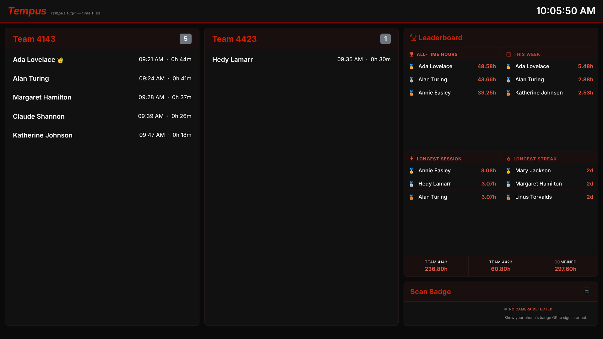
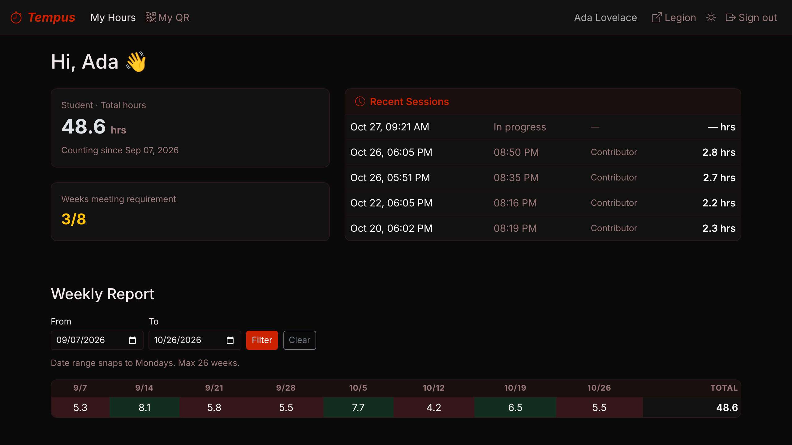
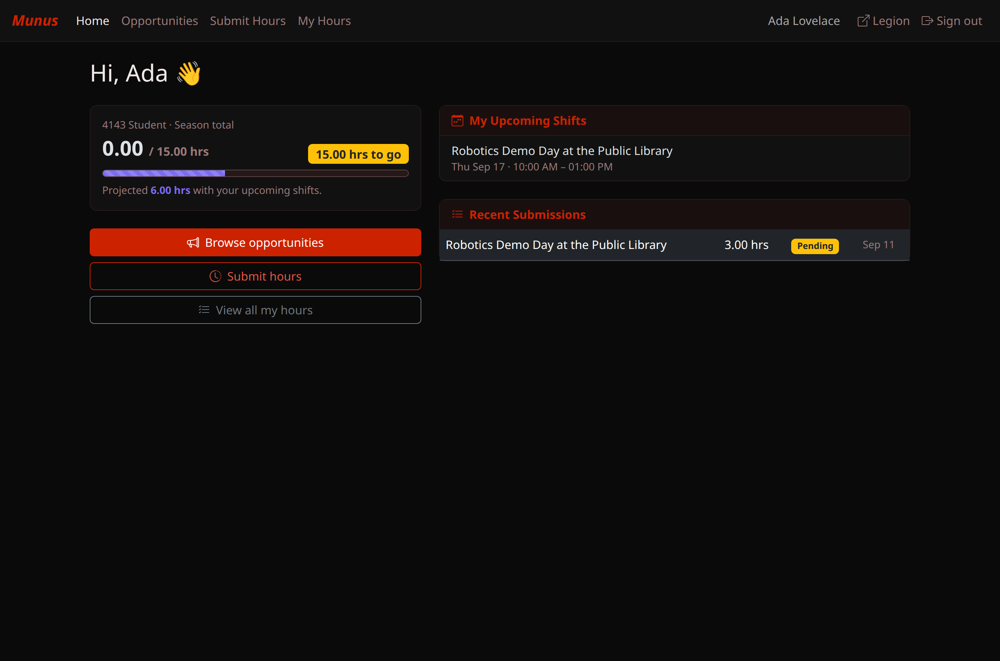
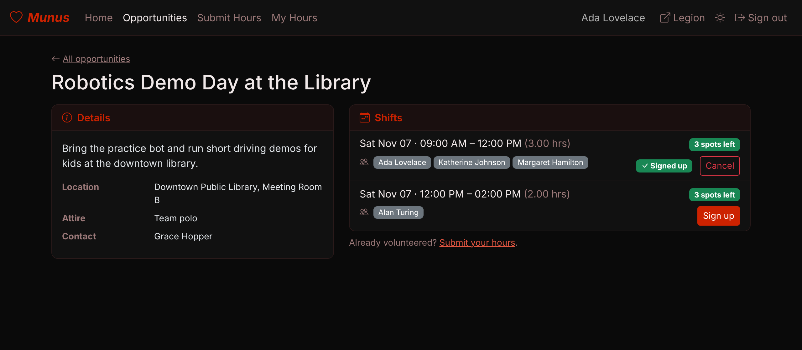
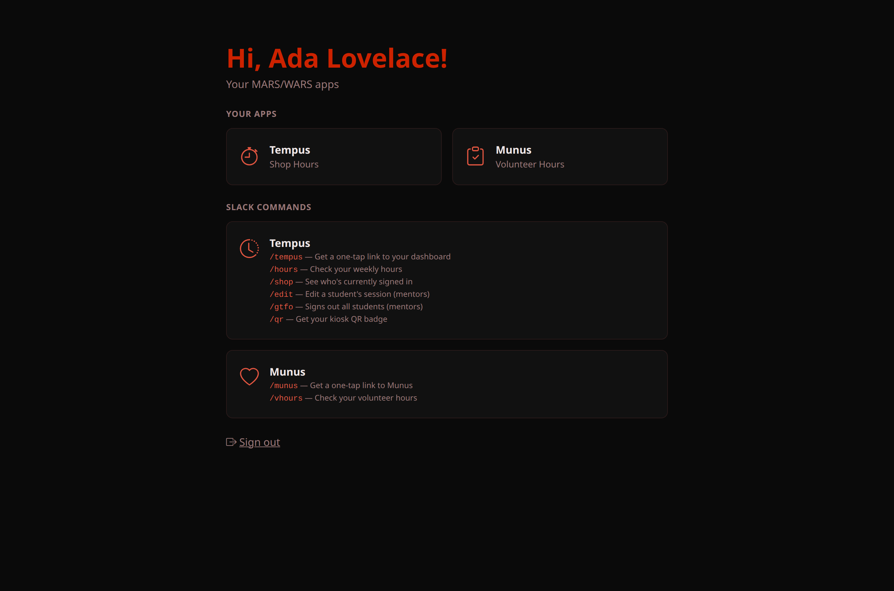

import SlackTempusHours from './img/slack-tempus-hours.png';
import SlackMunusLogHours from './img/slack-munus-log-hours.png';
import SlackTempusQr from './img/slack-tempus-qr.png';
import SlackTempusWeekly from './img/slack-tempus-weekly-behind.png';
import WorkflowAnnounce from './img/workflow-munus-1-announce.png';
import WorkflowSignupModal from './img/workflow-munus-2-signup-modal.png';
import WorkflowReminder from './img/workflow-munus-3-reminder.png';
import WorkflowOutcome from './img/workflow-munus-6-outcome.png';

Legion, Tempus, and Munus are three apps the **software subteam** builds and runs for
the rest of MARS/WARS. As a student you don't need to understand any of that — you need
to know how to sign in, log your shop hours, and sign up for volunteer opportunities.
That's this post.

<!-- truncate -->

## Signing in — one tap, no password

Every one of these apps signs you in through **Legion**, and Legion never asks for a
password. Run `/legion`, `/tempus`, or `/munus` in Slack, and **Mercury** — the one
shared Slack app behind every MARS/WARS tool — replies right there with a one-tap
link, visible only to you: something like `🏠 Open Legion` or `🕒 Open Tempus`. Tap it
and you're in — no approval step, nothing to wait for. `/hours` and `/vhours` work the
same way, they just show your stats *first*, with the same kind of link at the end.

You might land on a page with a small "limited mode" banner the first time — that's
normal and not something you need to do anything about. It's mentor-relevant (see the
mentor's guide if that's ever you); as a student it doesn't affect anything you can do.

## Tempus — shop attendance

Tempus tracks your hours in the shop. There's no app to open for the everyday part:

- **Walk in, scan your badge** at the kiosk — you're signed in. Hold your phone's QR
  up to the kiosk camera, or use the handheld scanner.
- **Walk out, scan it again** — you're signed out, counted as full "Contributor" hours
  by default.

**Forgot to scan out?** It happens. At 3 AM Tempus signs out anyone still signed in.
Instead of your real time, a forgotten session is credited a set session length, so you
may get fewer hours than you actually worked. If it looks off, ask a mentor to fix the
session. Easiest fix: scan out on your way out the door.

- **`/hours`** in Slack any time for a private summary of your week and season so far:

That reply ends with a **📊 Open my dashboard** link straight to your personal page —
your recent sessions, total hours, and whether you're on pace for the week:

A couple of other commands worth knowing:

- **`/qr`** — lost your badge? This DMs you a fresh QR code on the spot, no mentor
  needed. The DM also links your personal badge page, which you can bookmark (it opens
  without signing in), and, when the team has them turned on, Apple and Google Wallet
  passes that turn your screen brightness up so the kiosk reads it first try. No phone?
  Ask a mentor for a printed badge card.

- **`/shop`** — see who else is currently signed in.

**Every Sunday night** Mercury sends your week: hours so far against your team's weekly
goal. If you're behind, that message goes to a group DM with your subteam's lead mentors,
so you can plan make-up time together:

We want everyone to have fun and enjoy their time at robotics, but there's also a goal
and a job to get done, and your hours are meant to reflect helping with it. That's what the
three contribution levels are for: Contributor counts 100% of your time, Present 60%, and
Distraction 25%.

If a mentor needs to correct a session (say, you were marked Contributor but were
mostly goofing off — or the reverse), that happens on their end via `/edit`; there's
nothing for you to do there.

## Munus — volunteer hours

Munus is where volunteer opportunities get posted, and where you sign up and log your
hours toward your season requirement: 5 hours for freshmen (and junior high), 10 for 4423
sophomores, and 15 for everyone else on 4143. Opportunities marked 🚨 Required need every
student to sign up for at least one shift. The whole loop below — signing up, getting
reminded, and logging your hours — happens without leaving Slack.

**1. An opportunity gets posted** to the team's volunteer channel:

**2. Tap "View & sign up"** and a form opens right there — pick your shift and submit,
no page load:

**3. The day before your shift, a reminder** shows up with the time, location, and
attire, so it's not a surprise:

**4. When the shift ends, log your hours in one tap** — pre-filled with the scheduled
length, or adjust it if you ran long or short:

**5. A mentor reviews it**, and once they approve, you'll hear back:

Log your hours within **7 days** of the shift: after that it's closed out automatically
and won't count. Only **approved** hours count toward your season total — if a submission is sitting as
"Pending" for a bit, that's normal, it just means nobody's reviewed it yet.

If you'd rather do any of this from a browser, **`/vhours`** replies with your season
progress and a one-tap link into the same dashboard:

## Legion — your home base

You'll rarely need to think about Legion directly, but `/legion` is a one-tap link to
its home page, which lists every app you have access to plus every slash command
available to you:

(The `/edit` and `/gtfo` commands are listed there too, but they're mentor-only — running
them as a student just gets you an error.)

## Quick reference

| Command | What it does |
|---|---|
| `/legion` | One-tap link to Legion's home page |
| `/tempus` | One-tap link to your Tempus dashboard |
| `/hours` | Your weekly & season shop hours |
| `/qr` | DMs you a replacement kiosk badge |
| `/shop` | Who's currently signed in |
| `/munus` | One-tap link to Munus |
| `/vhours` | Your volunteer-hours progress + upcoming shifts |

Stuck on a sign-in, or something looks wrong? Drop a note in the software subteam's
Slack channel — that's us.
