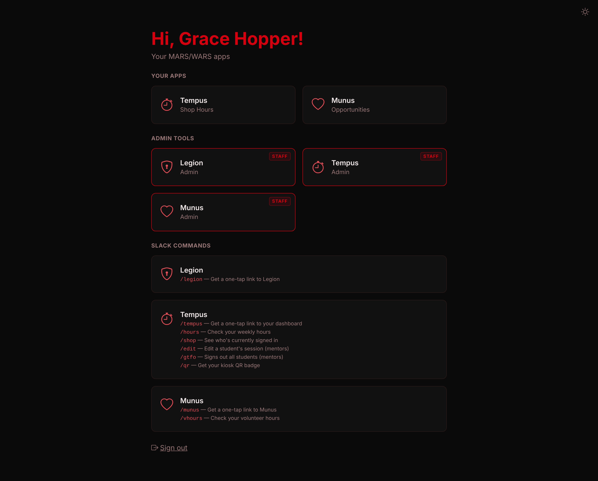
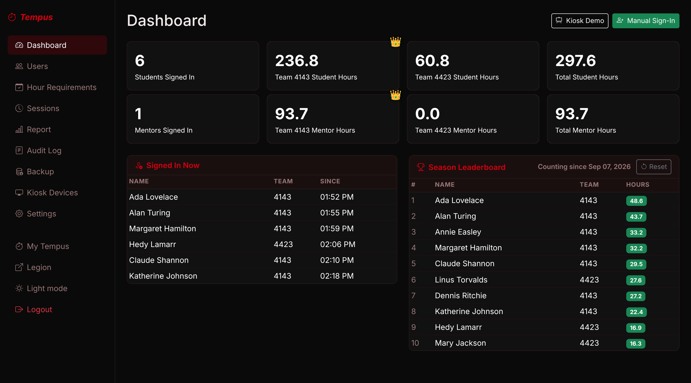
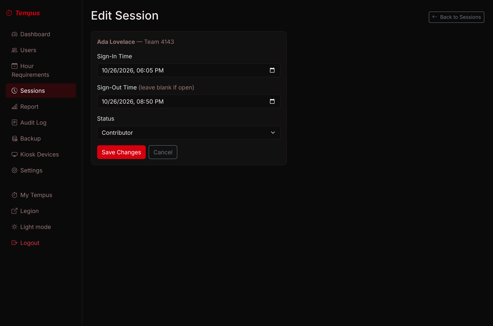
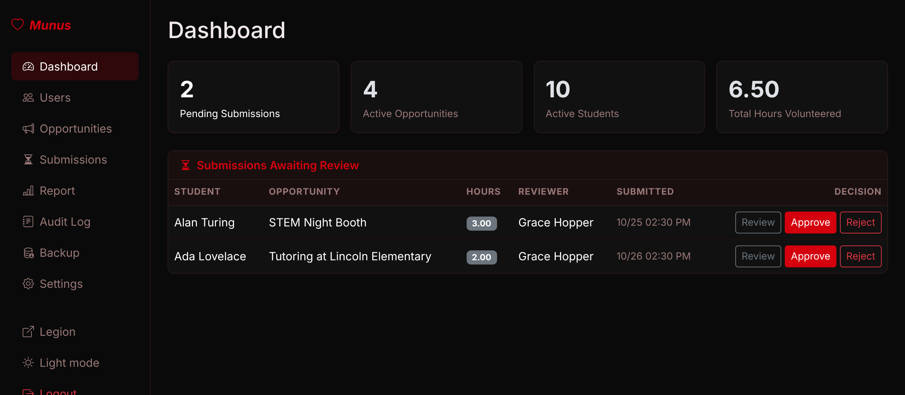
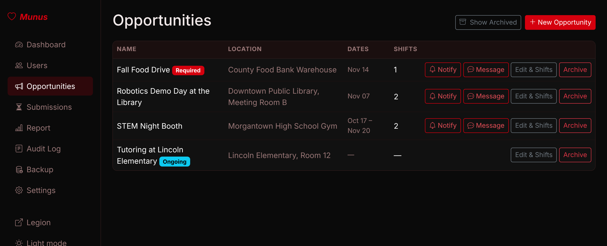

import SlackLegionSso from './img/slack-legion-sso.png';
import SlackMunusReview from './img/slack-munus-review.png';
import WorkflowEditModal from './img/workflow-tempus-1-edit-modal.png';
import WorkflowEditNotify from './img/workflow-tempus-2-notify.png';

Legion, Tempus, and Munus are three apps the **software subteam** builds and runs for
the rest of MARS/WARS. As a mentor you get more than a student does — admin dashboards,
the ability to correct attendance, and hour-submission approvals — all gated by which
groups Legion has you in. This is the guide to that side of things.

<!-- truncate -->

## Signing in, and what "admin access" actually means

Run `/legion`, `/tempus`, or `/munus` in Slack same as everyone else, and you get back
a one-tap link — no password, no approval step. Tap it and you're in immediately. But
that link is deliberately weak: it only proves Slack already knows who you are, so it
signs you in with **no groups at all** — none of your admin tools show up yet, even
ones you actually hold.

You'll see a small banner on whatever page you land on:

> You opened this from a Slack quick link, so you're in limited mode — admin tools are
> hidden. **Switch to full access**

Click that, and *now* you get the real thing — a Slack Approve/Deny push:

Approve it, and your session is upgraded in place — no sign-out, no re-navigating — to
a full session carrying your actual **groups**: `tempus-admin`, `tempus-manager`,
`munus-admin`, `munus-manager`, and so on. Each app checks those groups to decide what
to show you. A mentor holding admin groups on all three sees a home page like this:

If you're missing an admin tile you think you should have, that's a Legion group
issue — ask an existing `legion-admin` to add you under **Admin → User Groups**, not
something to troubleshoot in the individual app. The **-manager** groups (vs.
**-admin**) exist for a reason: a `tempus-manager` gets the dashboard and report view
only, and a `munus-manager` can manage opportunities/shifts but not the rest of admin —
useful for someone who needs day-to-day access without full admin. (A `tempus-manager`
can also edit sessions and the weekly hour requirements.)

**A bookmarked `*.marswars.org` link skips all of this.** Go straight to
`tempus.marswars.org`, `munus.marswars.org`, `legion.marswars.org` — any of them —
without a live session, and you land on Legion's real sign-in form (type your
username) instead of a magic link. That path was never weakened, so it gets you the
real Approve/Deny push and a full-groups session immediately — no limited mode, no
step-up. If you'd rather not deal with any of the Slack-link nuance above, just
bookmark the app you use most and sign in that way.

## Tempus — attendance

The kiosk isn't student-only — scan your own badge in and out like anyone else to
record your own shop hours, no admin access needed for that part. Mentors get their own
board (the kiosk swaps to it automatically on a mentor badge scan) and their own
leaderboard, separate from the student one; `/qr` and `/hours` both work for you too if
you ever need a replacement badge or want to check your own total.

Your admin dashboard is the at-a-glance view walking into the shop: who's signed in
right now, hours by team, and the season leaderboard, all live:

We want everyone to have fun and enjoy their time at robotics, but there's also a goal
and a job to get done. A sign-in earns full "Contributor" hours (100%) by default;
"Present" counts 60% and "Distraction" 25%. When that needs correcting —
someone was mostly distracted, or a session needs backfilling — run **`/edit <name>`**
in Slack. It opens a modal right there with their last five sessions and the three
contribution levels — pick both and save:

The student finds out immediately — Tempus DMs them the moment you save:

The same edit is available from **Admin → Sessions** if you'd rather work from a
browser, or are cleaning up several sessions at once:

Other commands worth having memorized:

- **`/shop`** — who's currently signed in, without opening a browser.
- **`/gtfo`** — mass-signs-out every student and mentor still signed in (end-of-night
  cleanup). Mentor-only; students get an error if they try it. Like the 3 AM auto
  sign-out, it treats those sessions as forgotten: each one is credited the
  "Session length (minutes)" set under **Admin → Settings** instead of the time up to
  that moment. Fix any that were real work from **Admin → Sessions**.

`/qr` also works for you if you ever need a replacement badge yourself.

**Lead mentors** are set by Legion groups named `tempus-lead-<team>-<subteam>` (for
example `tempus-lead-4143-software`). When a student on that team and subteam misses
their weekly goal, Sunday's update goes to a group DM with them and their leads.

## Munus — volunteer hours

The reviewing mentor for a submission (set per-shift, or a default for the whole
opportunity) gets a DM the moment a student logs hours, with the claimed hours and their
report right there:

**Approve**, **Edit hours** (fix the number and approve it in one step; the student's
DM says what you changed), or **Reject** — all from the DM, no site visit needed. A submission you haven't acted on
gets re-sent to you every few days until you do. The same queue lives on the admin
dashboard if you'd rather work from a browser, or are catching up on more than one:

Only **approved** hours count toward a student's season total — a submission left
sitting in Pending doesn't help them yet, though it does show as "projected" on the
report page.

Posting a new opportunity is a `munus-manager`-or-above task, under **Admin →
Opportunities**:

Add at least one shift (or mark it continuous) and Munus announces it to the team's
volunteer channel automatically — you don't need to post about it separately in Slack.

## Legion — the roster underneath everything

You'll spend the least time here, but it's worth knowing what lives in Legion since it's
the one place all of this actually gets configured:

- **Adding/editing members** — students and mentors are managed in Legion, not in
  Tempus or Munus directly (both just mirror the roster read-only, synced hourly or on
  demand via each app's own "Sync now" button).
- **Granting admin access** — a member's `tempus-admin`/`munus-admin`/etc. group
  membership is set entirely under **Admin → User Groups**, on the group's own page —
  never from the member edit form itself.
- **Slack IDs** — a student or mentor needs their Slack user ID set in Legion to receive
  any DMs (reminders, approval pushes, hour-submission notices). If someone says
  they're "not getting anything," check this first.

## Quick reference

| Command | Who | What it does |
|---|---|---|
| `/legion` | everyone | One-tap link to Legion's home page |
| `/tempus` | everyone | One-tap link to your Tempus dashboard |
| `/hours` | everyone | Weekly & season shop hours |
| `/edit <name>` | mentors | Correct a student's session rating |
| `/shop` | everyone | Who's currently signed in |
| `/gtfo` | mentors | Mass sign-out at closing time |
| `/qr` | everyone | DMs a replacement kiosk badge |
| `/munus` | everyone | One-tap link to Munus |
| `/vhours` | everyone | Volunteer-hours progress + upcoming shifts |

Something broken, or a group that isn't behaving the way this post says it should? That's
a software subteam question — find us in Slack.
