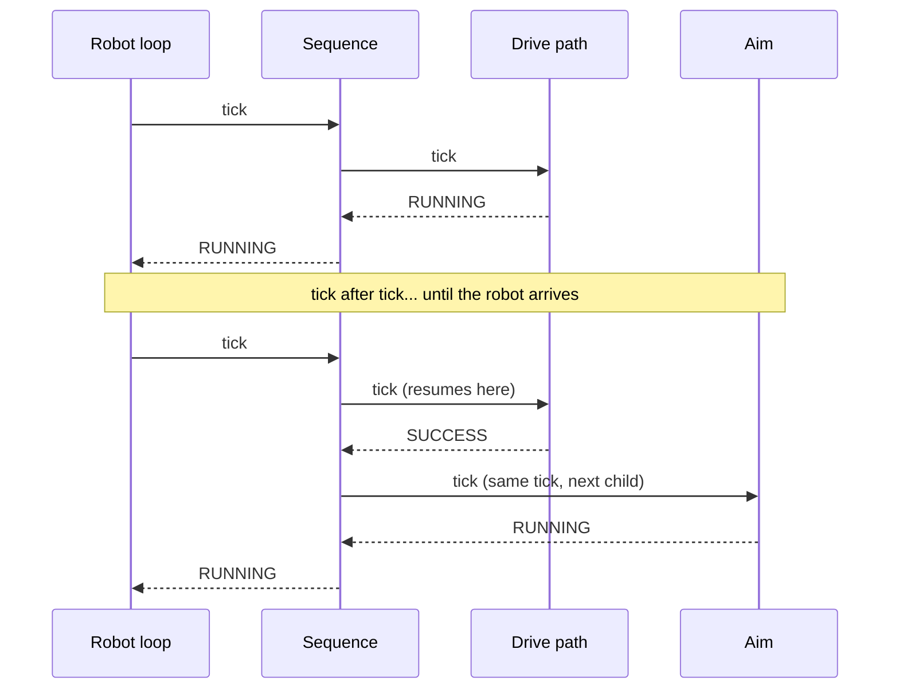
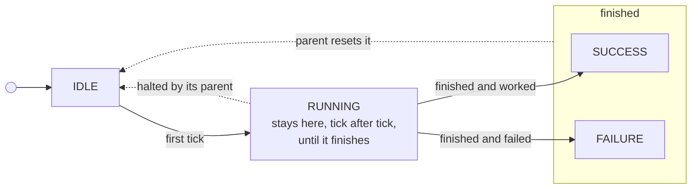
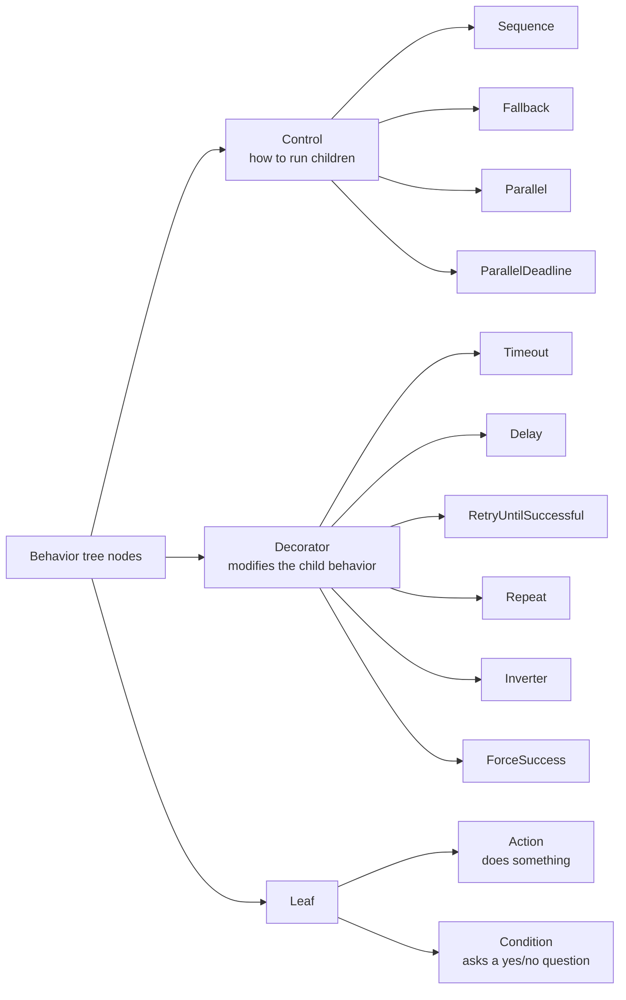
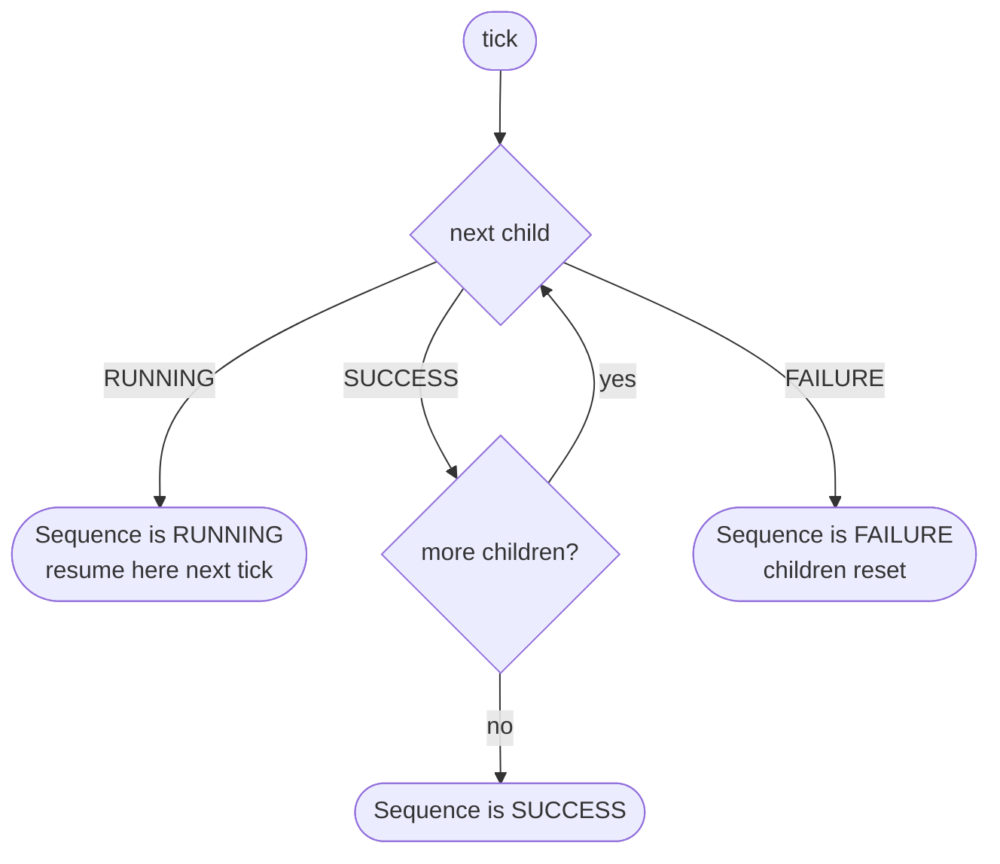
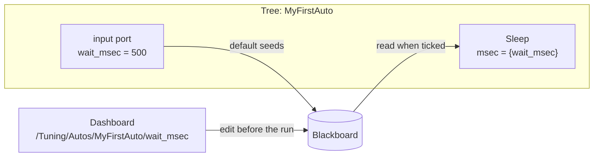
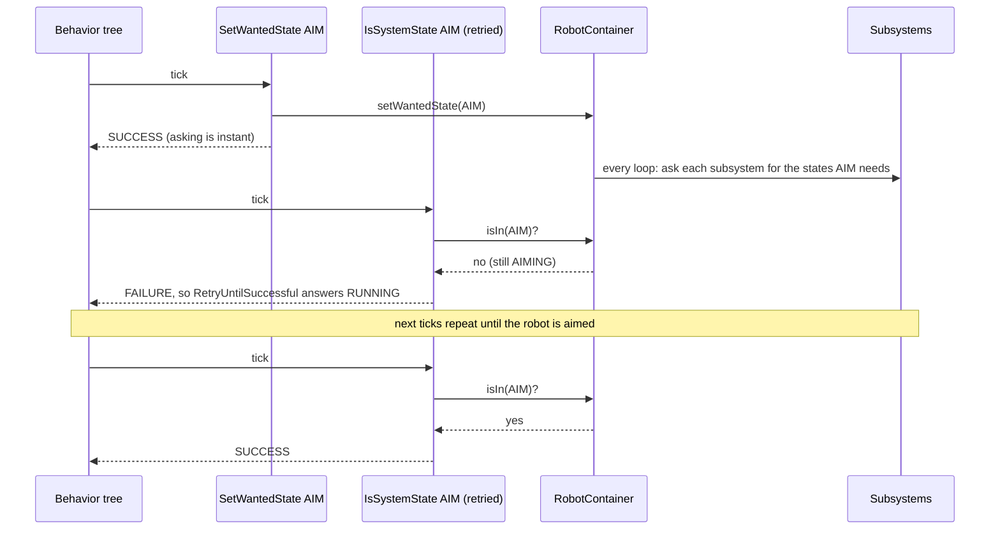

import {LabLink} from '@site/src/components/LabLink';

import ArboristTree from '@site/src/components/ArboristTree';
import * as BT from '@site/src/data/btTrees';

# Behavior Trees

A **behavior tree** is a way to describe what a robot should do as a tree of small steps. It is how we write
[autonomous routines](../robot_dev/autonomous.mdx): "drive this path, then aim, then shoot, and if aiming takes too long,
drive to the backup spot instead."

Where a [state machine](./state-machines.mdx) answers "what mode is the robot in right now?", a behavior tree answers
"what should happen, in what order, and what if a step goes wrong?" The two work together on our robot: the tree decides
the *order* and handles *failure*, and the steps it runs mostly ask the robot's own state machine for a state.

:::tip The trees on this page are live
They are drawn by **Arborist**, the viewer inside [Arbor](../tools/arbor.mdx), so they look exactly like Arbor. The
animations play tick by tick: a node turns **orange** while it is RUNNING, then **green** (SUCCESS) or **red**
(FAILURE), and the caption under the tree says what just happened. Pause, or step with ◀ ▶. Click a tree to pan and
zoom it, and select a node to see its settings.
:::

:::tip Try it in the Behavior Tree Lab
Run these trees tick by tick on a simulated robot, in the same viewer Arbor uses, and make steps fail on purpose. <LabLink slug="behavior-tree-lab" />
:::

---

## A Tree of Steps

Every box in the tree is a **node**. Nodes at the bottom do real work and are called **leaves**. Nodes that hold other
nodes decide *how* their children run. Here is a real-looking auto:

<ArboristTree xml={BT.STEPS_TREE} height={400} label="PickupAndScore: a Sequence of Drive to the pickup, a Fallback (a Timeout of 3000 ms around Aim, else Drive to the backup spot), and SetWantedState SHOOT" />

Read it from the top, left to right:

1. The **Sequence** runs its children in order.
2. First it drives to the pickup.
3. Then the **Fallback** tries to aim, but only for 3 seconds (the **Timeout**). If aiming fails or runs out of time,
   the Fallback gives up on it and drives to the backup spot instead.
4. Finally it shoots.

The boxes that hold other boxes (Sequence, Fallback, and the Timeout drawn as a frame around Aim) are the **control
flow**. The boxes at the ends are the **actions** that actually move the robot. All the cleverness in a behavior tree is in how the control flow combines simple actions.

---

## Ticks and Statuses

A behavior tree does not run once and finish. The robot's main loop **ticks** the tree about fifty times a second.
Each tick starts at the root and travels down into the tree. Every node it visits answers with one of three **statuses**:

| Status | Meaning | Example |
|---|---|---|
| **RUNNING** | "I'm not done yet, ask me again next tick." | Driving a path, until the robot arrives |
| **SUCCESS** | "I'm done, and it worked." | The path reached its end; the condition is true |
| **FAILURE** | "I'm done, and it didn't work." | A target was not found; a timeout ran out |

The answers travel back **up** the tree, and each control node uses its children's answers to decide what to do and
what to answer *its* parent.

A node is not always in the middle of something. Between runs it is **idle**, and a node that finishes goes back to idle
once its parent has finished with it:

**Halted** is worth remembering: if a node is RUNNING and its parent decides it should stop (a timeout, a failed
condition, a sibling that finished first), the parent *halts* it and it goes straight back to idle. A well-written action
cleans up when it is halted, which is why a path-following node can stop the robot when something else wins.

---

## The Kinds of Nodes

| Kind | Children | What it does |
|---|---|---|
| **Control** | Several | Runs its children in a pattern: in order, until one works, all at once... |
| **Decorator** | Exactly one | Wraps a child and changes how it runs or what it reports (a time limit, a retry, "flip the answer") |
| **Action** | None | Does something: ask the robot for a state, follow a path, wait |
| **Condition** | None | Answers SUCCESS or FAILURE right away, never RUNNING: "do we have a game piece?" |
| **SubTree** | None | Runs another tree by name, so a block like "shoot for two seconds" is written once and used everywhere |

---

## Sequence: Do These in Order

A **Sequence** runs its children one after another. It moves on to the next child when the current one succeeds. When
a child answers RUNNING the Sequence answers RUNNING too, and **next tick it resumes at that same child**, not at the
start.

<ArboristTree {...BT.SEQUENCE_SUCCESS} height={320} label="Animated tree: a Sequence runs Drive path, Aim and Shoot in turn, each RUNNING and then SUCCESS, and finally the Sequence reports SUCCESS" />

The Sequence is only SUCCESS when **all** of its children succeeded. But the moment one of them fails, it gives up:

<ArboristTree {...BT.SEQUENCE_FAILURE} height={320} label="Animated tree: Drive path succeeds, Aim fails, the Sequence reports FAILURE and Shoot is never ticked" />

This is why a Sequence is the natural way to write "do A, then B, then C, but only if each one worked". Because Shoot
is only reached after Aim succeeded, **Shoot never has to check whether Aim worked**.

---

## Fallback: Try Until Something Works

A **Fallback** is "plan B" (some people call it a *selector*). It tries its children in order and stops at the first
one that **succeeds**. It only fails if *every* child failed.

<ArboristTree {...BT.FALLBACK} height={320} label="Animated tree: a Fallback tries Aim: vision, which fails, then Aim: manual, which succeeds, so the Fallback succeeds. In a second run Aim: vision, Aim: manual and Skip the shot fail one after another, and only then does the Fallback fail" />

It is the mirror image of a Sequence:

| | Moves on to the next child when... | Stops early when... | Is SUCCESS when... | Is FAILURE when... |
|---|---|---|---|---|
| **Sequence** | a child **succeeds** | a child **fails** | all children succeeded | any child failed |
| **Fallback** | a child **fails** | a child **succeeds** | any child succeeded | all children failed |

A Sequence is "AND"; a Fallback is "OR".

---

## Reactive Sequence: Keep Checking

A plain Sequence remembers where it was. That is usually what you want, but sometimes a condition needs to stay true
the *whole time* an action runs: "keep driving only while we still hold the game piece."

A **ReactiveSequence** ticks **all** of its earlier children again on **every** tick, starting from the first. If a
condition that used to pass now fails, the running action after it is **halted**.

<ArboristTree {...BT.REACTIVE_SEQUENCE} height={300} label="Animated tree: a ReactiveSequence checks Has game piece? on every tick while Drive path runs; on the third tick the condition fails, Drive path is halted and the ReactiveSequence fails" />

:::info Only one child should be RUNNING
A ReactiveSequence is meant for "some conditions, then one long action". Two children that both take several ticks
would keep halting each other, and MW-Lib reports an error if it happens.
:::

---

## Parallel and ParallelDeadline: At the Same Time

Control nodes do not have to run children one at a time. A **Parallel** ticks all of its children on every tick and
finishes based on how many succeeded or failed. Our own **ParallelDeadline** is the version autos use most: the **first**
child is the *deadline*. When it finishes, every other child is halted, and the node reports the deadline's result.

<ArboristTree {...BT.PARALLEL_DEADLINE} height={300} label="Animated tree: Follow path and Intake on event run together; when Follow path succeeds, Intake on event is halted and the ParallelDeadline succeeds" />

That is exactly what "drive this path, and drop the intake when the robot passes the marker" needs: the path is the
deadline, and the intake branch is just along for the ride. If the robot reaches the end of the path before the marker
ever fires, the waiting branch is stopped instead of hanging the auto.

---

## Decorators: Change How a Child Runs

A **decorator** has exactly one child and modifies it. The one you will use most is **Timeout**: it gives its child a
time limit, and if the child is still RUNNING when time is up, it halts the child and reports FAILURE.

<ArboristTree {...BT.TIMEOUT} height={320} label="Animated tree: a Timeout gives Aim three seconds; when time is up it halts Aim and fails, so the Fallback moves on to Backup path, which succeeds" />

Put a Timeout under a Fallback and a step that *might* never finish becomes a step that *fails after three seconds*, which
the Fallback turns into a plan B. This is the single most useful pattern in an auto.

| Decorator | What it does |
|---|---|
| `Timeout msec` | Halts the child and fails if it runs longer than `msec` |
| `Delay delay_msec` | Waits, then runs the child |
| `RetryUntilSuccessful num_attempts` | Runs the child again if it fails, up to a limit |
| `Repeat num_cycles` | Runs the child several times in a row |
| `Inverter` | Swaps SUCCESS and FAILURE ("is the shooter *not* ready?") |
| `ForceSuccess` / `ForceFailure` | Reports a fixed result whatever the child did ("try this, but never let it fail the auto") |
| `RunOnce` | Runs the child the first time only |

---

## Ports and the Blackboard

Nodes take settings called **ports**, filled in on Arbor's inspector: `Sleep` has `msec` = 500. A port can hold a
fixed value, or point at a named slot in a shared notebook called the **blackboard**, written with braces:
`msec` = `{wait_msec}`.

A port declared for the tree, with a default, shows up on the dashboard, so the team can change a wait time at the
field without rebuilding the code. The **SubTree** node uses the same idea to pass values into a reusable block:
a `SubTree` of `ShootFor` with `duration_msec` = 2000.

:::warning A typo in a port name is an error, on purpose
If a node reads `{wait_msc}` and nothing ever sets it, the auto refuses to load and says which node, instead
of waiting until mid-match to read a missing value.
:::

---

## How a Tree Talks to the Robot

Most leaves in an auto do not drive motors themselves. **`SetWantedState`** asks the robot's state machine
(`RobotContainer`) for a robot state. It is an instant request, like the driver pressing a button: it succeeds the same
tick. To wait until the robot gets there, the tree retries the condition **`IsSystemState`**, which succeeds once the
robot is in the state, inside a `Timeout` so it can't wait forever:

<ArboristTree xml={BT.TALK_TO_ROBOT} height={300} label="A Sequence: SetWantedState AIM, then a Timeout of 3000 ms around RetryUntilSuccessful around IsSystemState AIM" />

Because the driver's buttons ask for the same robot states, the aim-spin-up-feed sequence is written **once**, in
`RobotContainer`, and used by both teleop and autos. The tree adds what only an auto needs: the wait, a `Timeout` so
aiming can fail, and a `Fallback` for what to do then. See [The Super State Machine](./state-machines.mdx#the-super-state-machine).

---

## Reading a Real Auto

Putting it all together, here is an example in the style of our autos, playing a run where aiming fails. Decorators
(`Timeout`, `RetryUntilSuccessful`) are drawn as frames around the child they wrap, and the edge labels give each
child's place in its parent:

<ArboristTree {...BT.PICKUP_AND_SCORE} height={460} label="PickupAndScore: a Sequence with four steps (FollowTrajectory ToPickup, SetWantedState AIM, a Fallback, SetWantedState SHOOT). The Fallback first tries a Timeout of 3000 ms around RetryUntilSuccessful around IsSystemState AIM, and if not, FollowTrajectory ToBackup. The animation shows aiming time out and the backup path run instead." />

When you are not sure what a tree will do, trace one tick by hand: start at the root, ask "what does this node do with
each child's answer?", and follow the RUNNING answers down to the node that is actually busy.

---

## Seeing It Run

[Arbor](../tools/arbor.mdx) shows exactly these colours for a real robot: connect to the robot or the simulator and each
node turns **orange** while it is RUNNING, then **green** or **red**. If an auto stops where you did not expect, the node
that is red, or the one that stayed orange, is where to look. The `.btlog` files the robot writes can be replayed there
afterwards, one tick at a time.

| Looks like | Usually means |
|---|---|
| A Sequence is red, the last children never lit up | A child before them failed; the rest were skipped on purpose |
| One node stays orange forever | That step never finishes. Wrap it in a `Timeout` and give the Fallback a plan B |
| The whole tree is green but the robot did not do the thing | The step succeeded without doing the work: check it asked for the right state or path name |
| An auto does nothing and Arbor shows no colours | The file failed to load: look at `BehaviorTree/<auto>/Error` and the Elastic alert |

### Try It: Behavior Tree Lab {#behavior-tree-lab}
No robot handy? This lab ticks a tree on a pretend robot and draws it with Arborist, the same viewer Arbor uses, so the colours mean the same thing. Break the camera or jam the intake to make each row of the table above happen, then edit the XML and run your own tree.

<LabLink slug="behavior-tree-lab" button />

---

## Practice

The **Arbor** lesson in [Scriptum](../tools/scriptum.mdx) walks you through building a tree: a Sequence of three steps,
a Timeout with a Fallback, and a tunable wait time. The **Autonomous** lesson then builds a real routine the same way.

---

## Related Documentation
- [Autonomous](../robot_dev/autonomous.mdx): our behavior-tree autos: layout, nodes, wiring and debugging.
- [State Machines](./state-machines.mdx): the robot states a tree asks for.
- [Arbor](../tools/arbor.mdx): the editor and live viewer.
- [BehaviorTree.CPP](https://www.behaviortree.dev/): the open-source library whose file format and node semantics ours follows.
