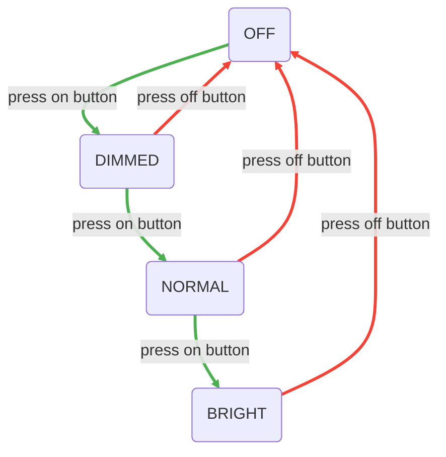
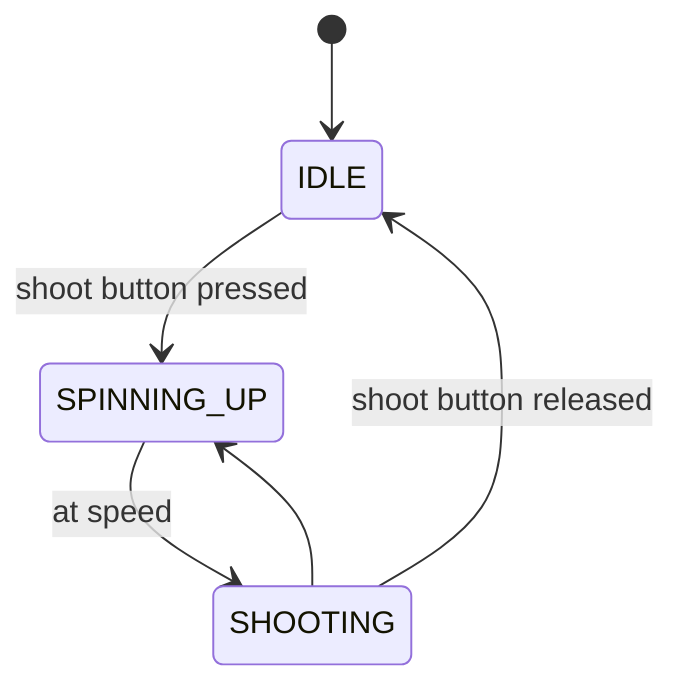

# State Machines

State machines are one of the most fundamental and powerful concepts in robotics programming. They help us organize complex robot behaviors by breaking them down into simple, manageable pieces called **states**. Think of a state machine like a flowchart that describes how something behaves. It's a way to model systems that can be in different "modes" or "states" at any given time, and can transition between these states based on certain conditions. They are very useful for controlling robots because they allow us to define clear behaviors and transitions.

---

### Real-World Examples
**Traffic Light**: A traffic light is a simple state machine with three states:
- **Red**: Cars must stop
- **Yellow**: Cars should prepare to stop
- **Green**: Cars can go

**Washing Machine**: Your washing machine has states like:
- **Fill**: Adding water
- **Wash**: Agitating clothes
- **Rinse**: Clean water cycle
- **Spin**: Remove water
- **Done**: Cycle complete

---

## Components of a State Machine
A state machine consists of two fundamental components: **states** and **transitions**. States represent the different modes or conditions that the system can be in. In the type of state machine we typically use in robotics, known as a finite state machine (FSM), the number of states is limited and well-defined. Each state has specific behaviors or actions associated with it.
:::info States as Enums
The easiest way to represent states in code is by using an enumeration (enum). Enums allow us to define a set of named constants, making our code more readable and maintainable. For example, in Java, we can define the states of a traffic light like this:
```java
public enum TrafficLightState {
    RED,
    YELLOW,
    GREEN
}
```
See the documentation on [Variables and Data Types](../java/vars-dt/#enums) for more information on enums.
:::

Transitions are the rules or conditions that determine when and how the system moves from one state to another. These transitions are often triggered by events or conditions, such as a button press, a sensor reading, or a timer expiring.

---

## State Machine Diagram
State machines are often represented visually using state diagrams. These can be a great way to plan and communicate your robot's behavior. It is recommended to start with a simple diagram before implementing the state machine in code. Just to illustrate, here is a simple state diagram for a dimmer switch:




Lets look at something more related to robotics. Below is a simple example of a state diagram for a robot shooter/indexer:



There are some software tools that help you create state diagrams. One we have used in the past is [Mural](https://www.mural.co/). While you can always draw them by hand, it is ideal to have a digital copy that can be updated as our robot becomes more complex.

---

## The Super State Machine
Every subsystem on our robot is its own state machine, but most robot actions need **more than one** subsystem. Shooting means aiming the drivetrain, spinning up the flywheel and feeding a game piece, in that order. We put that coordination in one more state machine on top of the subsystems: the **super state machine**, which lives in `RobotContainer`.

```mermaid
flowchart TD
    OI[Buttons in OI] -->|robot.setWantedState&#40;SHOOT&#41;| RC
    AUTO[Autonomous routines] -->|robot.setWantedState&#40;SHOOT&#41;| RC
    RC["RobotContainer<br/>(super state machine)<br/>IDLE · DRIVE · AIM · SHOOT"]
    RC -->|setWantedState&#40;ARCADE&#41;| D[Drivetrain state machine]
    RC -->|setWantedState&#40;SHOOT&#41;| S[Shooter state machine]
    RC -->|setWantedState&#40;SQUEEZE&#41;| I[Intake state machine]
```



- **Buttons and autos only ask the robot.** They call `setWantedState(...)` on `RobotContainer`, the same method you use on a subsystem. They never talk to a subsystem directly, and there are no per-subsystem command files.
- **The robot asks the subsystems.** Every loop, before the subsystems run, the super state machine looks at the robot's state and asks each subsystem for the state it needs. Each subsystem still decides for itself when it is allowed to get there (the shooter still spins up before it shoots).
- **Write it once.** A robot state like `SHOOT` is the same whether the driver's trigger or an autonomous routine asks for it. A scoring sequence is written once, in `RobotContainer`, and used in teleop and in autos.

```java
public class RobotContainer extends MwSuperStateMachine<RobotStates> {
    @Override
    protected void updateLogic(double timestamp) {
        switch (getSystemState()) {
            case SHOOT:
                drive_.setWantedState(DriveStates.ARCADE);
                shooter_.setWantedState(ShooterStates.SHOOT);
                break;
            case DRIVE:
                drive_.setWantedState(DriveStates.ARCADE);
                shooter_.setWantedState(ShooterStates.IDLE);
                break;
            case IDLE:
            default:
                drive_.setWantedState(DriveStates.IDLE);
                shooter_.setWantedState(ShooterStates.IDLE);
                break;
        }
    }
}
```

### Sequences and Failures
A multi-step action, such as *aim, then spin up, then feed*, is one robot state with a few **step states**. While that state is wanted, `handleStateTransition` walks the robot through the steps and lands in the state itself when it is done. If it can't finish (a timeout, no game piece), it calls `failWantedState()`.

`getStateResult()` reports **RUNNING**, **SUCCESS** or **FAILURE** for the wanted state. Autonomous behavior trees use the `SetWantedState` node, which waits on that result, so an auto can add its own fail handling (`Timeout`, `Fallback`, `Retry`) around the same sequence the driver uses in teleop.
