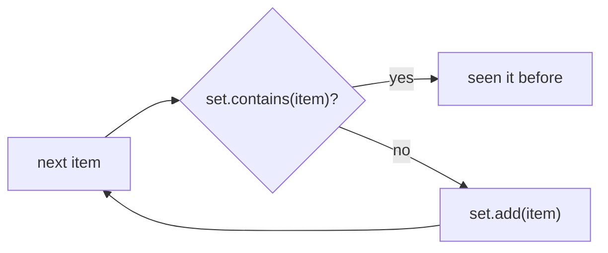

# Big-O & Efficiency
:::tip Why this matters on the robot
The robot runs its code every 20 milliseconds. If one loop takes longer than that, the Driver Station shows "loop
overrun" warnings and the robot reacts late. Big-O lets you tell, before a match, whether code that is fine with 5
items will still keep up with 500.
:::
:::warning Read first
[Collections](./collections.mdx) (`ArrayList`, `HashSet` and `HashMap`), plus [Loops](../basics/loops.mdx) and
[Arrays](../basics/arrays.mdx) from Java Basics.
:::

Code can give the right answer and still be too slow. Nothing is broken; it does far more work than it needs to, and
the extra work grows much faster than the data does. This page shows you how to count that work and how to cut it down.

---

## Count steps, not seconds
How long code takes in seconds depends on the computer. So programmers count **steps** instead: how many times the code
looks at an item in a list or array. The number of items is called **n**.

The question that matters is: **if n doubles, what happens to the number of steps?**

```java
// One look, however many readings there are.
double newest_m = distance_readings.get(distance_readings.size() - 1);

// One look per reading: n readings, n looks.
double total_m = 0.0;
for (double reading_m : distance_readings) {
    total_m += reading_m;
}
```

`size()` doesn't look at any items (the list already knows its own length), so jumping to the last item is one look.
The loop has to visit every reading, so its looks grow with the list.

**Big-O** is the name for that growth. You write it as `O(...)`, said "order ...".

---

## The four you'll see most
| Big-O | Name | If n doubles, steps... | Typical code |
| --- | --- | --- | --- |
| O(1) | constant | stay the same | `list.get(i)`, `set.contains(x)`, a loop that always runs 4 times |
| O(log n) | logarithmic | go up by one | each step throws away half of what's left |
| O(n) | linear | double | one loop over the list |
| O(n²) | quadratic | go up four times | a loop over the list inside another loop over the list |

There is one more you'll meet on the [Searching & Sorting](./search-sort.mdx) page: **O(n log n)**, the speed of
Java's own `sort`. It sits between O(n) and O(n²).

---

## How fast they grow
Here is how many steps each one takes as n grows. The O(log n) numbers are rounded.

| n | O(1) | O(log n) | O(n) | O(n log n) | O(n²) |
| ---: | ---: | ---: | ---: | ---: | ---: |
| 10 | 1 | 3 | 10 | 33 | 100 |
| 100 | 1 | 7 | 100 | 664 | 10,000 |
| 1,000 | 1 | 10 | 1,000 | 9,966 | 1,000,000 |
| 1,000,000 | 1 | 20 | 1,000,000 | 19,931,569 | 1,000,000,000,000 |

At n = 10 every column looks fine, which is why slow code passes your first test. At n = 1,000,000 the O(n²) column
is a trillion steps. That takes minutes even on a fast laptop, and a robot loop gets 20 milliseconds.

:::info What "log n" means here
$\log_2 n$ is "how many times can you cut n in half before you reach 1?". 1000 halves to 1 in about 10 cuts, and a
million in about 20. Double n and you need one more cut, which is why O(log n) barely grows.
:::

---

## O(1): constant time
Code is O(1) when it takes the same number of steps no matter how big n is.

```java
// Grabbing an item by index: one look, for a list of 10 or 10,000.
Pose2d first_waypoint = path_waypoints.get(0);

// A loop that always runs 4 times is O(1) too: a swerve drive has 4 modules,
// however long the match log is.
for (int i = 0; i < 4; i++) {
    module_speeds_mps[i] = 0.0;
}
```

**What to watch out for:** a loop doesn't make code O(n) by itself. Ask what the loop's limit depends on. A fixed number
(4 modules, 3 alliance robots) is O(1). The size of the data is O(n).

---

## O(n): one pass
Code is O(n) when it looks at each item about once. Finding the closest vision target has to check every target,
because any of them could be the closest.

```java
double closest_m = Double.MAX_VALUE;
for (double target_distance_m : target_distances_m) {
    if (target_distance_m < closest_m) {
        closest_m = target_distance_m;
    }
}
```

Big-O keeps only the *shape* of the growth and drops the constants:
- A loop that does 3 things per item is `3n` steps. Still a straight line, so still **O(n)**.
- Two loops one *after* the other are `n + n = 2n`. Still **O(n)**.
- With two different lists of sizes n and m, one pass over each is **O(n + m)**.

**What to watch out for:** an empty list. A one-pass method that starts from "the first item" crashes on an empty list,
so decide what it should return when there's nothing to look at, and check for that first.

---

## O(n²): a loop inside a loop
A loop *inside* another loop multiplies. If the outer loop runs n times and the inner loop runs n times *for each one*,
that's `n × n` steps.

```java
// pieces is a List<Translation2d>: where vision sees each game piece, in meters.
// Check whether any two are closer than 0.3 meters.
for (int i = 0; i < pieces.size(); i++) {
    for (int k = i + 1; k < pieces.size(); k++) {
        if (pieces.get(i).getDistance(pieces.get(k)) < 0.3) {
            too_close_ = true;
        }
    }
}
```

The inner loop starts at `i + 1`, so it does about half the pairs: `n × n / 2`. Drop the constant and it's still
**O(n²)**. Double the pieces and the work goes up about four times.

Sometimes every pair really does need checking, like above. Often it doesn't, and the next two sections show why.

---

## Hidden loops
Some methods are a loop even though you can't see one. `ArrayList.contains(x)` checks the list item by item until it
finds `x`, so it costs O(n).

```java
// Looks like one loop. It's really two.
for (int tag_id : seen_tags) {
    if (trusted_tag_list.contains(tag_id)) { // ArrayList: walks the whole list
        trusted_count_++;
    }
}
```

If both lists hold about n items, that's n calls to an O(n) method: **O(n²)**.

Other common hidden loops on an `ArrayList`:

| Call | Cost | Why |
| --- | --- | --- |
| `get(i)`, `set(i, x)`, `size()` | O(1) | jumps straight to the spot |
| `add(x)` at the end | about O(1) | the end is easy to reach |
| `contains(x)`, `indexOf(x)` | O(n) | checks item by item |
| `remove(0)`, `add(0, x)` | O(n) | every later item has to shift over |

---

## Trade a loop for a HashSet
A `HashSet` files each item by a number worked out from its value (its *hash*), so `contains` goes straight to the right
place. `HashSet.contains` and `HashSet.add` take about one step, however many items the set holds.

So the fix for a hidden loop is often: **build a set once, then ask it many times.**

```java
import java.util.HashSet;

// One pass to build the set: O(m).
HashSet<Integer> trusted_tags = new HashSet<>(trusted_tag_list);

// One pass over the detections, each contains() about one step: O(n).
for (int tag_id : seen_tags) {
    if (trusted_tags.contains(tag_id)) {
        trusted_count_++;
    }
}
```

That's O(n + m) instead of O(n × m). With 1000 items in each list, it's about 2000 steps instead of a million.

Two more things a set gives you for free:
- `new HashSet<>(list)` drops repeats. If an item appears twice in the list, it's in the set once.
- `set.size()` is then the number of *different* items.



**What to watch out for:** a set only helps if you build it *once*, outside the loop. Making a new `HashSet` from a list
inside the loop is a hidden O(n) loop again.

---

## Comparing `Integer`s
A `List<Integer>` holds `Integer` *objects*, not plain `int`s. Comparing two objects with `==` asks "are these the same
object?", not "do they hold the same number?".

```java
List<Integer> fault_codes = List.of(1001, 1001);

boolean same_object = fault_codes.get(0) == fault_codes.get(1);       // can be false!
boolean same_number = fault_codes.get(0).equals(fault_codes.get(1));  // true
```

Java keeps one shared object for small numbers (-128 to 127), so `==` *seems* to work in small tests and then fails on a
real team number like 4143. Use `.equals` to compare two `Integer`s. Comparing an `Integer` with a plain `int` is fine,
because Java turns the object back into an `int` first.

---

## O(log n): halving
Code is O(log n) when each step throws away half of what's left. Say a calibration routine searches the elevator's
1.2 meters of travel for a sensor's trigger point, and every test cuts the search window in half.

```java
// How many tests until the window is smaller than 1 millimeter?
double window_m = 1.2;
int tests = 0;
while (window_m > 0.001) {
    window_m = window_m / 2.0;
    tests++;
}
// tests is 11. With 2.4 meters of travel it would be 12.
```

Doubling the window adds one test. That's why O(log n) is the second-best row in the growth table.
[Searching & Sorting](./search-sort.mdx) builds a full binary search this way.

---

## Common mistakes
- **Counting loops instead of asking what they depend on.** A loop with a fixed limit is O(1). Look at the limit, not
  the `for`.
- **Calling two loops in a row O(n²).** Loops only multiply when one is *inside* the other. One after the other, they
  add.
- **Missing a hidden loop.** `contains`, `indexOf` and `remove` on an `ArrayList` each walk the list. Inside another
  loop, they make it O(n²).
- **Looping to reach the end of a list.** You can jump to any index with `get`, and `size()` tells you where the end is.
- **Forgetting the empty list.** `get(size() - 1)` on an empty list asks for index `-1` and crashes.
- **Building the set inside the loop.** The set has to be made once, before the loop, to save anything.
- **Counting a repeated item twice.** If the question is "how many *different* items", collect them in a set and use its
  size.
- **Comparing `Integer`s with `==`.** It passes small tests and fails on real team numbers. Use `.equals`.

---

## Quick reference
| You see... | It's... |
| --- | --- |
| `get(i)`, `size()`, arithmetic, a loop with a fixed limit | O(1) |
| each step halves what's left | O(log n) |
| one loop over the data, or several loops one after another | O(n) |
| one pass over each of two lists | O(n + m) |
| `list.sort(...)`, `Arrays.sort(...)` | O(n log n) |
| a loop over the data inside another loop over the data | O(n²) |

| Collection | `contains` | `add` |
| --- | --- | --- |
| `ArrayList` | O(n) | about O(1) at the end |
| `HashSet` | about O(1) | about O(1) |
| `HashMap` (`containsKey`, `get`, `put`) | about O(1) | about O(1) |

:::tip Practice in Scriptum
Load the **Big-O & Efficiency** lesson in the Java Advanced track.
:::
