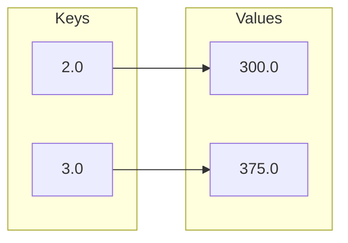
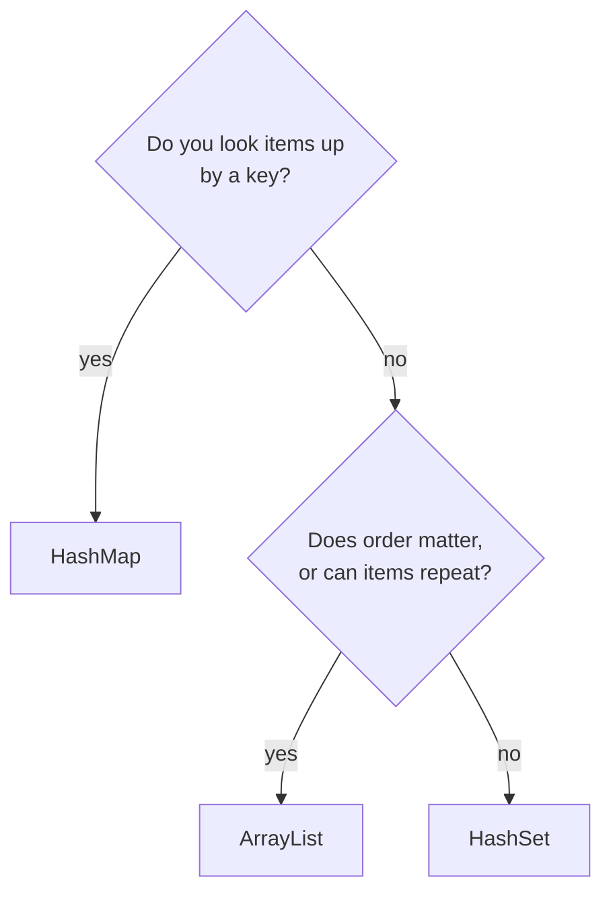

# Collections
:::tip Why this matters on the robot
Robot code uses all three main collections. A list holds the subsystems the robot updates every 20 milliseconds, in
order. A set holds the AprilTag ids the camera saw this frame, since a tag seen twice is still one tag. A map is a
shooter's lookup table: distance to the goal in meters to flywheel speed.
:::

:::warning Read first
This page builds on [Arrays and ArrayLists](../basics/arrays.mdx) and [Classes and Objects](../basics/classes-objs.mdx).
:::

An array has a fixed size, chosen when you make it. A lot of robot and scouting data keeps growing: match after
match, frame after frame. Java's **collections** are classes that grow as you add to them. Each one is good at a
different job, and most of the skill is picking the right one.

| Collection | What it holds | Repeats? | Order? | Use it when |
| --- | --- | --- | --- | --- |
| `ArrayList` | items in a row | allowed | kept | order matters, like readings one after another |
| `HashSet` | items, each at most once | no | none | you only care *whether* something is there |
| `HashMap` | **key** → **value** pairs | keys: no | none | you look things up by a key |

---

## Imports and the angle brackets
Collections live in Java's library package `java.util`, so a file that uses one starts with an import:

```java
import java.util.ArrayList;
import java.util.HashMap;
import java.util.HashSet;
// or all of java.util at once:
import java.util.*;
```

The type in angle brackets says what the collection holds. This is called a **generic** type.

```java
protected ArrayList<Double> voltages_ = new ArrayList<>();
```

The empty `<>` on the right means "the same type as the variable", so you don't write `Double` twice.

---

## `Integer`, not `int`
Collections can only hold objects. `int`, `double` and `boolean` are not objects, so each has an object version:

| Plain type | Object version |
| --- | --- |
| `int` | `Integer` |
| `double` | `Double` |
| `boolean` | `Boolean` |

You write `ArrayList<Integer>`, never `ArrayList<int>`. After that, Java turns an `int` into an `Integer` and back for
you. This is called **boxing** (and unboxing), so `tags.add(7)` and `int first = tags.get(0);` both work.

### What to watch out for
Boxing has one trap. If a map has no value for a key, `get` returns `null`, and unboxing `null` into an `int` crashes
the program with a `NullPointerException`. The [map section](#hashmap-look-things-up-by-key) shows how to avoid it.

---

## `ArrayList`: items in order
An `ArrayList` is an array that grows. Items stay in the order you added them, and repeats are fine.

```java
ArrayList<Double> voltages_ = new ArrayList<>();

voltages_.add(12.6);          // [12.6]
voltages_.add(12.1);          // [12.6, 12.1]
voltages_.add(12.1);          // [12.6, 12.1, 12.1]  repeats are fine
double first = voltages_.get(0);   // 12.6
int how_many = voltages_.size();   // 3
```

| Array | `ArrayList` |
| --- | --- |
| `double[] v = new double[3];` | `ArrayList<Double> v = new ArrayList<>();` |
| fixed size | grows with `add` |
| `v[0]` | `v.get(0)` |
| `v[0] = 1.0;` | `v.set(0, 1.0);` |
| `v.length` (no parentheses) | `v.size()` (a method) |
| holds `int`, `double`, ... | holds `Integer`, `Double`, ... |

A for-each loop works on a list the same way it does on an array:

```java
double lowest = 99.0;
for (double volts : voltages_) {
    if (volts < lowest) {
        lowest = volts;
    }
}
```

### What to watch out for
- **Empty lists.** `get(0)` on an empty list crashes with `IndexOutOfBoundsException`. Check `isEmpty()` first and
  decide what the method should return when there is nothing to work with.
- **Integer division.** If you add up `int`s and divide by `size()`, both sides are `int`s and the decimals are thrown
  away: `7 / 2` is `3`. Make one side a `double` before dividing, for example `(double) total / count`.

---

## `HashSet`: is it there?
A `HashSet` keeps each item at most once and has no order. Adding something that is already there changes nothing.

```java
HashSet<Integer> tags_seen_ = new HashSet<>();

tags_seen_.add(7);
tags_seen_.add(4);
tags_seen_.add(7);                       // already there: no change
boolean saw_four = tags_seen_.contains(4);   // true
int different_tags = tags_seen_.size();      // 2, not 3
```

`contains` on a set is fast no matter how big it gets. On a list, Java has to check every item until it finds a
match. If your main question is "have I seen this?", use a set.

### What to watch out for
- A set has no `get(index)`. There is no "first" or "second" item.
- Don't count repeats yourself before adding. The set already ignores them; `size()` is the number of different items.

---

## `HashMap`: look things up by key
A `HashMap` stores pairs. Each **key** points to one **value**. A shooter lookup table maps distance (meters) to
flywheel speed (radians per second):

```java
HashMap<Double, Double> flywheel_table_ = new HashMap<>();

flywheel_table_.put(2.0, 300.0);
flywheel_table_.put(3.0, 360.0);
flywheel_table_.put(3.0, 375.0);   // same key: replaces 360.0

double speed = flywheel_table_.get(3.0);        // 375.0
boolean known = flywheel_table_.containsKey(5.0); // false
```



Keys are unique, like a set: `put` with a key that is already there **replaces** its value. Values can repeat.

### Missing keys
`get` returns `null` for a key that isn't in the map. To get a default instead, use `getOrDefault`:

```java
HashMap<String, Integer> faults_ = new HashMap<>();

int arm_faults = faults_.getOrDefault("Arm", 0);   // 0, no crash
```

### Updating a value
A map has no "add to this value" method. You read the current value, change it, and `put` it back:

```java
// One more fault for this subsystem.
int before = faults_.getOrDefault("Arm", 0);
faults_.put("Arm", before + 1);
```

### Looping over a map
`keySet()` gives you the keys, and you can `get` each value:

```java
for (String subsystem : faults_.keySet()) {
    System.out.println(subsystem + ": " + faults_.get(subsystem) + " faults");
}
```

### What to watch out for
- **The order is not reliable.** A `HashMap` visits its keys in whatever order its internals choose, and that order
  can change as the map grows. If your answer depends on which key comes first (like breaking a tie), write a rule
  that gives the same answer whatever the order is.
- **`int x = map.get(key);` on a missing key crashes**, because of unboxing `null`. Use `getOrDefault` or check
  `containsKey` first.

---

## Picking the right collection


| Job on the robot | Pick |
| --- | --- |
| The last 50 gyro readings, oldest first | `ArrayList<Double>` |
| Every CAN id that reported a fault this match | `HashSet<Integer>` |
| Subsystem name → number of faults | `HashMap<String, Integer>` |
| The subsystems to update every loop, in order | `ArrayList<Subsystem>` |

---

## How fast is each one?
Computer scientists describe speed with **Big-O**: how the work grows as the collection gets bigger. $O(1)$ means
"about the same time no matter the size"; $O(n)$ means "time grows with the number of items $n$".

| Operation | `ArrayList` | `HashSet` | `HashMap` |
| --- | --- | --- | --- |
| add to the end / add | $O(1)$ | $O(1)$ | $O(1)$ (`put`) |
| get by index | $O(1)$ | n/a | n/a |
| get by key | n/a | n/a | $O(1)$ |
| `contains` | $O(n)$ | $O(1)$ | $O(1)$ (`containsKey`) |
| visit everything | $O(n)$ | $O(n)$ | $O(n)$ |

For a few dozen items any choice is fast. Pick the one whose methods match the question you are asking.
[Big-O & Efficiency](./big-o.mdx) covers this in more depth.

---

## Common mistakes
- **Forgetting the import.** `cannot find symbol: class HashMap` means the `import java.util...` line is missing.
- **Writing `ArrayList<int>`.** Use the object version: `Integer`, `Double`, `Boolean`.
- **Never creating the collection.** A field declared as `ArrayList<Integer> list_;` with no `= new ArrayList<>()` is
  `null`, and the first `add` crashes.
- **Reading the first item of an empty list.** Handle the empty case before you `get(0)`.
- **Dividing two `int`s for an average.** The decimals vanish; cast one side to `double`.
- **Overwriting instead of adding in a map.** `put(key, points)` replaces the old value. To keep a running total, add
  the old value to the new one before you `put`.
- **Trusting `HashMap` order for ties.** Two keys with the same value can come out in either order. Compare the keys
  themselves to break the tie.
- **Starting "best so far" at a value that could be a real answer.** If a starting value like `0` or `-1` could also be
  real data, your loop can't tell "nothing found yet" from a real result. Start from the first real item, or keep a
  separate flag.

---

## Quick reference
| Want to | `ArrayList<T>` | `HashSet<T>` | `HashMap<K, V>` |
| --- | --- | --- | --- |
| Make one | `new ArrayList<>()` | `new HashSet<>()` | `new HashMap<>()` |
| Add | `add(x)` | `add(x)` | `put(key, value)` |
| Read | `get(i)` | n/a | `get(key)`, `getOrDefault(key, d)` |
| Is it there? | `contains(x)` | `contains(x)` | `containsKey(key)` |
| Remove | `remove(i)` | `remove(x)` | `remove(key)` |
| How many | `size()` | `size()` | `size()` |
| Empty? | `isEmpty()` | `isEmpty()` | `isEmpty()` |
| Loop | `for (T x : list)` | `for (T x : set)` | `for (K key : map.keySet())` |

:::tip Practice in Scriptum
Load the **Collections** lesson in the Java Advanced track.
:::
