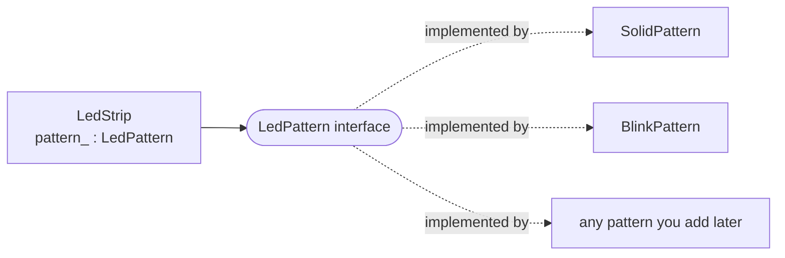
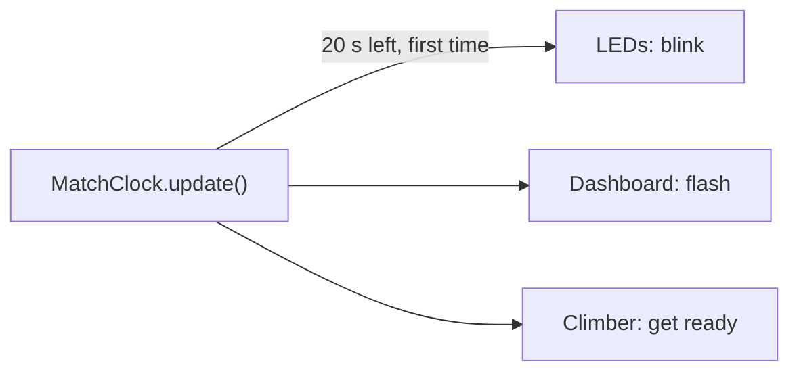

# Design Patterns

:::tip Why this matters on the robot
Robot code keeps hitting the same problems: swap how something works mid-match, tell several mechanisms when a
sensor changes, build the right auto from a name on the dashboard. **Design patterns** are the well-known answers to
those problems. Once you know their names, you'll spot them in WPILib and in our own code.
:::

:::warning Read first
- [Interfaces](./interfaces.mdx): every pattern here holds an object by its interface type.
- [Lambdas](./lambdas.mdx): a lambda is the shortest way to hand a pattern a piece of behavior.
- [Classes and Objects](../basics/classes-objs.mdx), if constructors and fields still feel new.
:::

---

## What a Pattern Is
A design pattern isn't a library you download. It's a **shape** your classes can take, with a name, so programmers
can say "use a factory here" instead of explaining the whole idea.

| Pattern | The problem | The shape |
| --- | --- | --- |
| **Strategy** | "I want to swap *how* this works without a rewrite" | keep the behavior in an interface-typed field |
| **Observer** | "lots of things need to know when this changes" | a list of listeners, each called on a change |
| **Factory** | "I need to build the right object from a name" | one method that turns the name into a new object |
| **Singleton** | "there must only ever be one of these" | a private constructor and a static `getInstance()` |

The first three are built from things you already know: an interface, a field, a list and a method. The new part is
seeing *why* they're arranged that way.

---

## Strategy: Swap the Behavior
Say the robot's LED strip can show different patterns: solid green, blinking orange, off. One way to write it is an
`if` for every pattern inside the strip. Every new pattern means editing the strip again.

The Strategy way: make "a pattern" an interface, write each pattern as its own class, and let the strip hold **one**
of them.

```java
public interface LedPattern {
    String getName();

    // How bright the strip is (0.0 to 1.0) at this point in time.
    double brightness(double time_seconds);
}

public class SolidPattern implements LedPattern {
    public String getName() { return "Solid"; }

    public double brightness(double time_seconds) { return 1.0; }
}

public class BlinkPattern implements LedPattern {
    public String getName() { return "Blink"; }

    public double brightness(double time_seconds) {
        return (time_seconds % 0.5 < 0.25) ? 1.0 : 0.0;   // on for a quarter second, off for a quarter
    }
}
```

The strip doesn't know or care which pattern it has:

```java
public class LedStrip {
    protected LedPattern pattern_;

    public LedStrip(LedPattern starting_pattern) {
        pattern_ = starting_pattern;
    }

    public void setPattern(LedPattern pattern) {
        pattern_ = pattern;
    }

    public double output(double time_seconds) {
        return pattern_.brightness(time_seconds);   // whatever pattern it has, ask it
    }
}

LedStrip strip = new LedStrip(new SolidPattern());
strip.setPattern(new BlinkPattern());   // same strip, new behavior, nothing else changes
```



Adding a rainbow pattern now means writing one new class. `LedStrip` never changes.

### What to watch out for
- The holder must not check **which** strategy it has. No `instanceof`, no `if` on the name. If it does, you've
  rebuilt the `if` chain the pattern was meant to remove.
- Decide what a `null` strategy means. Usually the safe answer is "ignore it and keep the one you have", so the next
  call doesn't crash.

### Clamping a number
Strategies often compute a motor output, and outputs have limits. **Clamping** keeps a number between a low and a high
limit: `Math.max` lifts anything below the low end up, and `Math.min` pulls anything above the high end down.

```java
// The elevator can only travel between 0.0 and 1.2 meters.
double target_meters = Math.max(0.0, Math.min(requested_meters, 1.2));
```

---

## Observer: Tell Everyone Who Cares
When the match clock reaches the endgame, the LEDs should change color, the dashboard should flash, and the climber
should get ready. The clock could call all three directly, but then it has to know about every one of them.

The Observer way: the clock keeps a **list of listeners**. Anything that cares signs up. When the event happens, the
clock calls every listener in the list, in the order they signed up.

```java
import java.util.ArrayList;
import java.util.List;

public class MatchClock {
    protected List<Runnable> endgame_listeners_ = new ArrayList<>();
    protected boolean endgame_started_ = false;

    public void onEndgame(Runnable listener) {
        endgame_listeners_.add(listener);
    }

    // Called every robot loop.
    public void update(double seconds_left) {
        if (!endgame_started_ && seconds_left <= 20.0) {
            endgame_started_ = true;
            for (Runnable listener : endgame_listeners_) {
                listener.run();
            }
        }
    }
}
```

`Runnable` is Java's built-in interface for "a piece of code with no inputs", so each listener can be a lambda:

```java
clock.onEndgame(() -> leds.setPattern(new BlinkPattern()));
clock.onEndgame(() -> System.out.println("Endgame! Climb!"));
```



`update` runs about fifty times a second. The `endgame_started_` flag makes sure the listeners hear about it **once**,
on the loop where it changes, not fifty times a second for the rest of the match.

### What to watch out for
- **Tell listeners about changes, not readings.** Compare the new value with the one you saved; if they're the same,
  call nobody.
- **Update your own state before you call anyone.** A listener might ask the subject "what's your value now?" If
  you haven't saved the new value yet, it gets the old one.
- **Listeners with an input.** When the listener needs to know *what* changed, make your own one-method interface
  (like `void onChange(boolean value)`) instead of `Runnable`. Mark it `@FunctionalInterface` so a lambda fits it.
- **Removing a lambda listener.** `list.remove(listener)` only works with the *same* object you added. Keep the
  lambda in a variable if you'll ever need to take it out.

### Where you've already seen it
WPILib's buttons are the Observer pattern. In our [operator interface code](../../robot_dev/oi.mdx),
`controller.a().onTrue(...)` hands the button a command, and the button runs it when the button changes from
released to pressed.

---

## Factory: Build the Right Object From a Name
The drive team picks an auto on the dashboard, and the robot code gets back a `String`. Somebody has to turn that
string into an object. The **Factory** pattern puts that job in one method, so the rest of the code never needs to
know which classes exist.

Here is a factory for LED patterns that uses a `Map` from each name to a way of building that pattern. `Supplier<T>`
is Java's built-in interface for "something that makes a `T`", and `SolidPattern::new` is a lambda that calls the
constructor. `OffPattern` is one more pattern whose brightness is always 0.0:

```java
import java.util.Map;
import java.util.function.Supplier;

public class LedPatterns {
    protected static final Map<String, Supplier<LedPattern>> MAKERS = Map.of(
        "solid", SolidPattern::new,
        "blink", BlinkPattern::new);

    public static LedPattern fromName(String name) {
        if (name == null) {
            return new OffPattern();
        }
        Supplier<LedPattern> maker = MAKERS.get(name.trim().toLowerCase());
        if (maker == null) {
            return new OffPattern();         // unknown name: a safe default, never null
        }
        return maker.get();                  // a brand-new pattern every time
    }
}
```

A `switch` on a `String` works too, and reads well when there are only a few names:

```java
switch (alliance.trim().toLowerCase()) {
    case "red":
        led_color_ = "red";
        break;
    case "blue":
        led_color_ = "blue";
        break;
    default:
        led_color_ = "white";
}
```

### What to watch out for
- **Never return `null`.** The caller trusts the factory. If it hands back `null`, the robot crashes the first time
  the object is used, which for an auto is the start of the match. Return a safe "do nothing" object instead.
- **Clean up the name first.** `trim()` drops spaces at both ends, and `toLowerCase()` makes `"BLINK"` match
  `"blink"`. Call them on a `null` string and you crash, so check for `null` first.
- **Build a new object each time.** If the factory hands out the same object twice, two users share its fields, and
  one changing it changes the other.

### Where you've already seen it
Our autos are built this way. In the [autonomous code](../../robot_dev/autonomous.mdx), every Arbor node is a **name**
registered with a `BehaviorTreeFactory` together with the Java that runs it, and the robot looks up each name when it
loads a tree. The dashboard **Auto Chooser** lists each auto by its file name.

---

## Singleton: Use Sparingly
A **Singleton** is a class that only ever has one object, which everything reaches through a static method. Our
[subsystems](../../robot_dev/subsystems.mdx) are singletons:

```java
private static ShooterSubsystem instance_ = null;

public static ShooterSubsystem getInstance() {
    if (instance_ == null) {
        instance_ = new ShooterSubsystem();
    }
    return instance_;
}
```

That fits a subsystem: the robot has exactly one shooter, and two `ShooterSubsystem` objects fighting over the same
motors would be a real bug.

But a singleton is a global variable in disguise. Any code anywhere can reach it and change it, and a test can't swap
it for a fake. It also gets built the first time anything asks for it, which can be at a surprising moment: the
autonomous docs warn never to call `getInstance()` in a behavior tree node's constructor, because trees are built in
tests and in the editor with no hardware.

So for your own classes, prefer **passing objects in** through the constructor, the way `LedStrip` takes its pattern.
Reach for a singleton only when there truly can only be one.

---

## Choosing a Pattern

| If you catch yourself writing... | Try |
| --- | --- |
| a long `if`/`else` on "which mode am I in?" that keeps growing | Strategy |
| a sensor class that calls the LEDs, then the intake, then the dashboard by name | Observer |
| `new` for one of several classes, chosen by a string, copied in three places | Factory |
| a static field "so everything can get at it" | pass the object in instead, or a Singleton if there's really one |

Patterns are tools, not goals. A class with one behavior that will never change doesn't need a Strategy.

---

## Common Mistakes
- **Not actually implementing the interface.** A class with the right methods but no `implements` can't be stored in
  a field of the interface type. Add `implements LedPattern` (or whatever the interface is) to the class line.
- **Checking the type inside the holder.** `instanceof` or an `if` on `getName()` in the class that holds the strategy
  defeats the pattern. Just call the method.
- **Forgetting to clamp.** Adding two stick values can give more than 1.0. Clamp both sides of anything you send to
  a motor.
- **Notifying every loop.** Listeners should hear about a change once, not fifty times a second.
- **Saving the new value after the notify loop.** Listeners that read the subject see stale data.
- **Calling `trim()` or `toLowerCase()` on `null`.** Check `null` first.
- **Returning `null` or a shared object from a factory.** Return a safe default, and build a new object each time.
- **Comparing strings with `==`.** Use `.equals(...)` or a `switch`; `==` checks whether they're the same object, not
  the same text.

---

## Quick Reference

| Idea | Java |
| --- | --- |
| hold a strategy | `protected LedPattern pattern_;` |
| use it | `pattern_.brightness(time_seconds)` |
| swap it | `pattern_ = new BlinkPattern();` |
| clamp between limits | `Math.max(low, Math.min(value, high))` |
| list of listeners | `protected List<Runnable> listeners_ = new ArrayList<>();` |
| sign up with a lambda | `clock.onEndgame(() -> ...);` |
| notify everyone | `for (Runnable listener : listeners_) { listener.run(); }` |
| one-method listener interface | `@FunctionalInterface interface ... { void onChange(boolean value); }` |
| clean up a name | `name.trim().toLowerCase()` |
| switch on a string | `switch (name) { case "solid": ... break; default: ... }` |
| constructor as a lambda | `SolidPattern::new` (a `Supplier<LedPattern>`) |
| singleton | `private static X instance_;` plus `public static X getInstance()` |

:::tip Practice in Scriptum
Load the **Design Patterns** lesson in the Java Advanced track.
:::
