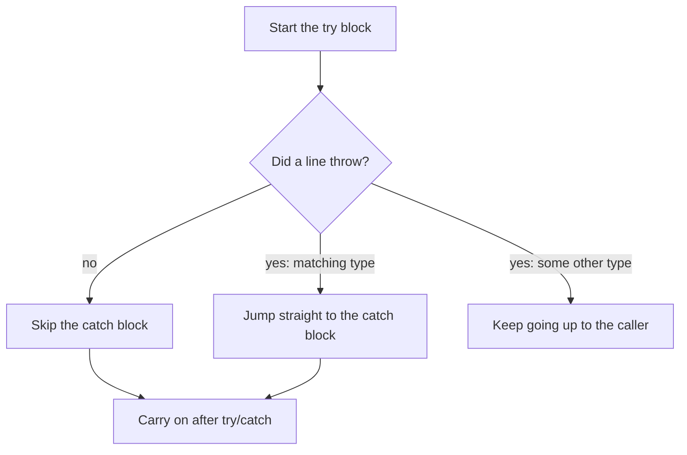
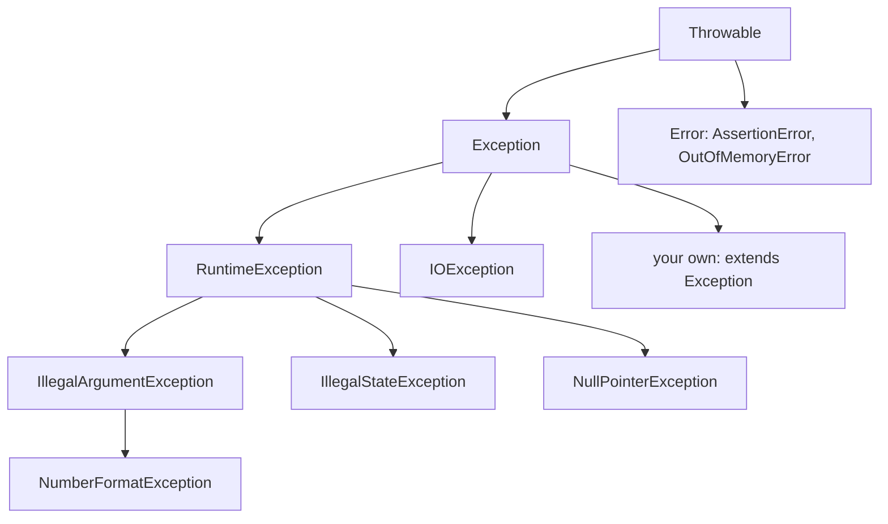

# Exceptions
:::tip Why this matters on the robot
Robot code runs 50 times a second for a whole match, and a crashed robot just sits there. Code that reads a camera, a
sensor or a file catches the exceptions they throw and carries on with a safe choice. And when something goes wrong
in auto, `finally` makes sure the motors stop.
:::
:::warning Read first
This page builds classes with constructors, fields and `extends`. Read
[Classes and Objects](../basics/classes-objs.mdx) first.
:::

An **exception** is an object that means "something went wrong here". Code **throws** an exception to stop and report
a problem. Other code **catches** it to deal with the problem instead of crashing. You've already seen exceptions when a
program crashed with a red message like `ArrayIndexOutOfBoundsException`. This page shows how to make them work for
you.

---

## What a crash really is
When code throws an exception and nothing catches it, Java stops the program and prints a **stack trace**:

```text
Exception in thread "main" java.lang.NumberFormatException: For input string: "twelve"
    at java.lang.Integer.parseInt(Integer.java:652)
    at ConfigReader.readCanId(ConfigReader.java:8)
    at Main.main(Main.java:5)
```

Read it from the top:
- The first line is the exception's **type** (`NumberFormatException`) and its **message** (`For input string:
  "twelve"`).
- Each `at` line is a method that was running, newest first. The first line that names **your** file is usually where
  to look: here, line 8 of `ConfigReader.java`.

---

## Throwing an exception
Use `throw` when your code is handed something that can't be right. It stops the method on the spot, so nothing after
it runs.

```java
public class Elevator {
    protected double max_height_m_;

    public Elevator(double max_height_m) {
        if (max_height_m <= 0.0) {
            throw new IllegalArgumentException("max height must be positive, got " + max_height_m);
        }
        max_height_m_ = max_height_m;
    }
}
```

`IllegalArgumentException` is Java's built-in exception for "a parameter has a bad value". Checking in the constructor
means a broken `Elevator` object can never exist: either the numbers are good, or there's no object at all.

**What to watch out for:**
- Put the checks **before** you store anything. Once the field is set, the bad value is already in.
- Write a message that says what was wrong **and** what the value was. `"max height must be positive, got -1.0"` is
  much faster to fix than `"bad input"`.
- Read the rule carefully for the edge. "Positive" means `0` is bad; "can't be negative" means `0` is fine.

---

## Catching an exception
A `try` block holds code that might throw. A `catch` block says what to do if it does.

```java
int can_id;
try {
    can_id = Integer.parseInt(text);
} catch (NumberFormatException e) {
    System.out.println("Not a CAN ID: " + e.getMessage());
    can_id = 0;
}
```



- If nothing throws, the `catch` block is skipped.
- If a line throws, the rest of the `try` block is skipped and Java jumps to the `catch` block whose type matches.
- `e` is the exception object. `e.getMessage()` gives its message.
- If no `catch` matches, the exception keeps going up to whoever called this method.

`Integer.parseInt(text)` turns text like `"12"` into the number `12`. For text that isn't a whole number, like
`"twelve"` or `"1.5"`, it throws a `NumberFormatException`. `Double.parseDouble` does the same for decimals.

### Several catch blocks
One `try` can have several `catch` blocks, one per kind of problem. Java checks them **top to bottom** and runs the
first one that matches.

```java
try {
    double gear_ratio = Double.parseDouble(ratio_text);
    gearbox = new Gearbox(gear_ratio);
} catch (NumberFormatException e) {
    System.out.println("Gear ratio isn't a number: " + ratio_text);
} catch (IllegalArgumentException e) {
    System.out.println("Gearbox refused it: " + e.getMessage());
}
```

**What to watch out for:** a `catch` for a type also catches every type that `extends` it. `NumberFormatException`
extends `IllegalArgumentException`, so the more specific one must come **first**. In the other order, Java won't even
compile it, because the second `catch` could never run.

---

## The exception family tree
Every exception is a class, and they're arranged by `extends`:



The big split is between **checked** and **unchecked** exceptions:

| | Checked | Unchecked |
|---|---|---|
| Extends | `Exception` (but not `RuntimeException`) | `RuntimeException` |
| Means | A problem callers should plan for: a missing file, a bad line of data | Usually a bug: `null`, a bad index |
| Java makes callers... | catch it, or write `throws` to pass it on | do nothing; catching is optional |
| Examples | `IOException`, your own `extends Exception` | `IllegalArgumentException`, `NullPointerException` |

Catching `RuntimeException` catches every unchecked exception, whatever its exact type.

---

## `throws`: warning the caller
A method that can throw a checked exception must say so with `throws` after its parameter list:

```java
public static double readOffset(String text) throws CalibrationException {
    // ...
}
```

Now every caller has two choices, and Java won't compile until it picks one:
1. **Catch it** with `try`/`catch`.
2. **Pass it on** by writing `throws CalibrationException` on its own method too.

That's the point of a checked exception: nobody can forget the problem might happen.

---

## Writing your own exception
Built-in exceptions say *what kind* of thing went wrong. Your own exception can carry *your* details too. It's an
ordinary class that extends `Exception` (checked) or `RuntimeException` (unchecked):

```java
public class CalibrationException extends Exception {
    protected String sensor_name_;

    public CalibrationException(String message, String sensor_name) {
        super(message);
        sensor_name_ = sensor_name;
    }

    public String getSensorName() {
        return sensor_name_;
    }
}
```

- `super(message)` hands the message to `Exception`, so `getMessage()` works like it does for any exception. It must
  be the first line of the constructor.
- The extra field stores whatever the catcher needs to know: here, which sensor failed.

Throw and catch it like any other:

```java
try {
    double offset = readOffset(config_line);
} catch (CalibrationException e) {
    System.out.println(e.getSensorName() + " not calibrated: " + e.getMessage());
}
```

### Turning one exception into another
Sometimes you catch a low-level exception and throw your own instead, with the details your caller cares about:

```java
try {
    return Double.parseDouble(text.trim());
} catch (NumberFormatException e) {
    throw new CalibrationException("offset isn't a number: \"" + text + "\"", "arm encoder");
}
```

Your caller now only has to handle one exception type, and it says which sensor and what text was wrong.

---

## Keep going: catch inside a loop
To read many items and skip the bad ones, put the `try`/`catch` **inside** the loop. A bad item is handled, and the loop
moves on to the next one.

```java
int bad_count = 0;
for (int i = 0; i < offsets.length; i++) {
    try {
        total += readOffset(offsets[i]);
    } catch (CalibrationException e) {
        bad_count++;
    }
}
```

If the `try` wraps the whole loop instead, the first bad item jumps out of the loop and everything after it is lost.

Two `String` methods help when reading typed text:
- `text.split(",")` cuts text at each comma and returns a `String[]` of the pieces. `"1,2,3"` gives 3 pieces.
- `text.trim()` removes spaces from both ends. `" 2 "` becomes `"2"`. `text.trim().isEmpty()` is `true` for a line
  that's blank or only spaces.

---

## `finally`: code that always runs
A `finally` block runs after the `try`, whatever happened: the `try` finished, threw, or even hit a `return`.

```java
public static boolean runIntake(Intake intake) {
    try {
        intake.spinUntilLoaded();
        return true;
    } catch (IllegalStateException e) {
        System.out.println("Intake failed: " + e.getMessage());
        return false;
    } finally {
        intake.stopRollers();
    }
}
```

| What happens in `try` | Runs next | Then |
|---|---|---|
| Finishes and returns `true` | `finally` (rollers stop) | the method returns `true` |
| Throws `IllegalStateException` | `catch`, then `finally` | the method returns `false` |
| Throws something not caught | `finally` | the exception goes up to the caller |

This is the safety net for motors: if `stopRollers()` were at the end of the `try`, a throw would skip it and the
rollers would keep spinning.

:::info try-with-resources
You may also meet `try (FileReader reader = new FileReader("matches.csv")) { ... }`. It closes the file for you when
the block ends, like a built-in `finally`.
:::

---

## Common mistakes
- **Storing the value, then checking it.** Checks go first, before any field is set.
- **Getting the edge wrong.** "0 or less" and "less than 0" are different rules; one allows `0`, the other doesn't.
- **Extending the wrong class.** A checked exception extends `Exception`. Extending `RuntimeException` makes it
  unchecked, and Java stops reminding callers to handle it.
- **Forgetting `super(message)`.** Without it, `getMessage()` returns `null`.
- **Catching the parent before the child.** `catch (IllegalArgumentException e)` above
  `catch (NumberFormatException e)` won't compile.
- **Missing a way the input can be bad.** Text can have too few pieces, too many, a piece that isn't a number, or a
  number that's out of range. Each one needs to end in the same exception.
- **Putting the loop inside the `try`.** The first bad item ends the whole loop. Put the `try` inside the loop.
- **Treating a blank line as bad.** Blank isn't wrong, it's empty: skip it before trying to read it.
- **Stopping the motors only in the `try` or only in the `catch`.** Put the stop in `finally` so it runs either way.

---

## Quick reference

| You want to... | Write |
|---|---|
| Refuse a bad value | `throw new IllegalArgumentException("what was wrong, got " + value);` |
| Handle a problem | `try { ... } catch (SomeException e) { ... }` |
| Read the message | `e.getMessage()` |
| Always run cleanup | `finally { ... }` after the `try`/`catch` |
| Make a checked exception | `public class MyException extends Exception` with `super(message)` |
| Make an unchecked exception | `public class MyException extends RuntimeException` |
| Warn callers | `void readIt() throws MyException` |
| Text to a whole number | `Integer.parseInt(text)` (throws `NumberFormatException`) |
| Split and tidy text | `text.split(",")`, `text.trim()`, `text.trim().isEmpty()` |

:::tip Practice in Scriptum
Load the **Exceptions** lesson in the Java Advanced track.
:::
