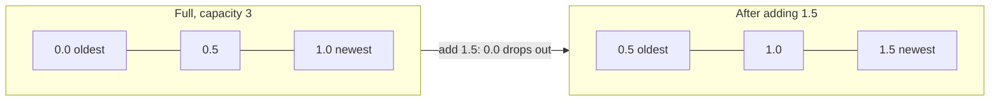

# Generics
:::tip Why this matters on the robot
Generics are everywhere in robot code. Every `ArrayList` of subsystems and `HashMap` of AprilTag poses is a generic
class someone wrote once so that everyone could use it for anything. Filters that smooth a noisy sensor keep a buffer of
its last readings, and WPILib's lookup tables (distance to shooter speed) are generic in both their key and value.
:::
:::warning Read first
This page builds on `ArrayList` and `HashMap`. Read [Collections](./collections.mdx) first.
:::

In the Collections lesson you wrote `ArrayList<Integer>` and `HashMap<Integer, String>`. The type in the angle brackets
told the collection what it holds. That's **generics**, and on this page you write generic code of your own.

---

## The problem generics solve
The robot wants to remember the time of its last gyro reading. The driver station wants to remember the time of its
last alert. Same job, different types: a `Double` and a `String`. Without generics you have two bad choices.

**Write it twice**, once per type:

```java
public class TimedDouble { protected Double value_; protected double time_s_; /* ... */ }
public class TimedString { protected String value_; protected double time_s_; /* ... */ }
```

**Write it once with `Object`**, which can hold anything, and lose track of what's inside:

```java
public class TimedValue {
    protected Object value_;
    // ...
    public Object getValue() { return value_; }
}

TimedValue heading = new TimedValue(1.57, 3.2);
double radians = (Double) heading.getValue(); // you have to cast, and you'd better be right
String oops = (String) heading.getValue();    // compiles, then crashes with ClassCastException
```

Generics give you the third choice: write it **once**, and let Java keep track of the type for you.

---

## A generic class
After the class name, put a **type parameter** in angle brackets, like `<T>`. `T` is a blank that stands for "some
type, chosen later". Inside the class, use `T` anywhere you'd write a type: a field, a parameter or a return type.

```java
public class TimedValue<T> {
    protected T value_;
    protected double time_s_;

    public TimedValue(T value, double time_s) {
        value_ = value;
        time_s_ = time_s;
    }

    public T getValue() {
        return value_;
    }

    public double getTime() {
        return time_s_;
    }
}
```

When you **use** the class, you fill in the blank:

```java
TimedValue<Double> heading = new TimedValue<>(1.57, 3.2);
TimedValue<String> alert = new TimedValue<>("Arm stalled", 41.0);

double radians = heading.getValue(); // a Double comes out: no cast
String text = alert.getValue();      // a String comes out
String oops = heading.getValue();    // compile error: caught before the program runs
```

The `<>` on the right is called the **diamond**. Java copies the type from the left side, so you don't write it twice.

**What to watch out for:** `time_s_` is a plain `double` on purpose. Only use `T` for the parts that change from one
use to the next.

---

## Type parameters take classes, not primitives
The blank can only be filled with a class. For numbers and booleans, use the wrapper class:

| Primitive | Write this in `<...>` |
|---|---|
| `int` | `Integer` |
| `double` | `Double` |
| `boolean` | `Boolean` |
| `char` | `Character` |

`ArrayList<int>` is a compile error; `ArrayList<Integer>` works. Java converts between `int` and `Integer` for you
(**autoboxing**), so you can still pass `4143` and get back something you can do math with.

---

## More than one type parameter
A class can have several blanks, separated by commas. Each one is its own type, so the values can be different types.

```java
public class Tagged<K, V> {
    protected K key_;
    protected V value_;

    public Tagged(K key, V value) {
        key_ = key;
        value_ = value;
    }

    public K getKey() { return key_; }
    public V getValue() { return value_; }
}

Tagged<Integer, String> tag = new Tagged<>(7, "Blue speaker");
Tagged<String, Double> limit = new Tagged<>("arm max", 2.1);
```

By habit, type parameters are single capital letters:

| Letter | Usually means |
|---|---|
| `T` | "type": the one thing a container holds |
| `E` | "element", as in `ArrayList<E>` |
| `K`, `V` | "key" and "value", as in `HashMap<K, V>` |
| `A`, `B` | a first and second value of any two types |

**What to watch out for:** the order matters. `Tagged<Integer, String>` and `Tagged<String, Integer>` are different
types.

---

## A generic class wrapped around a collection
Generic classes often keep an `ArrayList` inside, using the same `T`:

```java
import java.util.ArrayList;

public class History<T> {
    protected ArrayList<T> items_ = new ArrayList<>();

    public void record(T item) {
        items_.add(item);
    }

    public T first() {
        if (items_.isEmpty()) {
            return null;
        }
        return items_.get(0);
    }
}
```

`History<Double>` keeps headings and `History<String>` keeps alerts. Because `items_` is an `ArrayList<T>`, everything
that goes in or comes out is checked as a `T`.

### Keeping only the newest few
A **ring buffer** (or circular buffer) is a container with a fixed size that keeps only the newest items. When it's
full, adding one more pushes the oldest one out. Filters use one to average a sensor's last few readings.



WPILib has one, `CircularBuffer<T>`, that `LinearFilter` uses to smooth sensor values.

---

## A generic method
Sometimes only one method needs a type blank, not a whole class. Put the type parameter just **before the return type**:

```java
public static <T> T middle(List<T> items) {
    return items.get(items.size() / 2);
}
```

Read it as "for any type `T`, take a list of `T` and give back one `T`". The `<T>` comes first so Java knows what `T`
means in the rest of the line.

When you call it, you don't write the type. Java looks at the arguments and works `T` out itself (**type inference**):

```java
List<String> autos = List.of("Amp side", "Center", "Source side");
String pick = ListUtil.middle(autos);           // T is String

List<Double> distances_m = List.of(1.2, 2.8, 4.1);
double mid_m = ListUtil.middle(distances_m);    // T is Double
```

When two parameters use the same `T`, Java makes sure they match:

```java
public static <T> List<T> repeat(T item, int count) {
    List<T> result = new ArrayList<>();
    for (int i = 0; i < count; i++) {
        result.add(item);
    }
    return result;
}
```

**What to watch out for:** a method that takes `List<Object>` is **not** generic. A `List<String>` can't be passed to
it, and what comes out is only an `Object`. Use `<T>` and `List<T>` instead.

---

## Bounded types: "any type that can..."
With a plain `<T>`, Java knows nothing about `T`, so it only lets you do things every object can do. You can't add two
`T`s or compare them, because not every type can be compared.

A **bound** narrows the blank. `<T extends Comparable<T>>` means "any type `T`, as long as a `T` can be compared with
another `T`". `Integer`, `Double` and `String` all qualify. Now you can call `compareTo`:

```java
public static <T extends Comparable<T>> T clamp(T value, T low, T high) {
    if (value.compareTo(low) < 0) {
        return low;
    }
    if (value.compareTo(high) > 0) {
        return high;
    }
    return value;
}

double speed = ListUtil.clamp(1.4, -1.0, 1.0);            // 1.0
String name = ListUtil.clamp("Zebra", "Alpha", "Mango");  // "Mango"
```

### Reading `compareTo`
`a.compareTo(b)` answers with an `int`:

| Result | Means | For numbers | For `String`s |
|---|---|---|---|
| negative | `a` comes before `b` | `a` is smaller | `a` is earlier in alphabetical order |
| `0` | equal | same value | same text |
| positive | `a` comes after `b` | `a` is bigger | `a` is later in alphabetical order |

**What to watch out for:** compare the result with `0`, never with `1` or `-1`. The number can be any size;
`"Zebra".compareTo("Alpha")` is `25`.

The word is always `extends` in a bound, even though `Comparable` is an interface.

---

## Generics in robot code
You'll meet these in WPILib and the robot project:

| Generic type | What it holds |
|---|---|
| `ArrayList<E>`, `List<E>` | a list of subsystems, waypoints, scores |
| `HashMap<K, V>` | AprilTag ID to field pose, motor name to CAN ID |
| `Pair<A, B>` (WPILib) | two related values, like a distance and a shooter speed |
| `CircularBuffer<T>` (WPILib) | the last few readings of a sensor |
| `Optional<T>` | a value that might be missing, like the alliance color before the match starts |
| `Supplier<T>` | a lambda that returns a `T` when asked, like `() -> encoder.getPosition()` |

---

## Common mistakes
- **Leaving `Object` in the signature.** The starter code uses `Object`; changing only the body isn't enough. The class
  line or method line itself needs the `<T>`.
- **Putting the method's `<T>` in the wrong place.** It goes after `static` and before the return type:
  `public static <T> T name(...)`, not `public static T <T> name(...)`.
- **Writing `int` or `double` in the brackets.** Use `Integer` and `Double`.
- **Forgetting the empty case.** Calling `get` on an empty list throws `IndexOutOfBoundsException`. Check `isEmpty()`
  first and return what the rule says to.
- **Off-by-one at the end of a list.** The last index is `size() - 1`, not `size()`.
- **Mixing up oldest and newest.** In a list you add to at the end, index `0` is the oldest item.
- **Using `> 0` vs `>= 0` without thinking about ties.** Which one you pick decides whether a tie keeps the earlier
  item or the later one. Read the rule.
- **Comparing `compareTo` with `1`.** Compare with `0`.
- **Calling `compareTo` on a plain `<T>`.** It won't compile until `T` has the bound `extends Comparable<T>`.

---

## Quick reference

| You want to... | Write |
|---|---|
| A generic class | `public class Box<T> { protected T item_; }` |
| Two type parameters | `public class Tagged<K, V>` |
| Use a generic class | `Box<Double> box = new Box<>(1.57);` |
| A generic method | `public static <T> T pick(List<T> items)` |
| A bounded type | `<T extends Comparable<T>>` |
| Compare two `T`s | `a.compareTo(b) < 0`, `== 0`, `> 0` |
| Numbers in brackets | `Integer`, `Double`, `Boolean` |
| Last item of a list | `items.get(items.size() - 1)` (check `isEmpty()` first) |

:::tip Practice in Scriptum
Load the **Generics** lesson in the Java Advanced track.
:::
