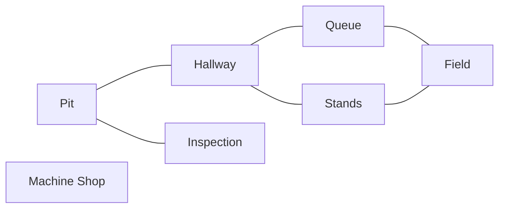

# Graphs

:::tip Why this matters on the robot
When the robot drives itself around the field, something has to work out a route around the field elements. Path
planners do that by searching a **graph**. A [state machine](../../controls/state-machines.mdx) is a graph too: each state
is a node, and each allowed change is an edge.
:::

:::warning Read first
- [Trees](./trees.mdx): nodes, children and recursion. A graph is a tree with the rules taken off.
- [Stacks and Queues](./stacks-queues.mdx): the two searches on this page are the same loop, run with a stack or with a
  queue.
:::

---

## Nodes and Edges
A **graph** is a set of **nodes** joined by **edges**. Here is the venue at an event. Each place is a node, and each
hallway or door you can walk through is an edge:



Two nodes joined by an edge are **neighbors**. Pit's neighbors are Hallway and Inspection.

| | Tree | Graph |
| --- | --- | --- |
| a top node | one root | none needed |
| links into a node | exactly one parent (except the root) | any number |
| loops | never | allowed (Hallway, Queue, Field, Stands, back to Hallway) |
| every node connected | yes | not always (nobody can walk to the Machine Shop) |

Those last two rows are what make graph code different from tree code. A search can go round a loop forever, and some
nodes can't be reached at all.

---

## Kinds of Edges

| Kind | Meaning | Example |
| --- | --- | --- |
| **undirected** | the edge goes both ways | a hallway: walk it either way |
| **directed** | the edge goes one way only | a state machine: **INTAKE** can change to **STOW**, but not back |
| **weighted** | each edge has a cost | a lane on the field that is 4.2 meters long |

This page uses undirected edges with no weights. Counting edges along a path (the **hops**) is the cost.

---

## Storing a Graph: the Adjacency List
The usual way to store a graph is a `Map` from each node to the `List` of its neighbors. This is called an
**adjacency list**:

```java
Map<String, List<String>> venue_ = new LinkedHashMap<>();
```

```text
"Pit"          -> [Hallway, Inspection]
"Hallway"      -> [Pit, Stands, Queue]
"Machine Shop" -> []
```

An undirected edge shows up **twice**: Hallway is in Pit's list, and Pit is in Hallway's list. A node with no edges
still gets a key, with an empty list.

Here is a one-way edge, the kind a state machine uses. It only touches one list:

```java
protected Map<String, List<String>> transitions_ = new HashMap<>();

// INTAKE may change to STOW. Says nothing about STOW changing to INTAKE.
public void addTransition(String from, String to) {
    if (!transitions_.containsKey(from)) {
        transitions_.put(from, new ArrayList<>());
    }
    transitions_.get(from).add(to);
}
```

| Way to store | What it is | Good when |
| --- | --- | --- |
| adjacency list | `Map<String, List<String>>`, each node to its neighbors | most graphs; few edges per node |
| adjacency matrix | a 2D `boolean[][]`, `true` where two nodes are joined | small graphs, many "joined?" checks |
| grid | a 2D array of open and blocked squares; neighbors are the squares next door | path planning on a field |

### What to watch out for
- Calling `put(name, new ArrayList<>())` on a key that already exists **replaces** its list and throws away its edges.
  Check `containsKey` first.
- `map.get(name)` returns `null` for a name that isn't a key. Code that loops over the result crashes. For a read,
  `map.getOrDefault(name, List.of())` hands back an empty list instead.
- A `List` happily holds the same name twice. If an edge can be added more than once, check `list.contains(...)`.

---

## Searching Needs a Visited Set
"Can I get from the Pit to the Field?" To answer, start at the Pit, visit its neighbors, then their neighbors, and so
on. The catch is the loop. From Hallway you reach Queue, then Field, then Stands, then
Hallway again, then Queue again...

The fix is a **`Set`** of nodes you've already visited. A `Set` holds each value at most once and answers "is this in
here?" quickly.

```java
Set<String> visited = new HashSet<>();
visited.add("Pit");
visited.contains("Pit");     // true
visited.add("Pit");          // already there: returns false, nothing changes
```

Before you visit a node, check the set. If it's there, skip it.

---

## Depth-First Search
A **depth-first search** (DFS) goes as far as it can down one route, then backs up and tries the next one, like
exploring a maze with one hand on the wall. You can write it with recursion, which uses Java's own call stack:

```java
// Prints every place you can walk to from start, in depth-first order.
public static void walkFrom(Map<String, List<String>> venue, String place, Set<String> visited) {
    if (visited.contains(place)) {
        return;                             // been here: stop, or the loop never ends
    }
    visited.add(place);
    System.out.println(place);
    for (String next : venue.getOrDefault(place, List.of())) {
        walkFrom(venue, next, visited);
    }
}
```

Or you can do the same thing with a loop and your own **stack** (a `Deque` used with `push` and `pop`): push the
start, then keep popping a node, skipping it if visited, marking it, and pushing its neighbors. The stack version
can't overflow on a huge graph, which is why it's the one most code uses.

Once a search finishes, the `visited` set is every node you can reach from the start. Anything **not** in it is cut off.

---

## Breadth-First Search
A **breadth-first search** (BFS) spreads out like ripples in a pond: everything 1 hop away first, then everything
2 hops away, then 3. It uses a **queue** (first in, first out) instead of a stack.

From the Pit:

| Hops | Places reached |
| --- | --- |
| 0 | Pit |
| 1 | Hallway, Inspection |
| 2 | Stands, Queue |
| 3 | Field |
| never | Machine Shop |

Because it goes in rings, the **first** time BFS reaches a node is by a route with the fewest hops. Here's a BFS that
records how many hops each place is from the start:

```java
public static Map<String, Integer> hopsFrom(Map<String, List<String>> venue, String start) {
    Map<String, Integer> hops = new HashMap<>();
    Deque<String> queue = new ArrayDeque<>();
    hops.put(start, 0);
    queue.addLast(start);
    while (!queue.isEmpty()) {
        String place = queue.removeFirst();
        for (String next : venue.getOrDefault(place, List.of())) {
            if (!hops.containsKey(next)) {      // the hops map doubles as "visited"
                hops.put(next, hops.get(place) + 1);
                queue.addLast(next);
            }
        }
    }
    return hops;
}
```

### What to watch out for
- Mark a node as seen **when you add it to the queue**, not when you take it out. Otherwise the same node can be added
  many times before it's processed.
- `addLast` with `removeFirst` is a queue. `push` with `pop` is a stack. Mixing them (say `push` with `removeLast`)
  gives you something that isn't quite either.

---

## Rebuilding the Route
`hopsFrom` tells you *how far*, not *which way*. To get the route, remember where you **came from** instead: a
`Map` from each node to the node you were standing on when you first reached it. Walking from the Pit to the Field
leaves this trail:

| Node | Came from |
| --- | --- |
| Hallway | Pit |
| Inspection | Pit |
| Stands | Hallway |
| Queue | Hallway |
| Field | Queue |

Read it backwards from the goal: Field came from Queue, Queue from Hallway, Hallway from the Pit. Turn that around and
you have the route: Pit, Hallway, Queue, Field. If the goal never made it into the map, there is no route.

(Stands to Field is also 3 hops. When two routes tie, BFS finds whichever one its neighbor lists happen to reach first.)

---

## DFS or BFS?

| | Depth-first | Breadth-first |
| --- | --- | --- |
| holds the nodes to try in | a stack (or recursion) | a queue |
| explores | one route all the way, then backs up | every node 1 hop away, then 2, then 3 |
| "can I get there at all?" | yes | yes |
| "which nodes are cut off?" | yes | yes |
| "fewest hops to get there?" | **no**, the first route it finds may be long | **yes** |

---

## On the Robot
A path planner splits the field into a grid of small squares. Each open square is a node, and each step to a square
next door is an edge. It searches that graph for the best way around the field elements. Real planners use **A\***
("A star"), a bigger cousin of BFS that counts real distances in meters and tries the squares that look closer to the
goal first.

The robot's own code is full of smaller graphs. A [state machine](../../controls/state-machines.mdx) is a directed graph
of states. A [behavior tree](../../controls/behavior-trees.mdx) is a graph with the tree rule (one parent per node) put
back on.

---

## Common Mistakes
- **No visited set.** The search goes round a loop until the program hangs or runs out of memory.
- **Adding an undirected edge to only one list.** A can reach B, but B can't reach A, and searches from B give the
  wrong answer.
- **Wiping a node's edges.** `put` on a key that's already there replaces its list. Guard with `containsKey`.
- **Duplicate neighbors.** Joining the same two nodes twice lists them twice unless you check first.
- **Returning `null` for a node that isn't in the map.** The caller loops over it and crashes. Return an empty list.
- **Forgetting the edge cases.** A node can always reach itself. A node that isn't on the map can't reach anything and
  can't be reached. Test both.
- **Using a stack when you need the fewest hops.** Only BFS (a queue) promises the shortest route by hops.
- **Building the route in the wrong order.** Walking the trail back from the goal gives the route backwards. Add each
  step to the front of the list, or reverse it at the end.
- **Unsorted output.** If the answer has to be in alphabetical order, call `Collections.sort(list)` before returning.

---

## Quick Reference

| Idea | Java |
| --- | --- |
| adjacency list | `Map<String, List<String>> graph = new LinkedHashMap<>();` |
| is it a node? | `graph.containsKey(name)` |
| neighbors, never `null` | `graph.getOrDefault(name, List.of())` |
| already a neighbor? | `graph.get(a).contains(b)` |
| visited set | `Set<String> visited = new HashSet<>();` then `add`, `contains` |
| stack (DFS) | `Deque<String> stack = new ArrayDeque<>();` then `push`, `pop` |
| queue (BFS) | `Deque<String> queue = new ArrayDeque<>();` then `addLast`, `removeFirst` |
| came-from trail | `Map<String, String> came_from = new HashMap<>();` |
| add to the front of a list | `list.add(0, item)` |
| sort a list | `Collections.sort(list)` |
| fewest hops | breadth-first search |

:::tip Practice in Scriptum
Load the **Graphs** lesson in the Java Advanced track.
:::
