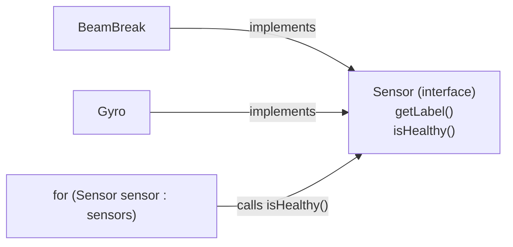
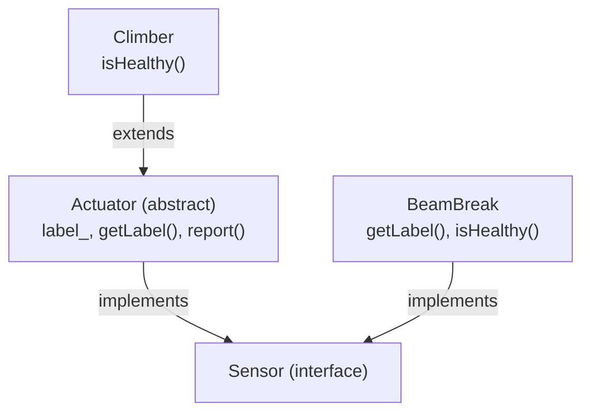

# Interfaces & Polymorphism
:::tip Why this matters on the robot
Robot code is full of interfaces. Every subsystem promises the same methods, so the robot can update all of them in
one loop, and WPILib's motor controllers share an interface, so the same drive code works with different brands of
motor. Once you can read and write an interface, most of the "magic" in robot code turns into plain Java.
:::

:::warning Read first
This page builds on [Classes and Objects](../basics/classes-objs.mdx), especially constructors, `extends` and
`super`. You should also be comfortable with [Loops](../basics/loops.mdx) and [Arrays](../basics/arrays.mdx).
:::

A drive motor, an LED strip and an intake are very different classes. Sometimes you want one method that works with
all of them, like a method that checks every part on the robot before a match. This page shows the three Java tools
that make that possible: **interfaces**, **abstract classes**, and the idea that ties them together,
**polymorphism**.

---

## An interface is a promise
An **interface** is a list of methods with no code inside them. It says: "any class that signs up will have these
methods." It is not a class, and you can't make one with `new`.

```java title="Sensor.java"
// Anything on the robot we can health-check before a match.
public interface Sensor {
    String getLabel();

    boolean isHealthy();
}
```

Each method ends in a semicolon instead of a `{ }` body. The interface says *what* a sensor can do. It says nothing
about *how*, because a gyro and a beam break check their health in completely different ways.

Interface methods are `public` automatically, so you don't write `public` in front of them inside the interface.

---

## `implements`: a class keeps the promise
A class signs up for an interface with the `implements` keyword. Then it has to write every method the interface
lists, with a body.

```java title="BeamBreak.java"
public class BeamBreak implements Sensor {
    protected int channel_;
    protected boolean wired_ = true;

    public BeamBreak(int channel) {
        channel_ = channel;
    }

    @Override
    public String getLabel() {
        return "Beam break " + channel_;
    }

    @Override
    public boolean isHealthy() {
        return wired_;
    }
}
```

`@Override` above a method tells Java "this method comes from somewhere else (here, the interface)". It is optional,
but always write it: if you misspell the method name, Java gives you an error instead of quietly making a new method.

### What to watch out for
- The method in the class must match the interface **exactly**: same name, same return type, same parameter types.
  `public int isHealthy()` does not keep the promise of `boolean isHealthy()`.
- The class's methods must be `public`. Leaving `public` off is a compile error, because the interface's methods are
  public.
- A class that says `implements Sensor` but forgets a method won't compile. The error names the missing method, so
  read it.

---

## One type, many shapes
Here is the useful part. Once `BeamBreak` and `Gyro` both implement `Sensor`, a variable of type `Sensor` can hold
either one.

```java
Sensor front = new BeamBreak(0);
Sensor heading = new Gyro("Pigeon");
```

That means one array can hold different kinds of parts, and one loop can treat them all the same way:

```java
Sensor[] sensors = { new BeamBreak(0), new BeamBreak(1), new Gyro("Pigeon") };

for (Sensor sensor : sensors) {
    System.out.println(sensor.getLabel() + " healthy? " + sensor.isHealthy());
}
```

When the loop calls `sensor.isHealthy()`, Java runs **that object's own** version: the beam break's code for a beam
break, the gyro's code for a gyro. This is **polymorphism** ("many shapes"): one call, and each class answers for
itself.



The code that loops never needs to know which classes exist. Add a `LimitSwitch implements Sensor` next season and the
loop works with it without changing a line.

---

## The for-each loop
The loop above is a **for-each loop**. It visits each item of an array in turn, without an index.

```java
for (Sensor sensor : sensors) {
    // sensor is sensors[0], then sensors[1], then sensors[2]
}
```

Read it as "for each `Sensor` called `sensor` in `sensors`". Use it when you need every item and don't care about the
position. Use a normal `for (int i = 0; ...)` loop when you need the index, or need to compare an item with the one
next to it.

A for-each loop over an empty array runs zero times, which is often exactly what you want.

---

## Writing a method that takes the interface
Polymorphism really pays off in methods. If a parameter's type is the interface, the method works with every class
that implements it.

```java
public static int countUnhealthy(Sensor[] sensors) {
    int count = 0;
    for (Sensor sensor : sensors) {
        if (!sensor.isHealthy()) {
            count++;
        }
    }
    return count;
}
```

Notice what this method does **not** do: it never asks "is this a beam break or a gyro?" It calls `isHealthy()` and
lets each object answer. If you find yourself writing `instanceof` checks or `if (sensor.getLabel().equals(...))` to
decide what to do, the logic belongs inside each class's own method instead.

---

## Abstract classes: halfway between
Sometimes several classes share real code, not only method names. Every mechanism has a name, for example, and the
name code is the same each time. Copying it into every class is wasteful.

An **abstract class** sits between an interface and a normal class:

| | Interface | Abstract class | Normal class |
| --- | --- | --- | --- |
| Has fields | No (only constants) | Yes | Yes |
| Has method bodies | No | Some | All |
| Can you `new` it? | No | No | Yes |
| A class uses it with | `implements` (many allowed) | `extends` (only one) | `extends` (only one) |
| Use it for | a promise many unrelated classes keep | shared code for a family of classes | a finished thing |

```java title="Actuator.java"
public abstract class Actuator implements Sensor {
    protected String label_;

    public Actuator(String label) {
        label_ = label;
    }

    @Override
    public String getLabel() {
        return label_;
    }
}
```

`Actuator` says `implements Sensor`, writes `getLabel()` once for everyone, and **leaves out** `isHealthy()`. A normal
class can't skip an interface method, but an abstract class can, *because* it isn't finished. Each subclass must write
the missing method.

---

## Calling a method you didn't write
An abstract class can call the method it left out. When the program runs, Java uses whichever subclass the object
really is.

```java
// Inside Actuator
public String report() {
    return label_ + (isHealthy() ? ": OK" : ": CHECK WIRING");
}
```

`Actuator` never writes `isHealthy()`, yet `report()` calls it. That works because nobody can ever make a plain
`Actuator`; every real object is some subclass that did write it.

Here is a subclass:

```java title="Climber.java"
public class Climber extends Actuator {
    protected double position_meters_ = 0.0;

    public Climber(String label) {
        super(label);
    }

    @Override
    public boolean isHealthy() {
        return position_meters_ >= 0.0;
    }
}
```

`Climber` only writes what is special about it. Its constructor hands the label up to `Actuator` with `super(label)`,
and it gets `getLabel()` and `report()` for free.



A `Climber` is an `Actuator` *and* a `Sensor`, so it fits in the same `Sensor[]` array as a `BeamBreak`.

### What to watch out for
- `super(label)` must be the **first** line of the subclass constructor.
- Don't re-write `getLabel()` in the subclass. It already has the one from `Actuator`; a second copy is extra code to
  keep in sync.
- `new Actuator("x")` is a compile error. That is on purpose.

---

## Common mistakes
- **Giving interface methods a body.** Inside an interface, a method line ends in `;`, not `{ }`.
- **Forgetting `implements`.** A class can have the right methods but still not be a `Sensor` until it says
  `implements Sensor`. Without it, the object won't go into a `Sensor[]` array.
- **Mismatched signatures.** Returning `int` where the interface says `double`, or a different method name
  (`getAmp` vs `getAmps`). `@Override` catches these, which is why you always write it.
- **Missing `abstract`.** If a class leaves out an interface method, it must be `abstract`, or it won't compile.
- **Checking the kind of object.** Using `instanceof` or comparing names inside a loop instead of calling the
  interface method. Let each class answer for itself.
- **Forgetting the empty case.** A method that loops over an array should still return something sensible when the
  array has no items. Decide what that is before you write the loop, and don't read `array[0]` until you know the
  array isn't empty.
- **Getting ties wrong when looking for the biggest.** If you keep "the best so far", `>` keeps the first of two equal
  items and `>=` keeps the last. Read the task to see which one it wants.

---

## Quick reference
| You want to | Write |
| --- | --- |
| Declare a promise | `public interface Sensor { boolean isHealthy(); }` |
| Keep the promise | `public class Gyro implements Sensor { ... }` |
| Mark a method from an interface or superclass | `@Override` on the line above it |
| Keep more than one promise | `class Arm implements Sensor, Loggable` |
| Share code but leave a method unwritten | `public abstract class Actuator implements Sensor` |
| Build on an abstract class | `public class Climber extends Actuator` |
| Call the superclass constructor | `super(label);` as the first line |
| Hold any kind of part | `Sensor part = new Climber("Climber");` |
| Visit every item of an array | `for (Sensor sensor : sensors) { ... }` |

:::tip Practice in Scriptum
Load the **Interfaces & Polymorphism** lesson in the Java Advanced track.
:::
