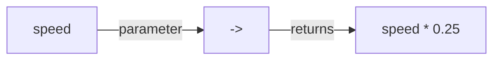
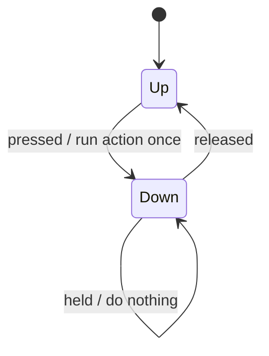

# Lambdas & Functional Interfaces
:::tip Why this matters on the robot
This is how robot code binds buttons and reads joysticks. A line like
`driver_controller_.a().onTrue(Commands.runOnce(() -> robot.setWantedState(RobotStates.INTAKE)))` doesn't change the
state when it runs. It hands the A button a piece of behavior to run *later*, whenever A is pressed.
:::

:::warning Read first
This page builds on [Interfaces & Polymorphism](./interfaces.mdx). A lambda is a short way to implement an interface,
so make sure `interface`, `implements` and `@Override` make sense first.
:::

So far a variable has held a *value*: a number, a string, an object. A **lambda** lets a variable hold *behavior*: a
small piece of code you can pass around and run later.

```java
SpeedLimit slow = speed -> speed * 0.25;   // nothing runs yet
slow.apply(0.8);                           // now it runs: 0.2
```

---

## Functional interfaces
A lambda needs a type, and that type is a **functional interface**: an interface with exactly **one** method.

```java title="SpeedLimit.java"
@FunctionalInterface
public interface SpeedLimit {
    double apply(double speed);
}
```

`@FunctionalInterface` is optional, like `@Override`, but write it. If someone later adds a second method, Java gives
an error right away instead of breaking every lambda somewhere else.

---

## A lambda is a class you didn't have to write
Without lambdas, you'd implement `SpeedLimit` with a whole class:

```java
public class QuarterSpeed implements SpeedLimit {
    @Override
    public double apply(double speed) {
        return speed * 0.25;
    }
}

SpeedLimit slow = new QuarterSpeed();
```

The lambda `speed -> speed * 0.25` means the same thing. Java knows `SpeedLimit` has one method, so it knows the
lambda **is** that method: `speed` is the parameter, and `speed * 0.25` is what it returns.



---

## The shapes of a lambda
| Shape | Example | Notes |
| --- | --- | --- |
| One parameter | `speed -> speed * 0.25` | no parentheses needed |
| No parameters | `() -> intake_.stop()` | empty `()` is required |
| Two parameters | `(left, right) -> (left + right) / 2.0` | parentheses required |
| A body with statements | `speed -> { if (...) { return 0.0; } return speed; }` | needs `{ }`, `return` and `;` |

A one-line lambda returns its expression automatically. Once you add `{ }`, it's like a normal method body: you need
`return` on every path, and semicolons.

```java
SpeedLimit clamp = speed -> {
    if (speed > 0.5) {
        return 0.5;
    }
    if (speed < -0.5) {
        return -0.5;
    }
    return speed;
};
```

Note the `;` after the closing `}`: the whole lambda is the right side of an assignment.

---

## A method that returns a lambda
A method can build a lambda and hand it back. The lambda can use the method's parameters, even after the method has
returned.

```java
public static SpeedLimit capAt(double max) {
    return speed -> Math.min(speed, max);
}

SpeedLimit cap_half = capAt(0.5);
cap_half.apply(0.9);   // 0.5
cap_half.apply(0.2);   // 0.2
```

The lambda "remembers" `max`. This is called **capturing**. Java only lets a lambda capture a local variable or
parameter that never changes after it's set (it is *effectively final*).

---

## Behavior built from behavior
Because a lambda is an object, you can pass lambdas into a method and return a new one that uses them. Java's built-in
`DoubleUnaryOperator` (a `double` in, a `double` out) has this built in as `andThen`:

```java
import java.util.function.DoubleUnaryOperator;

DoubleUnaryOperator square = x -> x * Math.abs(x);
DoubleUnaryOperator cap = x -> Math.min(x, 0.8);

DoubleUnaryOperator gentle = square.andThen(cap);   // square first, then cap
gentle.applyAsDouble(0.5);   // 0.25
gentle.applyAsDouble(1.0);   // 0.8
```

Order matters: "square then cap" and "cap then square" give different answers for `1.0`. When you write a combining
method yourself, decide which runs first and make sure the second one gets the **result** of the first, not the
original input.

---

## Java's built-in functional interfaces
You won't usually write your own functional interface. `java.util.function` has the common ones, and WPILib uses them
everywhere.

| Interface | In | Out | Method you call | Robot example |
| --- | --- | --- | --- | --- |
| `Runnable` | nothing | nothing | `run()` | an action: `() -> intake_.stop()` |
| `BooleanSupplier` | nothing | `boolean` | `getAsBoolean()` | a button: `() -> controller_.b()` |
| `DoubleSupplier` | nothing | `double` | `getAsDouble()` | a stick axis |
| `Supplier<T>` | nothing | a `T` | `get()` | the current pose |
| `Consumer<T>` | a `T` | nothing | `accept(x)` | log a value |
| `Function<T, R>` | a `T` | an `R` | `apply(x)` | convert one type to another |
| `DoubleUnaryOperator` | `double` | `double` | `applyAsDouble(x)` | a joystick curve |

`Runnable` lives in `java.lang`, so it needs no import. The rest need `import java.util.function.<Name>;`.

### What to watch out for
Making a lambda never runs it. To run it, call its method: `action.run()`, `button.getAsBoolean()`,
`curve.applyAsDouble(x)`. Forgetting that call is the most common lambda bug.

---

## Suppliers: a fresh value every time
A **supplier** answers "what is it *right now*?" each time you ask. Compare:

```java
// Read once, when this line runs. Stays the same forever.
double turn_once = -controller_.getRightX();

// Reads the stick again every time getAsDouble() is called.
DoubleSupplier turn_live = () -> -controller_.getRightX();
```

If the drive code is handed `turn_once`, the robot uses whatever the stick said when the robot turned on, every loop.
If it gets `turn_live`, it calls `getAsDouble()` every 20 milliseconds and gets a fresh reading. Robot code passes
suppliers for exactly this reason.

### What to watch out for
Put the stick read **inside** the lambda. `double y = stick(); return () -> y;` captures one old value; it looks like a
supplier but never changes.

---

## Method references
When a lambda only calls one existing method, you can name the method instead. That's a **method reference**, written
with `::`.

| Method reference | Same as |
| --- | --- |
| `controller_::y` | `() -> controller_.y()` |
| `climber_::retract` | `() -> climber_.retract()` |
| `Math::abs` | `x -> Math.abs(x)` |
| `System.out::println` | `x -> System.out.println(x)` |

```java
BooleanSupplier climb_button = controller_::y;
Runnable retract = climber_::retract;
```

There are no parentheses after the method name: `climber_::retract`, not `climber_::retract()`. You're naming the
method, not calling it.

A method reference works only when the parameters line up. `climber_::setHeight` can't be a `Runnable`, because
`setHeight` needs a number and `Runnable` gives it nothing. Use a lambda that supplies the number:
`() -> climber_.setHeight(0.6)`.

---

## Buttons: running an action on a press
A button binding is a pair: a `BooleanSupplier` (is the button down?) and a `Runnable` (what to do). Binding a button
only **stores** the pair. Something else checks it every robot loop.

Usually you want the action to run once per press, not 50 times a second while the button is held. So the checker
remembers last loop's value and acts only on the **rising edge**: false last loop, true now.

| Loop | Button | Last loop | Run the action? |
| --- | --- | --- | --- |
| 1 | up | up | no |
| 2 | down | up | **yes**, just pressed |
| 3 | down | down | no, still held |
| 4 | up | down | no, just released |
| 5 | down | up | **yes**, pressed again |



This is what WPILib's `Trigger.onTrue` does for you on the real robot.

### What to watch out for
- Read the condition **once** per loop into a local variable, then use that value both to decide and to remember.
  Calling `getAsBoolean()` twice can give two different answers.
- Remember the new value every loop, whether or not the action ran. If you only remember it when the action runs, a
  release is never noticed.

---

## Common mistakes
- **Two methods in a functional interface.** A lambda needs exactly one. `@FunctionalInterface` catches this.
- **Missing `return` or `;` in a `{ }` lambda.** A body lambda is a normal method body. Every path returns, and the
  whole assignment ends with `};`.
- **Running the action while binding.** Code that binds a button must store the action, not call `run()`. It runs
  later, from the loop.
- **Reading a value outside the supplier.** The read has to happen inside the lambda so each call gets a fresh value.
- **Chaining in the wrong order, or feeding the original input to the second step.** The second step works on the
  first step's result.
- **Parentheses on a method reference.** `intake_::stop()` doesn't compile; write `intake_::stop`.
- **A method reference where the parameters don't match.** If the method needs an argument the interface doesn't
  give, write a lambda instead.
- **Forgetting the sign of a joystick.** On a real controller, pushing a stick forward gives a **negative** number.
  Flip it inside the supplier.

---

## Quick reference
| You want to | Write |
| --- | --- |
| Declare a one-method interface | `@FunctionalInterface public interface SpeedLimit { double apply(double speed); }` |
| A one-line lambda | `speed -> speed * 0.25` |
| A lambda with no inputs | `() -> intake_.stop()` |
| A lambda with a body | `x -> { if (x < 0) { return 0.0; } return x; }` |
| Run a stored lambda | `limit.apply(x)`, `action.run()`, `button.getAsBoolean()` |
| A method that builds one | `static SpeedLimit capAt(double max) { return s -> Math.min(s, max); }` |
| A live value | `DoubleSupplier y = () -> -controller_.getLeftY();` |
| Name a method instead of a lambda | `intake_::run`, `controller_::a`, `Math::abs` |
| Combine two built-in operators | `first.andThen(second)` |

:::tip Practice in Scriptum
Load the **Lambdas & Functional Interfaces** lesson in the Java Advanced track.
:::
