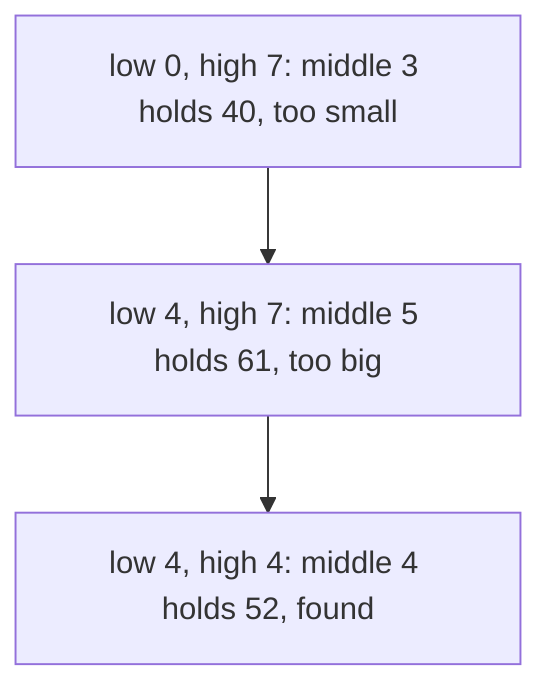

# Searching & Sorting
:::tip Why this matters on the robot
A shooter's lookup table is sorted by distance, so the code can binary-search for the nearest entries instead of
checking every row. Vision code sorts the AprilTags it sees to use the closest or most trusted one. And the pick list at
a competition is your scouting data sorted by a rule your strategy team agreed on.
:::
:::warning Read first
[Big-O & Efficiency](./big-o.mdx), plus [Arrays](../basics/arrays.mdx) and [Loops](../basics/loops.mdx) from Java Basics.
:::

Two jobs come up in almost every program: **finding** an item in a list, and **sorting** a list into order. This page
starts with the simplest way to do each, then shows the faster way and the way real Java code does it.

---

## Linear search: one at a time
**Linear search** checks items one by one from the front and stops the moment it finds a match. It works on any list, in
any order.

```java
// Which CAN ID slot holds this device? -1 means "not found".
int findDevice(List<Integer> can_ids, int wanted_id) {
    for (int i = 0; i < can_ids.size(); i++) {
        if (can_ids.get(i) == wanted_id) {
            return i; // found it: stop looking
        }
    }
    return -1; // only reached after checking every item
}
```

- Best case: the item is first. One look.
- Worst case: it's last, or not there at all. n looks, so linear search is **O(n)**.
- Because it returns at the first match, an item listed twice gives the *earlier* index.

**What to watch out for:** `return -1` goes *after* the loop. If you put it in an `else` inside the loop, the method
gives up after checking only the first item.

:::note `Integer` and `int`
`can_ids.get(i) == wanted_id` is safe because `wanted_id` is a plain `int`: Java turns the `Integer` into an `int`
before comparing. Comparing two `Integer` objects needs `.equals`
(see [Big-O & Efficiency](./big-o.mdx#comparing-integers)).
:::

---

## Binary search: halve it every time
If the list is **sorted**, you can do much better. Look at the middle item:
- It's the one you want: done.
- It's too small: everything to its left is smaller still, so throw the left half away.
- It's too big: throw the right half away.

Each look throws away half of what's left, so 1000 items take about 10 looks and a million take about 20. That's
**binary search**, and it's **O(log n)**.

Here's a search for `52` in a sorted list of 8 numbers:



Three looks instead of five.

---

## Low and high: the two fences
In code, keep two indexes, `low` and `high`, like fences. The item can only be between them, so they start at the two
ends of the list.

| Middle item is... | Move | Why |
| --- | --- | --- |
| the one you want | return its index | done |
| too small | `low = middle + 1` | the item can only be to the right of `middle` |
| too big | `high = middle - 1` | the item can only be to the left of `middle` |

The loop runs `while (low <= high)`. When `low` passes `high`, there's nothing left between the fences, so the item
isn't there.

This variant finds the first lookup-table row at or past a distance: the shooter uses that row and the one before it to
blend between two settings.

```java
// distances_m is sorted, smallest first. Returns distances_m.length if every row is closer.
int firstRowAtOrPast(double[] distances_m, double want_m) {
    int low = 0;
    int high = distances_m.length - 1;
    int answer = distances_m.length;
    while (low <= high) {
        int middle = (low + high) / 2;
        if (distances_m[middle] >= want_m) {
            answer = middle;     // a candidate: look for an earlier one
            high = middle - 1;
        } else {
            low = middle + 1;
        }
    }
    return answer;
}
```

**What to watch out for:**
- Move *one past* the middle. `low = middle` can leave `low` and `high` stuck on the same two items forever.
- `while (low < high)` stops one item early and can miss an item that's there.
- Binary search on an **unsorted** list gives wrong answers with no error. Sort it first, or use linear search.

---

## Selection sort
Now sorting. **Selection sort** works the way many people sort a hand of cards:
1. Look through *all* the items and find the smallest.
2. Swap it into the first spot.
3. Look through the rest for the next smallest, swap it into the second spot, and keep going.

Each pass *selects* one item, which is where the name comes from.

```java
// Sort lap times, fastest (smallest) first.
for (int spot = 0; spot < lap_times_s.length; spot++) {
    int fastest = spot;
    for (int i = spot + 1; i < lap_times_s.length; i++) {
        if (lap_times_s[i] < lap_times_s[fastest]) {
            fastest = i;
        }
    }
    double parked = lap_times_s[spot];
    lap_times_s[spot] = lap_times_s[fastest];
    lap_times_s[fastest] = parked;
}
```

It's a loop inside a loop, so selection sort is **O(n²)**: fine for 40 teams, slow for a million readings.

**What to watch out for:** to sort *largest* first, flip the comparison so each pass hunts for the biggest. And when the
array holds objects, compare a value from each (like a getter) but swap the whole objects.

---

## Swapping needs a spare variable
To swap two items you need somewhere to park one of them. Without it, the first copy overwrites a value you still need.

```java
// Wrong: both slots end up holding modes[3].
modes[0] = modes[3];
modes[3] = modes[0];

// Right: park one, copy, put the parked one back.
String parked = modes[0];
modes[0] = modes[3];
modes[3] = parked;
```

The spare variable has the same type as the items: a `String` for a `String[]`, a `double` for a `double[]`, an object
type for an array of objects.

---

## Insertion sort
**Insertion sort** takes each item in turn and slides it left past every item bigger than it, until it sits in the right
spot. Everything to its left is always already sorted.

```java
// Sort battery voltages, lowest first.
for (int i = 1; i < voltages.length; i++) {
    double voltage = voltages[i];
    int k = i - 1;
    while (k >= 0 && voltages[k] > voltage) {
        voltages[k + 1] = voltages[k]; // shift the bigger one right
        k--;
    }
    voltages[k + 1] = voltage;
}
```

Insertion sort is also **O(n²)** at worst, but on a list that's already *nearly* sorted it's close to O(n), because
each item only slides a short way.

---

## Sorting the real way: `List.sort`
Writing a sort teaches you how sorting works. Real code uses Java's own: `list.sort(...)` for a `List` and
`Arrays.sort(...)` for an array. They are **O(n log n)**, far faster than O(n²) on big lists, and well tested.

| Sort | Big-O | 1,000 items | Use it when |
| --- | --- | ---: | --- |
| selection sort | O(n²) | about 500,000 compares | learning how sorting works |
| insertion sort | O(n²), close to O(n) if nearly sorted | up to about 500,000 | small or nearly sorted lists |
| `List.sort`, `Arrays.sort` | O(n log n) | about 10,000 | everything else |

What Java's sort can't know is *what order you want*. You tell it with a **`Comparator`**: an object that looks at two
items and says which one comes first.

---

## Building a Comparator
`Comparator.comparingInt(...)` builds one from a method that pulls a number out of each item. `TagSighting::getId` is a
**method reference**: it means "call `getId()` on each sighting".

```java
import java.util.Comparator;

public class TagSighting {
    private final int id_;
    private final double distance_m_;

    public TagSighting(int id, double distance_m) {
        id_ = id;
        distance_m_ = distance_m;
    }

    public int getId() { return id_; }
    public double getDistanceMeters() { return distance_m_; }
}

// Closest tag first.
sightings.sort(Comparator.comparingDouble(TagSighting::getDistanceMeters));

// Farthest tag first: .reversed() flips the order.
sightings.sort(Comparator.comparingDouble(TagSighting::getDistanceMeters).reversed());
```

Use `comparingInt` for an `int`, `comparingDouble` for a `double`, and `comparing` for anything else that has a natural
order, like a `String`.

---

## Breaking ties
Two tags the same distance away? Without a rule, either could come first. `.thenComparingInt(...)` adds a second rule
that only matters when the first one ties.

```java
// Closest first. Same distance: lower tag ID first.
Comparator<TagSighting> best_first = Comparator.comparingDouble(TagSighting::getDistanceMeters)
    .thenComparingInt(TagSighting::getId);
```

Ties matter: everyone should get the *same* answer from the same data, every time.

**What to watch out for:** `.reversed()` flips *everything that comes before it* in the chain. If you want one rule
reversed and the tie-breaker not, put `.reversed()` straight after the rule it should flip, before you add the
tie-breaker.

```java
// Farthest first. Same distance: lower tag ID first.
Comparator<TagSighting> far_first = Comparator.comparingDouble(TagSighting::getDistanceMeters)
    .reversed()
    .thenComparingInt(TagSighting::getId);
```

---

## Copy before you sort
`sort` changes the list it's called on. If someone handed you that list, they may not want it shuffled. And a list made
with `List.of(...)` can't be changed at all: sorting it throws an `UnsupportedOperationException`.

```java
List<TagSighting> sorted = new ArrayList<>(sightings); // a copy you own
sorted.sort(best_first);
return sorted; // sightings is untouched
```

`new ArrayList<>(list)` makes a new list holding the same items, in one O(n) pass.

---

## Common mistakes
- **`return -1` inside the loop.** A linear search that returns "not found" from an `else` only ever checks the first
  item.
- **A binary search that checks every item.** If your loop visits items one by one, it's a linear search with extra
  steps. Each look must throw away half.
- **`low = middle` or `high = middle`.** The fences never pass each other, and the loop can run forever.
- **`while (low < high)`.** It stops with one item left unchecked.
- **Swapping without a spare variable.** One value is overwritten and lost.
- **Sorting the numbers instead of the objects.** Compare by a getter, but move the whole object.
- **Using `Arrays.sort` when the job is to write the sort yourself.** The point of a by-hand sort is the loops.
- **`.reversed()` in the wrong place.** Put last, it flips the tie-breaker too.
- **Sorting the list you were given.** Copy it first; a `List.of(...)` list crashes when sorted.
- **Forgetting the imports.** `ArrayList` and `Comparator` both live in `java.util`.

---

## Quick reference
| Task | Code | Big-O |
| --- | --- | --- |
| find in any list | a loop that returns at the first match, `-1` after | O(n) |
| find in a sorted list | binary search with `low`, `high`, `middle` | O(log n) |
| sort by hand | selection sort or insertion sort | O(n²) |
| sort a list | `list.sort(comparator)` | O(n log n) |
| sort an array | `Arrays.sort(array)` | O(n log n) |
| copy a list | `new ArrayList<>(list)` | O(n) |

| Comparator piece | Does |
| --- | --- |
| `Comparator.comparingInt(Thing::getNumber)` | smallest number first |
| `Comparator.comparingDouble(Thing::getValue)` | smallest `double` first |
| `.reversed()` | flips everything before it |
| `.thenComparingInt(Thing::getOther)` | breaks ties with a second rule |

:::tip Practice in Scriptum
Load the **Searching & Sorting** lesson in the Java Advanced track.
:::
