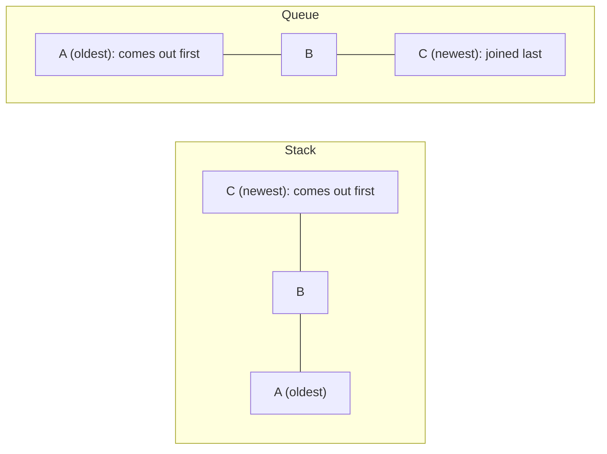
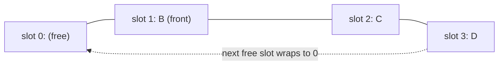

# Stacks & Queues
:::tip Why this matters on the robot
A command sequence runs its steps in the order you wrote them, and log messages go out in the order they happened:
those are queues. Anything nested, from brackets in a typed-in auto to the methods that called each other before a
crash (the "stack trace"), is tracked with a stack.
:::
:::warning Read first
[Collections](./collections.mdx) (`ArrayList` and generics like `ArrayList<Double>`), plus [Arrays](../basics/arrays.mdx)
and [Operators](../basics/operators.mdx) from Java Basics.
:::

A list lets you reach any item you like. Sometimes that's more freedom than you want. Stacks and queues are simpler: you
can only add at one place and take from one place. The only difference between them is **which item comes out next**.

| Shape | Comes out next | Also called | Think of | Robot example |
| --- | --- | --- | --- | --- |
| **stack** | the *newest* item | last in, first out (LIFO) | a pile of plates | Undo, nested brackets |
| **queue** | the *oldest* item | first in, first out (FIFO) | the line at a food truck | auto steps, log messages |



---

## `ArrayDeque`: one class, both shapes
Java's `ArrayDeque` (say "array deck") can be used as either. "Deque" is short for **d**ouble-**e**nded **que**ue: you
can add and take at both ends. Which methods you call decides which shape you get.

```java
import java.util.ArrayDeque;

ArrayDeque<String> menus_ = new ArrayDeque<>();
```

| Job | As a stack | As a queue |
| --- | --- | --- |
| add | `push(x)`: on top | `offer(x)`: at the back |
| take the next one off | `pop()`: the top | `poll()`: the front |
| look without taking | `peek()` | `peek()` |
| empty? / how many? | `isEmpty()`, `size()` | `isEmpty()`, `size()` |
| take from an empty one | `pop()` **crashes** | `poll()` returns `null` |

Like `ArrayList`, an `ArrayDeque` holds objects, so a deque of numbers is `ArrayDeque<Double>` or
`ArrayDeque<Integer>`, and a deque of characters is `ArrayDeque<Character>`. Adding, taking and peeking are all
**O(1)**.

---

## Stacks: push, pop and peek
A **stack** works like a pile of plates. `push` puts a plate on top. `pop` takes the top plate off and hands it to you.
`peek` looks at the top plate without taking it.

Here the dashboard has nested menus, and a Back button returns to the menu you came from.

```java
ArrayDeque<String> menus_ = new ArrayDeque<>();
String screen_ = "Home";

void open(String menu) {
    menus_.push(screen_); // remember where we were
    screen_ = menu;
}

void back() {
    if (!menus_.isEmpty()) {
        screen_ = menus_.pop(); // the newest one we left
    }
}
```

Open **Tuning**, then **Shooter**, then press Back twice: you see **Tuning**, then **Home**. The newest screen you left
comes back first.

**What to watch out for:**
- `pop()` on an empty deque throws a `NoSuchElementException` and crashes the program. Check `isEmpty()` first.
- Save the value you're *leaving* before you change it. Change first and the old value is gone.

---

## Matching pairs with a stack
Stacks are good at checking anything that nests. The rule: the newest thing that opened must be the first to close.
That's exactly the item on top of a stack.

Read the text left to right:
1. Something **opens**: push it.
2. Something **closes**: it must match the item on top. If the stack is empty, or the top is a different kind, the text
   is wrong. If it matches, pop it.
3. At the **end**, the stack must be empty. Anything left was opened and never closed.

Here is `(a[b)]` checked that way:

| Read | Stack (top on the right) | What happens |
| --- | --- | --- |
| `(` | `(` | opener: push |
| `a` | `(` | not a bracket: skip |
| `[` | `( [` | opener: push |
| `b` | `( [` | skip |
| `)` | `( [` | closer, but `[` is on top: **not balanced** |

A plain counter ("+1 for open, -1 for close") can't catch that mistake: it only knows *how many* are open, not *which
kind* is newest.

### `char` and looping over a `String`
A `char` is one character, written in single quotes: `'('`. Double quotes make a `String`. `text.toCharArray()` turns
a `String` into a `char[]`, so a for-each loop can visit each character.

```java
// Count how many times the driver pressed each button in a recorded string like "AABXA".
int a_presses = 0;
for (char c : recording.toCharArray()) {
    if (c == 'A') {
        a_presses++;
    }
}
```

Compare `char`s with `==`. A stack of them is `ArrayDeque<Character>`.

---

## Queues: offer and poll
A **queue** works like the line at a food truck. You join at the **back**, and the person at the **front** is served
next. `offer` adds at the back. `poll` takes the front item off and hands it to you.

Here LED patterns are requested during a match and played one after another, in the order they were asked for.

```java
ArrayDeque<String> led_patterns_ = new ArrayDeque<>();

void request(String pattern) {
    led_patterns_.offer(pattern);
}

String nextPattern() {
    if (led_patterns_.isEmpty()) {
        return "solid team color";
    }
    return led_patterns_.poll();
}
```

`poll()` on an empty queue returns `null` instead of crashing. If the rest of your code wants a real word instead of
`null`, check `isEmpty()` first and return that word yourself.

---

## Don't mix the ends
`push` and `pop` both work at the **front** of the deque. `offer` adds at the **back**, and `poll` takes from the
**front**.

```java
led_patterns_.push("flash green");
led_patterns_.push("flash red");
led_patterns_.poll(); // "flash red": the NEWEST one
```

Add with `push` and take with `poll`, and your queue has quietly become a stack. Pick one pair and stick to it:

| Want | Add with | Take with |
| --- | --- | --- |
| stack (newest first) | `push` | `pop` |
| queue (oldest first) | `offer` | `poll` |

---

## A queue built from an array
`ArrayDeque` does a lot for you. To see how, you can build a queue out of a plain array. The array is a row of slots
that never grows, so you track two numbers:
- **front**: the slot whose item comes out next.
- **count**: how many items are in.

The back of the line is `count` slots after the front. When that runs past the end of the array, it **wraps round** to
slot `0`, like a clock going from 12 back to 1.



### Wrapping with `%`
`%` gives the remainder after dividing: `5 % 4` is `1`, `4 % 4` is `0`, `3 % 4` is `3`. So `(i + 1) % length` steps
through `0, 1, 2, 3, 0, 1, ...` and never leaves the array.

### A different shape: overwrite the oldest
This buffer keeps the last few gyro readings for smoothing. Unlike a line of game pieces, it never refuses a reading:
when it's full, the newest reading overwrites the oldest.

```java
public class RecentReadings {
    private double[] readings_rad_;
    private int next_; // the slot the next reading goes in
    private int count_;

    public RecentReadings(int capacity) {
        readings_rad_ = new double[capacity];
    }

    public void add(double reading_rad) {
        readings_rad_[next_] = reading_rad;
        next_ = (next_ + 1) % readings_rad_.length; // wrap round
        if (count_ < readings_rad_.length) {
            count_++;
        }
    }

    public double average() {
        if (count_ == 0) {
            return 0.0;
        }
        double total_rad = 0.0;
        for (int i = 0; i < count_; i++) {
            total_rad += readings_rad_[i];
        }
        return total_rad / count_;
    }
}
```

Robot code uses fixed arrays like this because it can't afford to make new objects every 20 milliseconds. The array is
made once, in the constructor, and reused forever.

**What to watch out for:**
- Decide what "full" means *before* you write anything: `count == length`. A queue that must not overwrite has to
  check that first and refuse.
- Taking an item means three things: read the front slot, move front along one (wrapped), and make count one smaller.
  Forget any one and the queue drifts.
- A new `String[]` or `double[]` already has `length` slots, filled with `null` or `0.0`. Its `length` is the
  capacity, not how many items you've added; that's what `count` is for.

---

## Common mistakes
- **Popping an empty stack.** `pop()` crashes on an empty `ArrayDeque`. Check `isEmpty()` first.
- **Saving the new value instead of the old one.** For an undo history, the value to save is the one you're about to
  replace.
- **Mixing the ends.** `push` with `poll` (or `offer` with `pop`) turns a queue into a stack, or the other way round.
- **Returning `null` when the code wants a word.** `poll()` gives `null` on an empty queue; check first if you need
  something else.
- **Checking brackets with a counter.** It can't tell `(]` from `()`. Use a stack and compare the *kind* of bracket.
- **Forgetting the end check.** Text with an opener that's never closed leaves something on the stack. It's only
  balanced if the stack is empty at the end.
- **Forgetting to wrap.** An index that runs past the end of the array crashes with `ArrayIndexOutOfBoundsException`.
  Wrap it with `%`.
- **Using `length` as the count.** The array's `length` never changes; `count` is how many items are in it.
- **Missing the import.** `ArrayDeque` lives in `java.util`.

---

## Quick reference
| Code | Does |
| --- | --- |
| `ArrayDeque<Double> d = new ArrayDeque<>();` | make an empty deque |
| `d.push(x)` / `d.pop()` | stack: add on top / take the top off (crashes when empty) |
| `d.offer(x)` / `d.poll()` | queue: add at the back / take the front off (`null` when empty) |
| `d.peek()` | look at the next one without taking it (`null` when empty) |
| `d.isEmpty()`, `d.size()` | anything there? how many? |
| `'('` | a `char` literal |
| `for (char c : text.toCharArray())` | visit each character of a `String` |
| `(i + 1) % length` | the next index, wrapping round to `0` |

| Use a... | When the next item out should be... |
| --- | --- |
| stack | the newest one: undo, back buttons, anything nested |
| queue | the oldest one: steps in order, messages, game pieces in a line |
| array with front and count | the oldest one, with a fixed size and no new objects |

:::tip Practice in Scriptum
Load the **Stacks & Queues** lesson in the Java Advanced track.
:::
