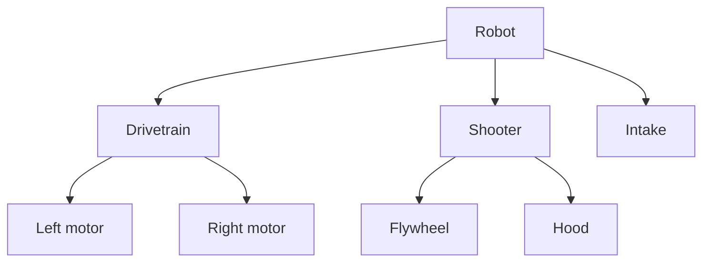
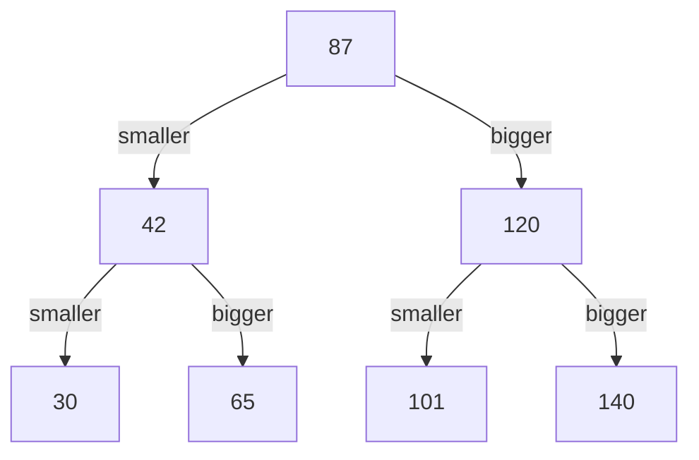
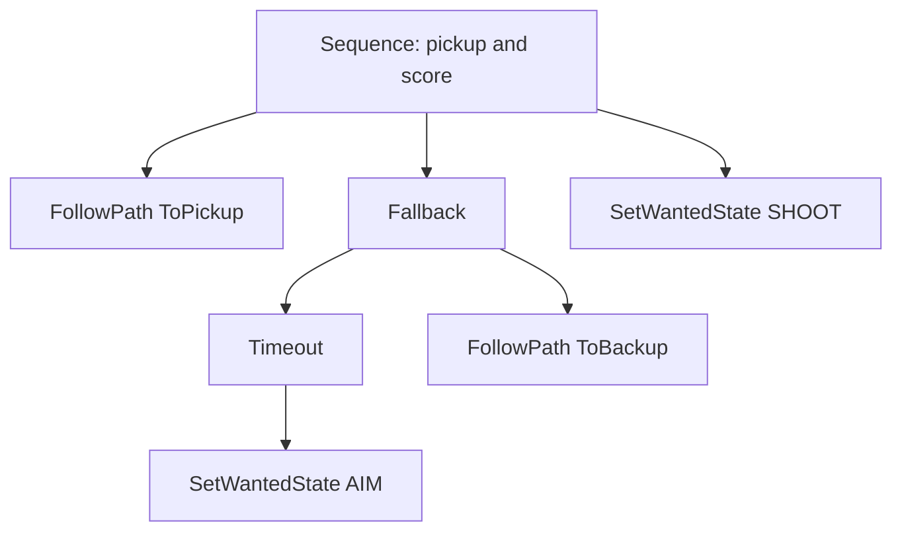

# Trees

:::tip Why this matters on the robot
Our autonomous routines are [behavior trees](../../controls/behavior-trees.mdx), built in [Arbor](../../tools/arbor.mdx).
Every time the robot runs an auto, it walks a tree from the top down, the same kind of walk you write on this page.
Search trees show up behind the scenes too: Java's `TreeMap` is one.
:::

:::warning Read first
- [Methods](../basics/methods.mdx): every tree method on this page is a method that calls itself (**recursion**).
- [Stacks and Queues](./stacks-queues.mdx): a list is a line of things. A tree is what you get when the line branches.
:::

---

## What a Tree Is
A list puts things in a line, one after another. A **tree** branches. Each item, called a **node**, can point at
other nodes below it. Computer trees grow upside down: the top is the **root**.



| Word | Meaning | In the picture |
| --- | --- | --- |
| **node** | one item in the tree | every box |
| **root** | the node at the very top; it has no parent | Robot |
| **child** | a node directly below another | Drivetrain is a child of Robot |
| **parent** | the node directly above | Shooter is the parent of Flywheel |
| **leaf** | a node with no children | Left motor, Hood, Intake |
| **subtree** | a node plus everything below it | Shooter, Flywheel and Hood |
| **height** | how many nodes are on the longest path from the top to the bottom | 3 (Robot, Shooter, Hood) |

Every node except the root has exactly **one** parent. That rule is what makes it a tree. (Drop the rule and you get a
[graph](./graphs.mdx).)

---

## A Class That Holds Itself
In Java, a node is an object. The trick is that the class has fields of **its own type**. Those fields are the links
to the nodes below.

```java
// One match score in a tree of scores.
public class ScoreNode {
    protected int score_;
    protected ScoreNode lower_;   // null when there is nothing there
    protected ScoreNode higher_;

    public ScoreNode(int score) {
        score_ = score;
    }
}
```

A `ScoreNode` inside a `ScoreNode` looks odd at first, but it's only a link (a reference), not a whole copy. A tree
class then only needs to remember one node, the root:

```java
public class ScoreTree {
    protected ScoreNode root_; // null while the tree is empty
}
```

A tree where each node has at most two children (here `lower_` and `higher_`) is called a **binary tree**.

### What to watch out for
- A link that holds `null` means "nothing down this way". Calling a method or reading a field on `null` crashes with a
  `NullPointerException`. Check `node == null` **before** you touch `node.score_`.
- An empty tree is a tree whose `root_` is `null`. Your methods have to work on it too.

---

## Recursion Fits Trees
Look at any node's `lower_` link. Everything below it is a whole tree on its own, just smaller. So a method can handle
**one** node and then call itself on each side. It stops at the **base case**: a `null` link, where there is nothing
left to look at.

```java
// Adds up every score in the tree.
public int total() {
    return totalBelow(root_);
}

private int totalBelow(ScoreNode node) {
    if (node == null) {
        return 0;                       // base case: nothing here adds nothing
    }
    return node.score_ + totalBelow(node.lower_) + totalBelow(node.higher_);
}
```

Two things are new here:
- The public method `total()` takes no node. It starts a **helper method**, `totalBelow`, at `root_`. The helper is
  `private` because only the tree itself should call it.
- The helper calls itself **twice**, once for each side. Java finishes the whole `lower_` side before it starts the
  `higher_` side.

### What to watch out for
- Put the `null` check first, before any line that reads from `node`.
- Every recursive call must move **down** the tree (`node.lower_`, `node.higher_`). Calling `totalBelow(node)` again
  on the same node never reaches the base case and ends in a `StackOverflowError`.

---

## Binary Search Trees
A **binary search tree** (BST) is a binary tree that follows one rule at every node:

> Everything down the left side is **smaller**. Everything down the right side is **bigger**.

Here are some match scores, put in a BST in the order 87, 42, 120, 30, 65, 101, 140:



To find 65, start at the root and ask one question per node:

| At | Compare | Go |
| --- | --- | --- |
| 87 | 65 is smaller | left |
| 42 | 65 is bigger | right |
| 65 | equal | found it |

Three looks, not seven. Each step throws away a whole side of the tree. If you fall off the bottom (reach `null`), the
number isn't there.

| Finding one item in... | Looks needed (n items) |
| --- | --- |
| an unsorted list | up to $n$ |
| a bushy (balanced) BST | about $\log_2 n$ |
| a BST built from already-sorted input | up to $n$ (it's a long chain) |

That last row matters: put 30, 42, 65, 87 into a BST in that order and every node goes right. The "tree" is a line,
and searching it is no faster than a list.

### Walking one path without recursion
Going down one side doesn't need recursion. A loop works. The smallest score is the one you reach by going left until
you can't:

```java
public int lowest() {
    ScoreNode node = root_;             // assumes the tree isn't empty
    while (node.lower_ != null) {
        node = node.lower_;
    }
    return node.score_;
}
```

---

## Adding to a BST
To add a number, walk down exactly as if you were searching for it. When you hit an empty (`null`) spot, that's where
the new node goes.

Adding 70 to the tree above: 70 is smaller than 87 (go left), bigger than 42 (go right), bigger than 65 (go right),
and `65.higher_` is `null`. The new node goes there.

The neat recursive way to do this is to have the helper **return the node that belongs in the spot it was given**:
- At a `null` spot, that's a brand-new node.
- Anywhere else, it's the same node that was already there, after its left or right side has been updated.

The caller saves whatever comes back into its own link (`node.lower_ = ...` or `node.higher_ = ...`). That
assignment is what hooks the new node on. The public method does the same with `root_`, which is how the very first
item becomes the root.

### What to watch out for
- Decide what happens to a number that's **already** in the tree. A BST of unique items goes neither left nor right
  for an equal number, so nothing is added.
- If the helper builds a new node but nobody stores the returned value, the node is created and then lost.

---

## Walking the Whole Tree
Sometimes you need every node, not one path. A walk that visits every node is called a **traversal**. The three
classic ones differ only in **when** you handle the node itself:

| Traversal | Order | Scores from the tree above | Good for |
| --- | --- | --- | --- |
| pre-order | node, left, right | 87 42 30 65 120 101 140 | copying a tree, printing an outline |
| in-order | left, node, right | 30 42 65 87 101 120 140 | a BST in sorted order |
| post-order | left, right, node | 30 65 42 101 140 120 87 | anything that needs the children's answers first |

In-order on a BST comes out sorted for free: everything smaller is on the left, so it gets visited first.

A pre-order walk that collects the scores into a list. The list is made once and handed down, so every call adds to
the same list:

```java
public ArrayList<Integer> preOrder() {
    ArrayList<Integer> scores = new ArrayList<>();
    addPreOrder(root_, scores);
    return scores;
}

private void addPreOrder(ScoreNode node, ArrayList<Integer> scores) {
    if (node == null) {
        return;
    }
    scores.add(node.score_);            // the node first...
    addPreOrder(node.lower_, scores);   // ...then its left side
    addPreOrder(node.higher_, scores);  // ...then its right side
}
```

### What to watch out for
- Making a `new ArrayList` **inside** the helper gives every call its own list, and the answers never come back up.
- Move one line and you have a different traversal. Check the order against the table.

---

## Height
The **height** of a tree is how many nodes are on its longest path from the root to the bottom. Ask each side how
tall it is, keep the taller one (`Math.max(a, b)` gives the bigger of two numbers), and add one for the node you're
standing on. A `null` side is 0 tall.

| Tree | Height |
| --- | --- |
| empty (`root_` is `null`) | 0 |
| one node | 1 |
| the seven-score tree above | 3 |
| 30, 42, 65, 87 added in sorted order (a chain) | 4 |

Height tells you how bad a search can get. A short, bushy tree is fast to search. A tall, skinny one is slow.

---

## Trees With Any Number of Children
Not every tree is binary. A node can keep a **list** of children instead of two links. Here's a pit checklist, where
a group's time is the time of all the tasks inside it:

```java
import java.util.ArrayList;

public class PitTask {
    protected String name_;
    protected int minutes_;              // only used by tasks with no children
    protected ArrayList<PitTask> children_ = new ArrayList<>();

    public PitTask(String name, int minutes) {
        name_ = name;
        minutes_ = minutes;
    }

    public PitTask add(PitTask child) {
        children_.add(child);
        return this;                     // lets you chain: group.add(a).add(b)
    }

    public int totalMinutes() {
        if (children_.isEmpty()) {
            return minutes_;             // base case: a single task
        }
        int total = 0;
        for (PitTask child : children_) {
            total += child.totalMinutes();
        }
        return total;
    }
}
```

The base case changes shape: there is no `null` link to stop at. A node with an **empty** child list is the bottom.
A `for` loop replaces the "call it on the left, call it on the right" pair.

### What to watch out for
- A group node usually has nothing of its own to count. Only the leaves do the work, and the group adds them up.
- Looping over an empty list runs zero times. Use that: a "biggest child" loop that starts at 0 gives 0 for a leaf,
  with no special case.

---

## Behavior Trees Are Trees
A [behavior tree](../../controls/behavior-trees.mdx) is a tree with any number of children per node. The nodes that
hold other nodes (**Sequence**, **Fallback**, **ParallelDeadline**) are the control flow. The leaves are the actions
that move the robot.



When the robot **ticks** the tree (about fifty times a second), it starts at the root and walks down, asking each
node for its status. That's a recursive walk, like `totalMinutes()`. Counting the leaves tells you how many actions an
auto has. The height tells you how deeply it's nested, which is a fair guess at how hard it is to read. You build these
trees in [Arbor](../../tools/arbor.mdx), not by hand, but knowing they're trees explains why Arbor draws them the way it
does.

---

## TreeMap: A BST You Don't Write
Java ships a search tree you can use today. A `TreeMap` is a `Map` that keeps its keys sorted, because it's a
(self-balancing) binary search tree inside.

```java
import java.util.TreeMap;

TreeMap<Integer, String> match_by_score = new TreeMap<>();
match_by_score.put(140, "Qual 12");
match_by_score.put(87, "Qual 3");
match_by_score.put(120, "Qual 7");

match_by_score.firstKey();      // 87: the lowest score
match_by_score.lastKey();       // 140: the highest
match_by_score.ceilingKey(100); // 120: the lowest score that is at least 100
match_by_score.keySet();        // [87, 120, 140], always in order
```

Use `TreeMap` when you need things sorted or need "the next one up". Use `HashMap` when you only look things up by
exact key; it's a little faster and doesn't keep order.

---

## Common Mistakes
- **Touching a node before checking for `null`.** The crash points at the line that reads the field. Move the `null`
  check above it.
- **Forgetting to store what a recursive insert returns.** The new node is built and then dropped, so the tree never
  grows. The same goes for the root: an empty tree stays empty.
- **Adding a duplicate.** If equal numbers go left or right, the same item ends up in the tree twice and the count is
  off by one.
- **Searching both sides of a BST.** It gives the right answer but throws away the whole point of the BST. Go down only
  the side the number could be on.
- **Off-by-one height.** Decide what an empty tree and a single node return (0 and 1 on this page) and check both.
- **A new list in every recursive call.** Make the list once in the public method and pass it down.
- **Counting group nodes as actions.** In a tree with any number of children, only nodes with no children are leaves.

---

## Quick Reference

| Idea | Java |
| --- | --- |
| node with two links | `protected ScoreNode lower_; protected ScoreNode higher_;` |
| node with any number of children | `protected ArrayList<PitTask> children_ = new ArrayList<>();` |
| empty link or empty tree | `null` |
| base case (binary) | `if (node == null) return ...;` |
| base case (any children) | `if (children_.isEmpty()) return ...;` |
| helper method | `private int totalBelow(ScoreNode node)`, started at `root_` |
| recurse into both sides | `totalBelow(node.lower_) + totalBelow(node.higher_)` |
| recurse into every child | `for (PitTask child : children_) { ... child.totalMinutes() ... }` |
| bigger of two | `Math.max(a, b)` |
| BST rule | smaller goes left, bigger goes right |
| sorted output from a BST | in-order: left, node, right |
| sorted map | `TreeMap<K, V>`: `firstKey()`, `lastKey()`, `ceilingKey(k)` |

:::tip Practice in Scriptum
Load the **Trees** lesson in the Java Advanced track.
:::
