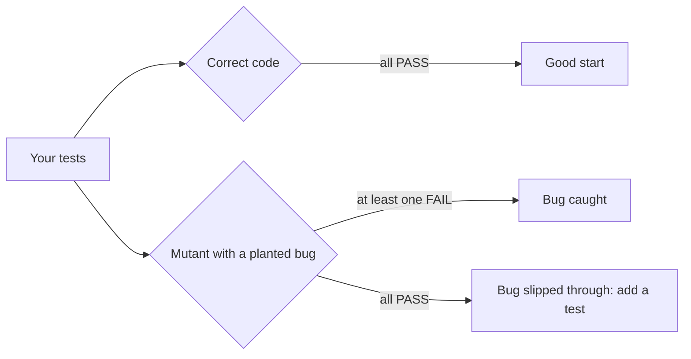

# Unit Testing
:::tip Why this matters on the robot
You can't plug the robot in every time you change a line of math. A bug in a joystick deadband makes the robot creep
across the field, and a bug in a "ready to shoot" check fires the game piece too early. Unit tests catch those on your
laptop in a second, and they keep catching them every time someone changes the code later.
:::
:::warning Read first
This page assumes you can write and call methods with parameters and return values. Read
[Methods](../basics/methods.mdx) first.
:::

Up to now you checked your code by running it and reading what it printed. That works once. Robot code changes every
week, and nobody re-reads every number after every change. A **unit test** is a tiny method that calls one piece of
your code with an input you picked and checks the answer for you. Write it once, and it re-checks the code every time
you run it.

---

## Your first test
A test has three parts: a tag that marks it as a test, a call to the code you're testing, and an **assertion** that
checks the answer.

```java
public class ElevatorMathTest {
    @Test
    void zeroRotationsIsTheBottom() {
        Assertions.assertEquals(0.0, ElevatorMath.rotationsToMeters(0.0), 0.0001);
    }
}
```

- `@Test` is an **annotation**: a tag on the line above a method. The test runner looks for every method tagged
  `@Test` and runs it.
- `Assertions.assertEquals(expected, actual, tolerance)` compares the answer you **expect** with the **actual** answer
  from the code.
- If they match, the test prints `PASS`. If not, the assertion throws an `AssertionError` and the test prints `FAIL`
  with a message like `expected 0.0 but was 0.05`.

Test methods take no parameters and return `void`. Each one checks one idea.

:::info The lesson's kit vs. real JUnit
The Scriptum lesson ships a small copy of **JUnit**, in `Test.java`, `Assertions.java` and `TestRunner.java`, so you can
see how the pieces work. Real robot projects use **JUnit 5**, and the tests look the same. See
[Real JUnit in a robot project](#real-junit-in-a-robot-project) below.
:::

---

## The assertions you'll use
Pick the assertion that matches the kind of answer the code gives.

| Answer type | Assertion | Example |
|---|---|---|
| `double` | `assertEquals(expected, actual, tolerance)` | `assertEquals(0.5, scale(1.0), 0.0001)` |
| `int` or `String` | `assertEquals(expected, actual)` | `assertEquals(3, countBalls())` |
| `boolean` that should be `true` | `assertTrue(condition)` | `assertTrue(isBatteryLow(11.2))` |
| `boolean` that should be `false` | `assertFalse(condition)` | `assertFalse(isBatteryLow(12.6))` |

Every assertion can take a **message** as its last argument. It's printed when the assertion fails, so say what the
test expected in words:

```java
Assertions.assertFalse(BatteryMath.isLow(12.6), "a full battery is not low");
```

---

## Why decimals need a tolerance
Computers store a `double` in binary, so most decimals are stored as a tiny bit off. In Java, `0.1 + 0.2` is
`0.30000000000000004`, not `0.3`. If you compared two `double`s exactly, a correct answer could still fail.

So for decimals you pass a third number, the **tolerance**: how close counts as equal. The test passes when

$$
|\text{expected} - \text{actual}| \le \text{tolerance}
$$

```java
// The drum turns 0.1 m per rotation, so 2.5 rotations is 0.25 m.
Assertions.assertEquals(0.25, ElevatorMath.rotationsToMeters(2.5), 0.0001);
```

**What to watch out for:** a tolerance that is too big hides bugs. With a tolerance of `0.1`, a wrong answer of `0.3`
would pass a test expecting `0.25`. Use something small, like `0.0001`, unless the math really is rough.

---

## Name the test after what it proves
When a test fails, its name is the first thing you read. A good name says what should be true:

| Weak name | Good name |
|---|---|
| `test1` | `squareInputKeepsTheSign` |
| `testElevator` | `rotationsToMetersKeepsTheFraction` |
| `batteryTest` | `fullBatteryIsNotLow` |

A test can hold a few assertions, but they should all check the same idea. If a test named
`squareInputKeepsTheSign` fails, you know where to look before you open the code.

---

## Bugs hide at the edges
A test only helps if it would **fail** when the code is wrong. One test from the middle of the range passes almost every
buggy version. Most bugs live at the **edges**, so test these:

- a normal value,
- zero,
- a negative value,
- a value exactly **on** a limit,
- a value just past the limit, on each side.

Here's a method that squares a joystick value to give finer control at low speed, but keeps the direction:

```java
public static double squareInput(double value) {
    return Math.copySign(value * value, value);
}
```

```java
@Test
void squareInputShrinksSmallValues() {
    Assertions.assertEquals(0.25, JoystickMath.squareInput(0.5), 0.0001);
}

@Test
void squareInputKeepsTheSign() {
    // Backwards must stay backwards: -0.5 squared is 0.25, then the sign comes back.
    Assertions.assertEquals(-0.25, JoystickMath.squareInput(-0.5), 0.0001);
}

@Test
void squareInputKeepsFullSpeed() {
    Assertions.assertEquals(1.0, JoystickMath.squareInput(1.0), 0.0001);
    Assertions.assertEquals(0.0, JoystickMath.squareInput(0.0), 0.0001);
}
```

If someone "simplifies" the method to `return value * value;`, only the negative test fails. Without it, the robot
could never drive backwards and every test would still say `PASS`.

### Exactly on the line
When a rule says "less than" or "at most", the value exactly **on** the line is where `<` and `<=` differ. Say the
elevator is safe from 0.0 m up to and including 1.2 m:

```java
@Test
void topOfTravelIsStillSafe() {
    Assertions.assertTrue(ElevatorMath.isSafeHeight(1.2));
}

@Test
void justPastTheTopIsNotSafe() {
    Assertions.assertFalse(ElevatorMath.isSafeHeight(1.21));
}
```

Read the rule carefully to decide what the answer on the line should be. That one test is what catches a `<` that
should be `<=`.

---

## Work out the answer yourself
Get the expected value from the rules, a calculator or pencil and paper, **not** by running the code and copying what
it prints.

```java
// 4 rotations of a 0.1 m drum: 4 * 0.1 = 0.4 m, worked out by hand.
Assertions.assertEquals(0.4, ElevatorMath.rotationsToMeters(4.0), 0.0001);
```

If the code is wrong and you copy its answer, you've written the bug into your test, and now the test protects the bug.

---

## How good tests are graded: planted bugs
How do you know your tests are good enough? Plant a bug and see if they notice. A **mutant** is a copy of the code with
one small mistake in it, like a `<` turned into `<=` or a minus sign dropped. Run your tests on it:



This is called **mutation testing**, and it's how the Scriptum lesson checks your work. Your tests must pass on the
correct code, and for each planted bug, at least one test must fail. When a bug slips through, the checkpoint tells you
what kind it was, so you know which edge you didn't test.

---

## Red, then green
When you find a bug, don't fix it yet. First write a test that shows it.

1. **Red:** write a test for the case that's wrong. Run it and watch it **FAIL**.
2. **Green:** fix the code. Run it again and watch it **PASS**.
3. Run every test, so the fix didn't break something else.

```text
FAIL fullBatteryIsNotLow: a full battery is not low: expected false but was true
...fix BatteryMath...
PASS fullBatteryIsNotLow
```

Seeing red first proves your test can catch the bug. Seeing green proves the fix works. And the test stays in the
project, so the same bug can never sneak back in. Writing the test first is called **test-driven development**.

---

## Real JUnit in a robot project
The lesson's kit is a small copy of **JUnit 5**, the testing library real Java projects, including WPILib robot
projects, use. The tests look almost the same:

```java
import static org.junit.jupiter.api.Assertions.*;
import org.junit.jupiter.api.Test;

class JoystickMathTest {
    @Test
    void squareInputKeepsTheSign() {
        assertEquals(-0.25, JoystickMath.squareInput(-0.5), 0.0001);
    }
}
```

| | Scriptum lesson kit | Real JUnit 5 |
|---|---|---|
| Mark a test | `@Test` (from `Test.java`) | `@Test` (from `org.junit.jupiter.api`) |
| Assert | `Assertions.assertEquals(...)` | `assertEquals(...)` after `import static` |
| Where tests live | `src/` next to the code | `src/test/java/`, mirroring `src/main/java/` |
| Run them | Run `Main`, which calls `TestRunner` | `./gradlew test` (also runs during a build) |

The `import static` line is why JUnit tests can write `assertEquals` without `Assertions.` in front. The lesson project
has no packages, so it can't use that trick.

**What to watch out for:** unit tests work best on plain math that doesn't touch hardware. Keep conversions, limits and
checks in small `static` methods (like `ElevatorMath` above) so you can test them without a robot.

---

## Common mistakes
- **Copying the code's output into the test.** If the code is wrong, the test is now wrong too. Work it out from the
  rule.
- **Only testing the middle.** A positive value well inside the range passes almost every planted bug. Add zero,
  negatives and values exactly on each limit.
- **Testing only one side of a range.** "Too fast or too slow", "below min or above max": a check that only looks one
  way passes every test from that side. Test both sides, and far away as well as close.
- **Forgetting the fraction.** Whole-number inputs can hide a conversion that rounds or drops the decimals. Try a value
  like `2.5`.
- **Fixing before seeing red.** If you fix the bug first, you never saw your test fail, so you don't know it can.
- **Leaving out the tolerance on a `double`.** Without it, the kit compares the numbers as objects and may fail a
  correct answer. Add a tolerance like `0.0001`.
- **Editing the provided files.** The lesson's checker uses its own copies of the kit and of the correct code, so
  changes there don't help.

---

## Quick reference

| You want to... | Write |
|---|---|
| Mark a method as a test | `@Test` on the line above `void nameOfTheIdea()` |
| Check a decimal | `Assertions.assertEquals(expected, actual, 0.0001)` |
| Check a whole number or `String` | `Assertions.assertEquals(expected, actual)` |
| Check a `boolean` | `Assertions.assertTrue(...)` / `Assertions.assertFalse(...)` |
| Explain a failure | Add a message as the last argument |
| Find bugs | Test zero, negatives, exactly-on-the-line and both sides |
| Fix a bug | Red (failing test) first, then green (fix) |
| Run tests in a robot project | `./gradlew test` |

:::tip Practice in Scriptum
Load the **Unit Testing** lesson in the Java Advanced track.
:::
