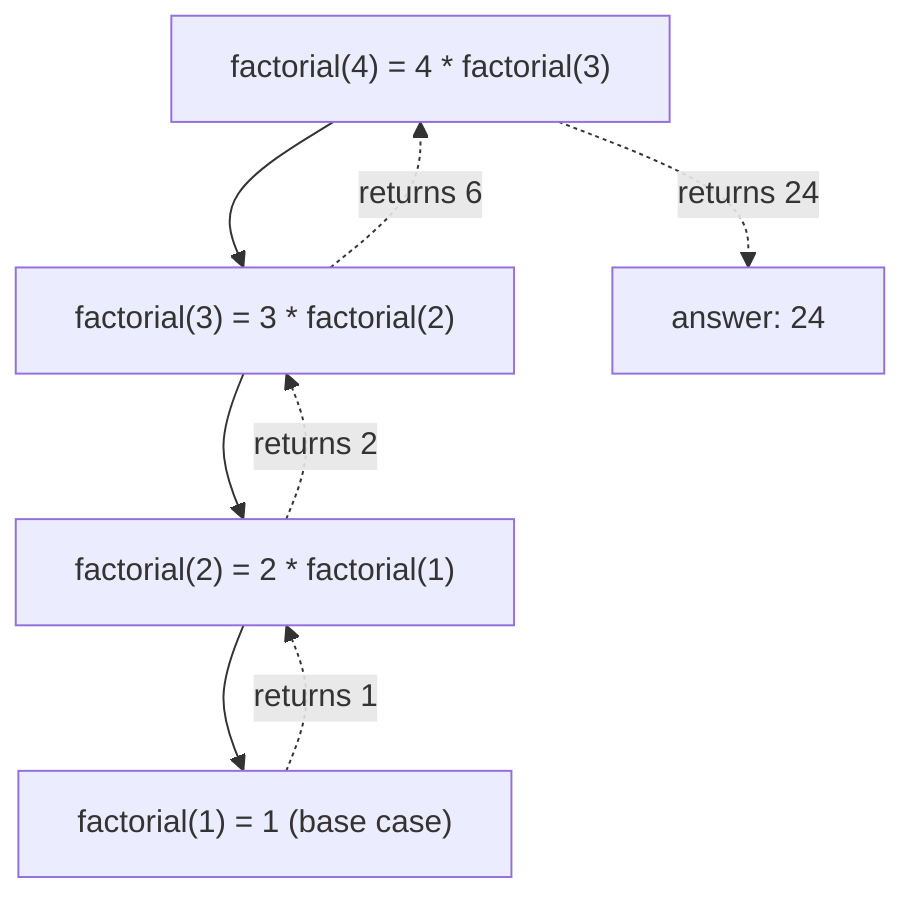

# Recursion
:::tip Why this matters on the robot
Some data is shaped like a tree: a folder full of folders, or an autonomous behavior tree where each step can hold more
steps. The easiest way to walk through data like that is a method that calls itself on each smaller piece. That's
recursion.
:::
:::warning Read first
[Methods](./methods.mdx) (parameters and `return`) and [Conditions](./conditions.mdx) (`if`). It also helps to have
solved a few problems with [Loops](./loops.mdx), so you can compare.
:::

A **recursive** method is a method that calls itself. Each call works on a **smaller** version of the problem, until the
problem is so small the answer is obvious. Then the answers come back up, one call at a time.

---

## The two-part recipe
Every recursive method has the same two parts:

1. **The base case.** The smallest input you can answer directly, without calling yourself again. Write this `if`
   first and `return` the answer.
2. **The recursive step.** Say the answer for `n` using the same method on something smaller (`n - 1`, `n / 10`, the
   rest of a `String`), plus whatever small piece is left over.

Here's a countdown, the simplest recursion there is:

```java
public static void countdown(int n) {
    if (n == 0) {              // base case: nothing left to count
        System.out.println("Go!");
        return;
    }
    System.out.println(n);
    countdown(n - 1);          // recursive step: the same job, one smaller
}
```

`countdown(3)` prints `3`, calls `countdown(2)`, which prints `2`, calls `countdown(1)`, prints `1`, calls
`countdown(0)`, which prints `Go!` and stops.

---

## Returning a value: factorial
`n!` ("n factorial") is `n × (n - 1) × ... × 1`. So `4! = 4 × 3 × 2 × 1 = 24`. Notice that `4! = 4 × 3!`: the answer for
4 is built from the answer for 3. That's the recursive step.

```java
public static int factorial(int n) {
    if (n <= 1) {                  // base case: 0! and 1! are both 1
        return 1;
    }
    return n * factorial(n - 1);   // recursive step
}
```

Here's what happens for `factorial(4)`. Each call waits for the one below it, then finishes:



Going down, nothing gets multiplied yet. Each call is parked, waiting. The multiplying happens on the way back up.

---

## Two calls at once: Fibonacci
The Fibonacci numbers start `0, 1, 1, 2, 3, 5, 8, 13, ...`. Each one is the sum of the two before it. That rule *is*
the recursive step, and the first two numbers are the base case:

```java
public static int fibonacci(int n) {
    if (n < 2) {                                   // base case: fibonacci(0) is 0, fibonacci(1) is 1
        return n;
    }
    return fibonacci(n - 1) + fibonacci(n - 2);    // recursive step: add the two before
}
```

This one calls itself **twice**, so the calls branch out like a tree. It's short and easy to read, but it repeats a lot
of work: `fibonacci(30)` makes over a million calls. A loop is much faster here. Recursion is a tool, not always the
best one.

---

## Shrinking a number: digits
To work through a number's digits, split off the last digit with `%` and keep the rest with `/`:

| Expression | For `n = 472` | Means |
|---|---|---|
| `n % 10` | `2` | the last digit |
| `n / 10` | `47` | everything but the last digit (integer division drops the rest) |

```java
public static int sumDigits(int n) {
    if (n < 10) {                          // base case: a single digit is its own sum
        return n;
    }
    return n % 10 + sumDigits(n / 10);     // last digit, plus the sum of the rest
}
```

`sumDigits(472)` is `2 + sumDigits(47)`, which is `2 + 7 + sumDigits(4)`, which is `2 + 7 + 4 = 13`.

---

## Shrinking a String
A `String` gets smaller with `substring`. `s.substring(1)` is everything after the first character, and
`s.charAt(0)` is the first character.

```java
public static int countChar(String s, char target) {
    if (s.isEmpty()) {                     // base case: an empty String has none
        return 0;
    }
    int here = (s.charAt(0) == target) ? 1 : 0;
    return here + countChar(s.substring(1), target);
}
```

`countChar("elevator", 'e')` checks the first `e`, then counts the `e`s in `"levator"`, and so on down to `""`.

---

## The call stack and `StackOverflowError`
Every call that hasn't finished yet takes up a little memory, stacked on top of the call that made it. This pile is the
**call stack**. (The debugger's **Call Stack** pane shows it. See [Debugging](../../tools/debugging.mdx).)

If the base case is never reached, the stack keeps growing until Java runs out of room and crashes:

```text
Exception in thread "main" java.lang.StackOverflowError
    at Main.factorial(Main.java:5)
    at Main.factorial(Main.java:5)
    at Main.factorial(Main.java:5)
    ...
```

The same line repeated over and over means a method keeps calling itself. Check two things:
- **Is there a base case?** And does it come *before* the recursive call?
- **Does each call really get smaller?** `factorial(n)` calling `factorial(n)` (instead of `n - 1`) never gets there.
  Neither does `factorial(-1)` with a base case of `n == 0`, because counting down from -1 never hits 0. That's why the
  example above uses `n <= 1`.

---

## Recursion or a loop?
Anything you can do with recursion, you can do with a loop, and the other way around. Pick the one that's easier to read.

| Use a loop when... | Use recursion when... |
|---|---|
| You go through items one after another: an array, a list, a countdown | The data branches: trees, folders inside folders, a behavior tree's children |
| Speed matters and the recursive version repeats work (like `fibonacci`) | The answer is naturally "this piece plus the same job on the rest" |
| The input can be very large (deep recursion overflows the stack) | The input is small, or the depth is small |

On the robot, code runs every 20 ms, so a loop is usually the safer choice for big inputs. Recursion shines on
tree-shaped data, which you'll meet in [Trees](../advanced/trees.mdx) and [Graphs](../advanced/graphs.mdx).

---

## Common mistakes
- **No base case, or the wrong one.** The method never stops and ends in a `StackOverflowError`.
- **The base case comes after the recursive call.** Java never reaches it. Check first, then recurse.
- **Not getting smaller.** Every call must move toward the base case.
- **Forgetting to `return` the recursive result.** Writing `factorial(n - 1);` on its own line throws the answer away.
  Write `return n * factorial(n - 1);`.
- **Missing a small input.** Test the base cases themselves: `factorial(0)`, `sumDigits(7)`, `reverse("")`.

---

## Quick reference

| You want to... | Write |
|---|---|
| Stop the recursion | `if (smallest case) { return answer; }` as the first lines |
| Recurse on a number | `method(n - 1)` or `method(n / 10)` |
| Get a number's last digit | `n % 10` |
| Recurse on a `String` | `method(s.substring(1))`, using `s.charAt(0)` for the first character |
| Recurse on everything but the last character | `s.substring(0, s.length() - 1)`, with `s.charAt(s.length() - 1)` |
| Find a missing base case | look for `StackOverflowError` and the same `at` line repeated |

:::tip Practice in Scriptum
Load the **Recursion** lesson in the Java Basics track.
:::
