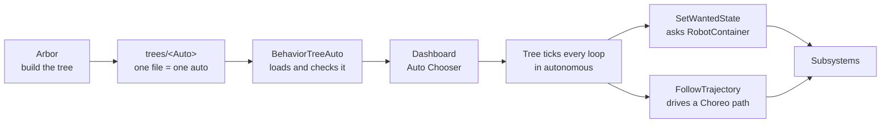

# Autonomous
Autonomous covers the first 15 seconds of the match, when the robot runs with no driver. A good auto scores while
the field is still empty, so it is worth a lot, and it has to work the same every match.

Our autos are **behavior trees**, built in [Arbor](../tools/arbor.mdx) and run by MWLib's behavior-tree engine
(`com.marswars.bt`). There is no Java to write for a new routine: you drag nodes onto Arbor's canvas, the tree asks
the robot for the same [robot states](../controls/state-machines.mdx#the-super-state-machine) the driver's buttons
do, and drives Choreo paths with a built-in node. The only Java in autos is the code that **connects a node to the
robot** (see [Connecting Nodes to Java](#connecting-nodes-to-java)), and most autos only use nodes that already
exist. The examples on this page come from the 2026 robot.

New to behavior trees? Read [Behavior Trees](../controls/behavior-trees.mdx) first: it explains ticks, statuses, Sequence,
Fallback and Timeout with animated examples. The short version of how an auto gets to the robot:



:::note MARS/WARS Custom Implementation
The behavior-tree engine, the `SetWantedState` node and the Choreo driving nodes are part of MWLib, not WPILib.
Arbor saves trees in the standard [BehaviorTree.CPP v4](https://www.behaviortree.dev/) file format, so they also
open in Groot2. You never need to edit those files by hand.
:::

:::tip Try it in the Behavior Tree Lab
Step through an auto like ours tick by tick and see what `Timeout` and `Fallback` do when aiming fails. [Open the Behavior Tree Lab](/labs/behavior-tree-lab)
:::

---

## Why Trees
- **No code deploy for a new auto.** The robot re-reads the tree when you pick the auto on the dashboard, so a
  change to the order of steps, a wait time or a path name is a save in Arbor, not a build.
- **The same sequence as teleop.** `SetWantedState` `SHOOT` runs exactly what the driver's right trigger runs. The
  aim-spin-feed sequence is written once, in `RobotContainer`, and an auto cannot drift from it.
- **You can see it run.** Every node lights up in [Arbor's](../tools/arbor.mdx) live view while the auto runs, and
  each run is recorded for replay.
- **Failure handling is in the tree.** `Timeout`, `Fallback` and `RetryUntilSuccessful` wrap any step, so an
  auto decides what to do when aiming never finishes, without touching robot code.

---

## Where Things Live
`src/main/deploy/autos/` is an [Arbor](../tools/arbor.mdx) project. Open that folder in Arbor; everything in it is
either written by Arbor or generated from the Java code:

| Path | What it is |
|---|---|
| `trees/` | The autos, one file each. Every file here is an option in the dashboard **Auto Chooser**, named after the file |
| `trees/common.xml` | Shared building blocks (sub-trees) every auto can use. A *library* file: several trees and no main tree, so it is not in the chooser |
| `trees/unlisted/` | Finished autos kept out of the chooser. Still checked by the tests; move one up a level to list it |
| `nodes.xml` | Generated from the Java code: every node an auto can use, with ports and descriptions. It is Arbor's palette (see [Node Palette](#node-palette)) |
| `bt_project.json` | Arbor project file: where the nodes and trees are, and the robot's live-view address |
| `README.md` | The authoring guide that ships with the robot code |

Paths come from [Choreo](../tools/choreo.mdx) and live next door in `src/main/deploy/choreo/*.traj`.

---

## Anatomy of an Auto
The trees on this page are written as outlines: each line is one node on Arbor's canvas, its ports (the values you
fill in on the inspector) after it, and indented lines are its children. This is the 2026 robot's `CitrusSynergy`:

```text
CitrusSynergy                          tree port: middle_wait_msec = 3000 (int)
└─ Sequence
   ├─ SetShooterTarget                 target = HUB
   ├─ SetIntakeState                   state = STORE
   ├─ Sleep                            msec = 1000
   ├─ ParallelDeadline                 drive the first path; intake on at "Intake Out"
   │  ├─ FollowTrajectory              trajectory = SynergyP1, end_state = IDLE
   │  └─ SubTree IntakeOnEvent         event = Intake Out, state = INTAKE
   ├─ Delay                            delay_msec = {middle_wait_msec}
   │  └─ FollowTrajectory              trajectory = SynergyP2, end_state = IDLE
   └─ SubTree ShootFor                 duration_msec = 2000
```

Rules for every auto:
- **One auto, one file, one name.** The chooser lists an auto by its file name, and the robot runs the file's main
  tree. Keep the file, the tree and the auto the same name (`CitrusSynergy`, `trees/CitrusSynergy.xml`), with the
  tree marked **Set as main tree of file** in its ⋯ menu.
- **Shared blocks come from `common.xml`.** Drag a tree from Arbor's *Trees* list onto a node to use it as a
  `SubTree`, and fill in its ports on the inspector. A block only one auto needs can be a second tree in that auto's
  own file (*Extract to SubTree…* on a selected branch does this for you).
- **A port is a value or a name.** A plain value (`msec` = 1000) is used as written. The `{}` button on the inspector
  switches a port to a blackboard entry, shown as `{name}`, which is how tunable values and sub-tree inputs arrive.

### How a tree runs
The engine *ticks* the root every robot loop. A node returns **RUNNING**, **SUCCESS** or **FAILURE**. `Sequence`
runs its children in order and stops at the first failure; `Fallback` tries them in order until one succeeds.
That is enough to read most autos, and Arbor's **Explain** labels (*step 1, step 2*, *try this first, if not, try*)
read the tree out loud for you. The full node list is in [Nodes](#nodes).

---

## Robot States First
For anything the driver can also do, ask the robot, not the subsystems: use `SetWantedState` and pick the state from
its drop-down.

`SetWantedState` calls `RobotContainer.setWantedState(...)` and succeeds the same tick: a request is instant, like
the driver pressing a button, and the state stays wanted until something asks for another one. To wait until the
robot has finished the sequence, retry `IsSystemState` (the robot is in the state). The robot only reaches the
state once its step states are done (`AIM` comes after `AIMING`), so the wait ends when the work does. The tree
adds the fail handling that only autos need, while teleop keeps using the exact same sequence:

```text
├─ SetWantedState                      state = AIM
└─ Fallback
   ├─ Timeout                          msec = 3000
   │  └─ RetryUntilSuccessful          num_attempts = -1
   │     └─ IsSystemState              state = AIM
   └─ FollowTrajectory                 trajectory = ToBackupSpot
```

In Arbor, select the `IsSystemState` node and use *Wrap in…* to put `RetryUntilSuccessful`, then `Timeout`, then
`Fallback` around it.

Some robot states keep going until something else is asked for (`SHOOT` on the 2026 robot never "finishes"; the
driver lets go of the trigger). In an auto, put a `Sleep` next to it in a `ParallelDeadline` so the time decides,
then hand the robot back to `AUTO`. That is exactly what the shared `ShootFor` sub-tree does:

```text
ShootFor                               tree port: duration_msec = 2000 (int)
└─ Sequence
   ├─ ParallelDeadline
   │  ├─ Sleep                         msec = {duration_msec}
   │  └─ SetWantedState                state = SHOOT
   └─ SetWantedState                   state = AUTO
```

:::tip AUTO is a hands-off state
While the robot is in `AUTO`, `RobotContainer.updateLogic` asks the subsystems for nothing, so the tree's
subsystem nodes (`SetIntakeState` on a path event, `FollowTrajectory`) are in charge. When the tree asks for a robot
state, the robot takes over; when it asks for `AUTO` again, the tree is back in charge. `Robot.autonomousInit()`
puts the robot in `AUTO` before the tree starts.
:::

Setting a **single subsystem** directly is still right for small one-off moves that are not a robot state, such as
stowing the intake when a path passes an event marker: `SetIntakeState`, `SetShooterState`, `SetSwerveState`.

---

## Driving Paths
`FollowTrajectory` drives a Choreo path by name: set its `trajectory` port to the path's name.

- `trajectory` is the `.traj` file name in `deploy/choreo`. Every trajectory an auto names is loaded when the auto
  is selected and **flipped for the alliance automatically**, so draw paths for one alliance only.
- It requests the swerve's `path_state` (`CHOREO_PATH` by default, or `CHOREO_PATH_ROTATION_LOCK` to hold a
  heading), finishes when `isAtChoreoSetpoint()` holds and at least `min_time` seconds have passed, then
  requests `end_state` (`IDLE` by default).

### Choreo events
Choreo event markers fire while a path runs. Handle them *next to the path* in a `ParallelDeadline`, path first.
The path decides when the group ends, and a handler still waiting for an event that never came is stopped with it:

```text
└─ ParallelDeadline
   ├─ FollowTrajectory                 trajectory = SlopAutoStart, end_state = FIELD_CENTRIC_ROTATION_LOCK
   ├─ SubTree IntakeOnEvent            event = Intake Out, state = INTAKE
   └─ SubTree IntakeOnEvent            event = Intake In, state = STORE
```

`IntakeOnEvent` (in `common.xml`) is a `Sequence` of `WaitForChoreoEvent` and `SetIntakeState`. For a different
action, build the same two-step `Sequence` in place. `WaitForChoreoEvent` only works while its path is running, so
keep handlers inside the `ParallelDeadline`.

---

## Shared Sub-trees
`trees/common.xml` holds the blocks several autos use. Each one is a tree whose inputs are tree ports, declared in
the tree's properties in Arbor (press <kbd>Esc</kbd> to deselect, then edit the port interface), so a `SubTree` node
that uses it shows them on the inspector:

| Sub-tree | Ports | What it does |
|---|---|---|
| `IntakeOnEvent` | `event`, `state`=INTAKE | Waits for a Choreo event on the running path, then sets the intake state |
| `ShootFor` | `duration_msec`=2000 | Robot `SHOOT` (feeds once the shooter is ready) for `duration_msec`, then robot `AUTO` |

Give each port a type, a default and a description, and give the tree a description too: Arbor shows both when
someone drops the sub-tree into their auto.

---

## Tunable Values
Any number in an auto can be tuned from the dashboard without a code deploy. Add it as a port of the auto's own
tree (tree properties, as above, with a type and a default), then switch the node's port to read it with `{}`, as
`Delay` reads `{middle_wait_msec}` in `CitrusSynergy`.

- Each value appears at `/Tuning/Autos/<auto>/<name>` as soon as the robot boots. Edit it in
  [Elastic](../tools/elastic.mdx) or [AdvantageScope](../tools/ad-scope.mdx).
- The value when the auto **starts** is the one used for that run.
- Edits are logged and replay correctly, but they reset on reboot. Copy a value you want to keep into the port's
  default in Arbor.
- Types: `int`, `double`, `bool`, `std::string`. Times are milliseconds, like BehaviorTree.CPP's `Sleep` and `Delay`.

---

## Adding an Auto
1. **Draw the paths** in [Choreo](../tools/choreo.mdx). They end up in `src/main/deploy/choreo/<name>.traj`.
2. **Open `src/main/deploy/autos` in [Arbor](../tools/arbor.mdx)** and click **+ New tree**. Give it the auto's
   name, save it in **a new file**, and type the file name as `trees/<Name>.xml` (Arbor suggests a snake_case name;
   the chooser shows the file name, so change it). Then **Set as main tree of file** from the tree's ⋯ menu. Drafts
   can go in `trees/unlisted/<Name>.xml` until they are ready.
3. **Build the steps.** Robot states for anything the driver does, `FollowTrajectory` for paths, `ShootFor` to
   score. Keep Arbor's **Problems** panel empty: it catches unknown nodes, wrong child counts and unset ports as you
   go.
4. **Save and run `./gradlew test`.** It loads every auto with the robot's real node set and fails on an unknown
   node, a bad port value or a path missing from `deploy/choreo`.
5. **Deploy once** so the new file is on the robot. After that, a change saved in Arbor only needs the files
   re-deployed and the auto re-selected.

---

## Nodes
These are what Arbor's palette offers. Hover a node there for its description and ports.

### Flow control and timing (BehaviorTree.CPP built-ins)
| Node | What it does |
|---|---|
| `Sequence` | Run children in order. Stops at the first failure |
| `Fallback` | Try children in order until one succeeds |
| `ReactiveSequence` / `ReactiveFallback` | Same, but re-check earlier children every tick |
| `Parallel success_count failure_count` | Run all children together; finish on those counts |
| `ParallelAll max_failures` | Run all children to completion |
| `IfThenElse` / `WhileDoElse` | Branch on the first child |
| `Sleep msec` | Wait |
| `Delay delay_msec` | Wait, then run its child |
| `Timeout msec` | Stop the child and fail if it takes too long |
| `Repeat num_cycles`, `RetryUntilSuccessful num_attempts` | Loop the child |
| `Inverter`, `ForceSuccess`, `ForceFailure`, `KeepRunningUntilFailure`, `RunOnce` | Change the child's result |
| `SetBlackboard`, `UnsetBlackboard` | Write or clear blackboard entries |
| `SubTree ID` | Run another tree. Its other ports are the tree's ports |

BehaviorTree.CPP scripting (`Script`, `_skipIf`, `Precondition`) is not supported, even though Arbor offers it.

### MWLib shared nodes (any robot)
| Node | Ports | What it does |
|---|---|---|
| `ParallelDeadline` | | Runs its children together until the **first** child finishes, then stops the rest and returns that child's result (WPILib's `deadline`) |
| `FollowTrajectory` | `trajectory`, `path_state`=CHOREO_PATH, `end_state`=IDLE, `min_time`=0 | Drives a Choreo path, then requests `end_state` |
| `WaitForChoreoEvent` | `event` | Waits until the running path passes a Choreo event marker |
| `SetSwerveState` | `state` | Requests a swerve state |
| `IsAtChoreoSetpoint`, `IsChassisStationary` | | Conditions |
| `HasChoreoTimeElapsed` | `seconds` | Condition |
| `HasChoreoEventPassed` | `event` | Condition |

### Robot nodes (2026, `frc.robot.autos.bt.AutoNodes`)
| Node | Ports | What it does |
|---|---|---|
| `SetWantedState` | `state` (a `RobotStates`) | Asks `RobotContainer` for the state; instant, succeeds at once. Use it for anything teleop also does |
| `IsSystemState` | `state` | The robot is in `state`. Retry it (`RetryUntilSuccessful` `-1`, inside a `Timeout`) to wait for a state |
| `SetIntakeState` / `SetShooterState` | `state` | `setWantedState(state)` on that subsystem, for small one-off moves |
| `SetShooterTarget` | `target`=HUB (HUB, LEFT_PASS, RIGHT_PASS) | Points the shooter at a named field target |
| `IsShooterReady` | | Condition |

---

## Connecting Nodes to Java
This is the only Java an auto involves. Every node in Arbor's palette is a name connected to a Java function by one
registration call, and the robot looks up that name when it loads a tree. Most autos never need a new node; a robot
state or a sub-tree covers it. When you do need one, decide where it belongs:

- **Any robot could use it** (a drive move, a generic wait): it goes in [MWLib](./mwlib.mdx), registered with
  `registerLibraryNode`, so every robot gets it.
- **Only this robot** (an intake state, a shooter target): it goes in `frc/robot/autos/bt/AutoNodes.java`.

`AutoNodes.registerNodes(factory)` has one call per node. The factory offers a helper for each shape:

```java
// An enum request: SetIntakeState, state = STORE (the enum's values become a drop-down)
factory.registerSetState(
        "SetIntakeState",
        "Request an intake state",
        IntakeStates.class,
        s -> IntakeSubsystem.getInstance().setWantedState(s));

// A condition: IsShooterReady (SUCCESS when the lambda returns true, FAILURE otherwise)
factory.registerSimpleCondition(
        "IsShooterReady",
        "Flywheel, hood and aim are within tolerance",
        List.of(),
        n -> ShooterSubsystem.getInstance().isShooterReady());

// An instant action with a choice port: SetShooterTarget, target = HUB
factory.registerInstantAction(
        "SetShooterTarget",
        "Point the shooter at a named field target",
        List.of(PortInfo.choiceInput("target", List.copyOf(SHOOTER_TARGETS.keySet()), "HUB", "Field target to aim at")),
        n -> RobotContainer.getInstance().setAutoShooterTarget(SHOOTER_TARGETS.get(n.getString("target"))));
```

Each call gives the node's name and the description Arbor shows, its ports, and the Java to run. `n.getString("target")`
reads a port's value as filled in on Arbor's inspector.

`registerCommand(id, description, ports, node -> Command)` wraps a WPILib `Command` as a node (RUNNING until it
finishes), and `registerNodeType` takes a full `StatefulActionNode` for anything with its own start/running/halt
logic.

:::warning Never call `getInstance()` in a node constructor
Trees are built to check them, in the unit tests and in the editor's palette build, with no hardware.
Reach for a subsystem only inside the node's tick, start, running or halt code.
:::

After adding or changing a node, regenerate the palette (below) so it shows up in Arbor, and commit `nodes.xml` with
the code that defines it.

### Node palette
`nodes.xml` lists every node an auto can use, with its ports, defaults and descriptions. It is what the editor shows
in its palette and what the tests check the trees against. It starts with MWLib's shared nodes (generated from MWLib's own registrations) followed by this robot's
nodes, and it is generated from the Java code. Regenerate it after adding or changing a node, or after bumping MWLib:

```bash
./gradlew test -PupdateNodeSpec
```

---

## Wiring (once per robot project)
`Robot()` builds the factory, loads the trees and turns on the monitoring. This is already done on the 2026 robot;
a new project copies it:

```java
BehaviorTreeFactory bt_factory = AutoNodes.createFactory();        // BT.CPP built-ins + MWLib + robot nodes
AutoManager.getInstance()
        .registerAutos(BehaviorTreeAuto.loadAll(
                bt_factory, Filesystem.getDeployDirectory().toPath().resolve("autos/trees")));
BtLiveServer.start(BtLiveServer.Options.defaults().withRobotName("4143")); // live view, port 1670
BehaviorTreeFileLogger.enableDefault();                             // one .btlog per run
```

`AutoManager` owns the dashboard chooser and runs the selected auto. `Robot` calls it in three places:

```java
public void robotPeriodic() {
    CommandScheduler.getInstance().run();
    AutoManager.getInstance().periodic();   // ticks the running tree, prepares the selected auto
    robot_container_.doControlLoop();
}
public void autonomousInit() { AutoManager.getInstance().start(); }
public void disabledInit()   { AutoManager.getInstance().stop(); }  // teleopInit() too
```

A tree is **not** a WPILib command. `periodic()` ticks it once per loop, just before `doControlLoop()`, so a state it
asks for is acted on in the same loop. Ticking a tree is cheap (microseconds); the slow part, reading the tree file and
loading the Choreo paths, runs on a background thread whenever you pick an auto or the alliance changes, so it never
causes a loop overrun.

Command-based autos still work: an `Auto` subclass (a `SequentialCommandGroup`) or any command added with
`AutoManager.getInstance().registerAuto("Name", command)` sits in the same chooser and runs through the scheduler.
We don't write autos that way any more, but nothing stops it. The live server needs one extra dependency in `build.gradle`,
`implementation 'org.java-websocket:Java-WebSocket:1.6.0'`, because MWLib's published package does not list it.

---

## Testing and Debugging
- **`./gradlew test`** (`BtAutosParseTest`) loads every auto, including `unlisted/` and the `common.xml` sub-trees,
  with the robot's real node set. It checks every trajectory file exists, that the chooser lists exactly the
  expected autos, and that `nodes.xml` is up to date.
- **Broken files still show up.** An auto that fails to load still appears in the chooser. It raises an Elastic
  alert, logs `BehaviorTree/<auto>/Error` and does nothing when run, so a typo is visible instead of silent.
- **No code deploy for tree changes.** Re-selecting an auto, or changing alliance, re-reads its file.
- **AdvantageScope.** `BehaviorTree/Active` is the running auto. `BehaviorTree/<auto>/{Transitions,Result,Error}`
  give its state. `Transitions` lists each node's status change since the last tick as `"<node>: <STATE>"`, for
  example `Follow::2: RUNNING`, so AdvantageScope can show it as a table or timeline like a `.btlog`; it is empty on
  ticks where nothing changed. The tree's shape is not logged there; open it in [Arbor](../tools/arbor.mdx) (live view or the run's `.btlog`) to
  see it. Log replay reads the tree files from your checkout, like the rest of the robot code, and the Auto Chooser selection is
  a logged input, so a replay runs the auto that was chosen in the match. The tree that actually ran is also in the
  match's `.btlog` header.
- **Live view.** The robot streams the running tree over WebSocket at `ws://10.41.43.2:1670/` (`ws://localhost:1670/`
  in simulation). Open the project in [Arbor](../tools/arbor.mdx) and connect to watch nodes turn orange, green and
  red as the auto runs.
- **Run logs.** Every run writes `<auto>_<date>_<time>.btlog`, in BehaviorTree.CPP's `FileLogger2` format, to
  `/U/logs/bt` on the robot (next to the AdvantageKit logs) and `logs/bt` in simulation. Open one in Arbor or
  Groot2 to step through the run node by node. It is written as the auto runs, so a power loss mid-auto still
  leaves a usable file.

### Troubleshooting
- **The auto is not in the chooser.** The file is not in `trees/` (drafts in `unlisted/` are hidden on purpose), or
  no tree in it is marked as the main tree, so it is treated as a library file like `common.xml`.
- **The auto is in the chooser but does nothing.** Look at `BehaviorTree/<auto>/Error` and the Elastic alert; run
  `./gradlew test` to see the error. Arbor's **Problems** panel usually shows it too.
- **"Unknown node".** The node is not registered in `AutoNodes` (or its ID is misspelled; names are case-sensitive).
  After adding one, regenerate `nodes.xml`.
- **A path is missing.** `trajectory` must match a `.traj` in `deploy/choreo` exactly; the test lists the
  missing names.
- **The robot ignores a robot state.** The tree must be running while the robot is in `AUTO`; if an earlier step
  left the robot in another state, add `SetWantedState` `AUTO` after it (`ShootFor` does this).

---

## Related Documentation
- [State Machines](../controls/state-machines.mdx): the super state machine that autos ask for states.
- [Arbor](../tools/arbor.mdx): building trees, live view and `.btlog` replay.
- [Choreo](../tools/choreo.mdx): drawing the paths autos follow.
- [Swerve](./swerve.mdx): the drive states `FollowTrajectory` requests.
- [MWLib](./mwlib.mdx): where the engine and the shared nodes live, and how to change them.
