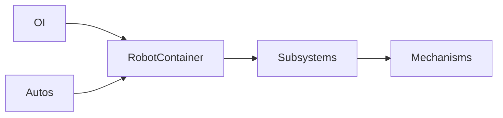

# Quick Reference Guide
This is a quick reference guide for programming our FRC robots using our standard libraries and practices. It is not a complete guide, but rather a summary of the most important concepts and code snippets.

## Data Flow and Architecture
Our robot architecture is based on a modular design that separates different components of the robot into distinct classes and packages. This allows for better organization, easier debugging, and more efficient collaboration among team members. The main components of our robot architecture include:
- **Subsystems**: These classes represent different subsystems of the robot, such as the drivetrain, elevator, and arm. Each subsystem is responsible for its own functionality and can be controlled independently.
- **Mechanisms**: These classes represent specific mechanisms or components of the robot, such as a flywheel or shooter. Mechanisms are typically used within subsystems to provide specific functionality.
- **RobotContainer (the super state machine)**: The robot's own state machine. It registers every subsystem, and it coordinates them: buttons and autos ask it for a robot state (such as `SHOOT`), and it asks each subsystem for the state it needs. Anything that uses more than one subsystem lives here, so there are no per-subsystem command files. See [The Super State Machine](../controls/state-machines.mdx#the-super-state-machine).
- **Operator Interface (OI)**: This class handles the interaction between the robot and the operator interface, such as game controllers or buttons. It reads input from the operator and asks `RobotContainer` for robot states with small inline commands.

The following diagram illustrates the relationships between these components:

OI is the highest level component that interacts with the operator. It receives the operator inputs and asks `RobotContainer` for a robot state with `setWantedState(...)`. Autonomous routines ask for the same robot states. `RobotContainer` (the super state machine) runs first every loop and asks each subsystem for a state. The subsystems then use mechanisms to perform the actual or simulated hardware control.

## Workflow
The best practice to follow when creating a new robot subsystem is:
1. Create the a Basic Subsystem class:
    - The steps to complete this can be found under [Creating a Subsystem](./subsystems.mdx#creating-a-subsystem).
    - Make sure to complete all steps including:
        - Creating the Subsystem Package
        - Creating the Subsystem Constants Class
        - Creating the Subsystem Class
        - Registering the Subsystem
2. Add Mechanisms as needed:
    - Refer to [Mechanisms](./mechanisms/) for guidance on available mechanisms.
    - Steps to implement mechanisms can be found under [Adding Mechanisms](./subsystems.mdx#adding-mechanisms).
3. Define the Behavior for your State Machine
    - Implement the behavior for each state in the subsystem's state machine.
    - Refer to [Adding the State Machine](./subsystems.mdx#adding-the-state-machine) for guidance.
        - This includes defining the actions to be taken in each state and how to transition between states.
        - **Remember if you don't care about any transitions just leave the default implementation alone.**
4. Use the Subsystem from the Robot's State Machine
    - Add or update robot states in `RobotStates` and ask your subsystem for its state from `RobotContainer`.
    - Refer to [The Super State Machine](../controls/state-machines.mdx#the-super-state-machine) for guidance.
    - Do **not** create a command file for the subsystem.
5. Integrate with the Operator Interface (OI)
    - Bind operator inputs to robot states with `Commands.startEnd(...)` / `Commands.runOnce(...)` around `robot.setWantedState(...)`.
    - Refer to [Requesting Robot States](./commands.mdx#requesting-robot-states) and [Operator Interface (OI)](./oi.mdx) for guidance.

## Example Project Template
Below is an example project structure and code templates to help you get started with creating new subsystems. Please try to follow this structure and coding style to maintain consistency across the codebase. These templates provide a starting point, but you will need to customize them to fit the specific requirements of your subsystem.

### Package Template
```
src/main/java/frc/robot/
├── Robot.java
├── RobotContainer.java   (the super state machine)
├── RobotStates.java
├── OI.java
└── subsystems/
    ├── template/
    |       ├── TemplateSubsystem.java
    |       └── TemplateConstants.java
    └── example/
            ├── ExampleSubsystem.java
            └── ExampleConstants.java
```
### Subsystem Class Template
```java title="TemplateSubsystem.java"
public class TemplateSubsystem extends MwSubsystem<TemplateStates, TemplateConstants> {
    private static TemplateSubsystem instance_ = null;

    // Mechanisms (declare your mechanism IOs here)
    // private RollerMech roller_;
    // private ArmMech pivot_;

    // Singleton Accessor
    public static TemplateSubsystem getInstance() {
        if (instance_ == null) {
            instance_ = new TemplateSubsystem();
        }
        return instance_;
    }

    public TemplateSubsystem() {
        // (Default State, Constants Class)
        super(TemplateStates.IDLE, new TemplateConstants());
        
        // Initialize mechanisms here
        // roller_ = new RollerMech(
        //     getSubsystemKey(),
        //     "Roller",
        //     List.of(CONSTANTS.ROLLER_MOTOR_CONFIG),
        //     CONSTANTS.ROLLER_GEAR_RATIO
        // );
    }

    @Override
    public List<SubsystemIoBase> getIos() {
        // Return all mechanism IO objects used by this subsystem
        return Arrays.asList(/* roller_, pivot_ */);
    }

    @Override
    public void reset() {
        // Reset subsystem to initial state
        system_state_ = TemplateStates.IDLE;
    }

    @Override
    public void updateLogic(double timestamp) {
        switch (system_state_) {
            // Handle each state behavior
            case IDLE:
                // Stop all mechanisms
                // roller_.setTargetDutyCycle(0.0);
                break;
            case CUSTOM_STATE:
                // Custom behavior here
                // roller_.setTargetVelocity(target_velocity);
                break;
        }

        // Log Data
        MwLog.log(getSubsystemKey() + "/State", system_state_.toString());
        // MwLog.log(getSubsystemKey() + "/CustomValue", custom_value);
    }

    // Only override if you need custom state transitions!
    // @Override
    // protected void handleStateTransition(TemplateStates wanted) {
    //     system_state_ = wanted;
    // }

    // Public Methods for Subsystem Behavior
    // public void customMethod() { }

    // Private Helper Methods
    // private boolean isReady() { return true; }
}
```

### Constants Class Template
```java title="TemplateConstants.java"
public class TemplateConstants extends MwConstants {

    // =============================================================================
    // ENUMS AND STATE DEFINITIONS
    // =============================================================================

    // Subsystem States
    public enum TemplateStates {
        IDLE,
        CUSTOM_STATE,
        EXAMPLE_STATE
    }

    // =============================================================================
    // CAN IDS AND HARDWARE CONFIGURATION
    // =============================================================================

    // Motor CAN IDs
    // public final int ROLLER_MOTOR_ID = 10;

    // =============================================================================
    // MECHANICAL CONSTANTS
    // =============================================================================

    // public final boolean ROLLER_INVERTED = false;
    // public final double ROLLER_GEAR_RATIO = 1.0;

    // =============================================================================
    // CONTROL SETPOINTS
    // =============================================================================

    // public final double TARGET_VELOCITY = 100.0;

    // =============================================================================
    // MOTOR CONFIGURATION OBJECTS
    // =============================================================================

    // public final MotorConfig ROLLER_MOTOR_CONFIG = new MotorConfig();

    // =============================================================================
    // CONSTRUCTOR - MOTOR CONFIGURATION INITIALIZATION
    // =============================================================================

    public TemplateConstants() {
        // Configure motor settings here
        // ROLLER_MOTOR_CONFIG.can_id = ROLLER_MOTOR_ID;
        // ROLLER_MOTOR_CONFIG.motor_type = FxMotorType.X60;
        // ROLLER_MOTOR_CONFIG.canbus_name = "rio";
        // ROLLER_MOTOR_CONFIG.config = new TalonFXConfiguration();
        // ROLLER_MOTOR_CONFIG.config.MotorOutput.Inverted = 
        //     PhoenixUtil.toInvertedValue(ROLLER_INVERTED);
    }
}
```

### RobotContainer Template
```java title="RobotContainer.java"
public class RobotContainer extends MwSuperStateMachine<RobotStates> {
    private static RobotContainer instance_ = null;

    public static RobotContainer getInstance() {
        if (instance_ == null) {
            instance_ = new RobotContainer();
        }
        return instance_;
    }

    private final TemplateSubsystem template_ = TemplateSubsystem.getInstance();

    private RobotContainer() {
        super(RobotStates.IDLE, BuildConstants.class);
        // !!!!!! ALL SUBSYSTEMS MUST BE REGISTERED HERE TO RUN !!!!!!!
        registerSubsystem(template_);
        // !!!!! LEAVE reset() AS THE LAST LINE IN THE CONSTRUCTOR !!!!!!
        reset();
    }

    // Ask each subsystem for the state the robot's state needs. Runs every loop, before the subsystems.
    @Override
    protected void updateLogic(double timestamp) {
        switch (getSystemState()) {
            case CUSTOM:
                template_.setWantedState(TemplateStates.CUSTOM_STATE);
                break;
            case IDLE:
            default:
                template_.setWantedState(TemplateStates.IDLE);
                break;
        }
    }
}
```

```java title="OI.java"
RobotContainer robot = RobotContainer.getInstance();
driver_controller_.a().whileTrue(
        Commands.startEnd(
                () -> robot.setWantedState(RobotStates.CUSTOM),
                () -> robot.setWantedState(RobotStates.IDLE)));
```

## Troubleshooting
*This is a list of common issues you may encounter when developing subsystems and how to troubleshoot them:
Not all problems are listed here, but these are some of the most common ones we have seen come up during development.*

- **My subsystem doesn't appear to be updating.**
    - Make sure you have registered the subsystem in `RobotContainer.java`.
        - See [Register the Subsystem](./subsystems.mdx#register-the-subsystem) for steps to register a subsystem.
- **My subsystem is updating, but I don't have my mechanisms working.**
    - Make sure you have added the mechanism IO objects to the `getIos()` method in your subsystem class.
        - See [Update the Subsystem IOs](./subsystems.mdx#update-the-subsystem-ios) for guidance on how to add mechanisms to your subsystem.
    - Ensure if you have multiple mechanisms of the same type (e.g. two arm mechs) ensure you provide a unique name for each mechanism
        - This will not cause the code to fail, but it will result in logging and tunable issues due to the shared NT keys.
- **My subsystem wont enter a new state I just added.**
    - Make sure you have implemented the state transition logic in `handleStateTransition()` if you are using custom transitions.
    - Make sure `RobotContainer` asks for it: the robot's state machine requests subsystem states, so a robot state has to ask your subsystem for the new state.
- **The auto I just created is not available from the dashboard chooser.**
    - Every `src/main/deploy/autos/trees/*.xml` is a chooser option, so the file is somewhere else (`unlisted/` hides drafts on purpose), or it has no `main_tree_to_execute` and is being treated as a library file like `common.xml`. Deploy once so the new file is on the robot.
        - See [Adding an Auto](./autonomous.mdx#adding-an-auto).
- **The auto is in the chooser but the robot does nothing.**
    - The file failed to load. Look at `BehaviorTree/<auto>/Error` in AdvantageScope and the Elastic alert, or run `./gradlew test` for the parse error with a line number. The usual causes: a misspelled node name (they are case-sensitive), a node not registered in `AutoNodes`, or a `trajectory="..."` with no matching `.traj` in `deploy/choreo`.
        - See [Testing and Debugging](./autonomous.mdx#testing-and-debugging).
- **The robot ignores the robot state my auto asked for.**
    - The tree only drives the robot while it is in `AUTO`. If an earlier step left the robot in another state, add `<SetWantedState state="AUTO"/>` after it, the way `ShootFor` does.
- **The code runs the wrong robot's constants.**
    - `Config/RobotName` on the dashboard shows the name the code resolved at boot. Burn the right one from Test mode with `Config/Burn RobotName` and restart the code; in simulation set `ROBOT_NAME`.
        - See [Robot Identity](./robot-identity.mdx).
