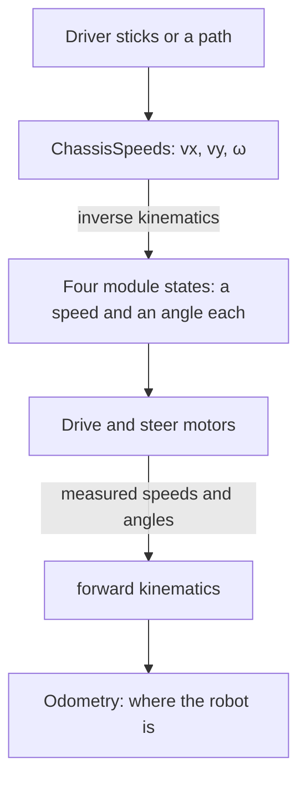

import {LabLink} from '@site/src/components/LabLink';

# Swerve
The swerve drive is a **library subsystem**. All of the driving, path following, heading lock, crawl and brake logic
lives in MWLib's `MwSwerveSubsystem`; the robot project only says which hardware it has, where the robot pose
comes from and which controller axes drive it. That keeps the drivetrain identical across our robots and lets a
fix land in one place.

:::note MARS/WARS Custom Implementation
`MwSwerveSubsystem`, `MwSwerveConstants` and `SwerveDriveConfig` are part of MWLib (`com.marswars.swerve_lib`).
Under the hood they drive CTRE TalonFX modules through Phoenix 6.
:::

:::tip Try it in the Swerve Kinematics Lab
Drive with two joysticks and watch chassis speeds turn into four module angles and speeds, field-centric or robot-centric. <LabLink slug="swerve-lab" />
:::

---

## How Swerve Works
A **swerve drive** can drive in any direction and turn at the same time: forward, sideways, diagonally, or spinning
while it slides across the field. A tank drive can only drive forward, backward and turn. That freedom is why almost
every FRC team, including ours, drives swerve.

### Modules
Each corner of the robot has a **swerve module**: one wheel with two motors.

- The **drive motor** spins the wheel, so it sets how fast that wheel rolls (m/s).
- The **steer motor** turns the whole wheel, so it sets which way that wheel points (an angle in radians).
- An **absolute encoder** on the steering tells the module which way the wheel points, even right after the robot
  powers on.

The four modules are always listed in the same order, **front left, front right, back left, back right** (FL, FR,
BL, BR). Each one has a position measured from the center of the robot. On the 2026 robot every module is 0.1905 m
(7.5 in) from the center in both x and y, so front left is at (0.1905, 0.1905) and back right is at
(−0.1905, −0.1905).



### Chassis Speeds
Everything that drives the robot, the driver's sticks, a Choreo path or rotation lock, first turns its request into
one **`ChassisSpeeds`**: three numbers for the whole robot.

| Field | Meaning | Units |
|---|---|---|
| `vxMetersPerSecond` | forward (+) or backward (−) | m/s |
| `vyMetersPerSecond` | left (+) or right (−) | m/s |
| `omegaRadiansPerSecond` | turning, counter-clockwise (+) or clockwise (−) | rad/s |

These follow the WPILib convention: **+x is forward, +y is left, counter-clockwise is positive.** On the 2026 robot a
full stick asks for 5.0 m/s (`SPEED_AT_12V_MPS`).

### Field-centric and Robot-centric
"Forward" can mean two different things:

- **Robot-centric** (`ROBOT_CENTRIC`): forward is wherever the robot's front points. Pushing the stick forward drives
  the robot's nose forward, even when the robot is turned around and coming toward the driver.
- **Field-centric** (`FIELD_CENTRIC`): forward is always away from the driver station, whichever way the robot
  faces. This is what drivers want almost all the time.

Field-centric works by rotating the stick's request by the robot's heading before anything else happens
(`ChassisSpeeds.fromFieldRelativeSpeeds(...)`). That is why the swerve needs the pose supplier from localization: a
wrong heading means "forward" points the wrong way. The red alliance drives from the other end of the field, so the
operator perspective (`setOperatorForwardDirection(...)`) turns "away from the driver" around for them.

### From Chassis Speeds to Wheels
The math that turns one `ChassisSpeeds` into four module states is called **inverse kinematics**. Every wheel's
velocity is the sum of two parts:

1. **Translation**: the same for every wheel, `(vx, vy)`.
2. **Rotation**: spinning the robot moves each wheel sideways around the center. The wheel moves at right angles to
   the line from the center to the wheel, at a speed of ω × (distance from the center).

For a module at position `(x, y)`:

$$
v_{x,\text{wheel}} = v_x - \omega \cdot y \qquad v_{y,\text{wheel}} = v_y + \omega \cdot x
$$

The wheel's **speed** is the length of that vector, `Math.hypot(vx_wheel, vy_wheel)`, and its **angle** is
`Math.atan2(vy_wheel, vx_wheel)`.

:::info Worked example
The 2026 robot drives forward at 1.0 m/s while turning left at 2.0 rad/s. Front left is at (0.1905, 0.1905):

- v<sub>x</sub> = 1.0 − 2.0 × 0.1905 = 0.619 m/s, v<sub>y</sub> = 0 + 2.0 × 0.1905 = 0.381 m/s
- speed = 0.727 m/s, angle = 0.552 rad (about 32°)

Front right is at (0.1905, −0.1905), which gives 1.433 m/s at 0.269 rad (about 15°). The right-side wheels are
going around the outside of the turn, so they have to roll almost twice as fast as the left-side wheels.
:::

WPILib does all of this for you with `SwerveDriveKinematics`, which MWLib builds from the module positions in
`SwerveConstants`:

```java
ChassisSpeeds speeds = ChassisSpeeds.discretize(
        ChassisSpeeds.fromFieldRelativeSpeeds(vx, vy, omega, currentPose.getRotation()),
        updatePeriod);
SwerveModuleState[] states = kinematics.toSwerveModuleStates(speeds);   // FL, FR, BL, BR
```

### Keeping the Wheels Sensible
A few fixes are applied before the states reach the motors:

| Fix | What it does | In MWLib |
|---|---|---|
| **Discretize** | The robot moves in 20 ms steps. Driving and turning at once in one step would curve the robot off its line, so `ChassisSpeeds.discretize` corrects for it. | Yes, every drive request |
| **Optimize** | A wheel never turns more than 90° (π/2 rad). If the new angle is further away, it turns the short way and spins backward instead. | Yes, `state.optimize(...)` in `Module.runSetpoint` |
| **Cosine scaling** | While a wheel is still turning toward its new angle, it slows down so it does not push the robot sideways. | Yes, `state.cosineScale(...)` |
| **Desaturate** | If any wheel is asked for more than its top speed, scale all four down by the same amount so the robot keeps its direction. | No: each wheel just tops out at full voltage, so the robot's path bends a little at full stick plus full spin |

### Going Back: Odometry
The same math also runs backward. **Forward kinematics** (`kinematics.toChassisSpeeds(...)`) takes the speeds and
angles the modules *measure* and works out how the whole robot is really moving. Adding that up every step is
**odometry**: where the robot thinks it is. MWLib reads the module and gyro sensors on a separate thread at 250 Hz
on a CAN FD bus (100 Hz otherwise), which keeps odometry accurate during fast moves. It also compares the four wheels
with each other to notice when one is skidding (`isSkidding()`).

Wheel odometry slowly drifts, so the localization subsystem blends it with AprilTag readings from the cameras; try
that in the [Pose Estimator Lab](../vision/april_tags.mdx#pose-estimator-lab).

### Try It: Swerve Kinematics Lab {#swerve-lab}
Drive with the two sticks (or W A S D and Q E) and watch each idea from this section: the `ChassisSpeeds` readout,
the field-centric, robot-centric and rotation-lock buttons, the module arrows, and toggles for desaturation,
optimization, cosine scaling and discretizing. The **Walkthrough** button goes through them in order.

<LabLink slug="swerve-lab" button />

---

## The Robot's SwerveSubsystem
The whole class on the 2026 robot:

```java
public class SwerveSubsystem extends MwSwerveSubsystem<SwerveConstants> {

    private static SwerveSubsystem instance_ = null;

    public static SwerveSubsystem getInstance() {
        if (instance_ == null) {
            instance_ = new SwerveSubsystem();
        }
        return instance_;
    }

    private SwerveSubsystem() {
        super(
                SwerveConstants.create(),
                () -> LocalizationSubsystem.getInstance().getFieldPose(),
                new SwerveDriverInputs(
                        OI::getDriverJoystickLeftX,
                        OI::getDriverJoystickLeftY,
                        OI::getDriverJoystickRightX,
                        OI::getDriverJoystickPOV));
    }
}
```

- **Keep the name `SwerveSubsystem`.** The logging keys are built from the class name, so dashboards and log
  tooling expect `Subsystem/Swerve/...`.
- **The constants** come from `SwerveConstants.create()`, which picks the variant for the robot the code is running
  on (next section).
- **The pose supplier** is how the swerve knows where it is for field-centric driving and path following. It comes
  from the localization subsystem, not from the swerve's own odometry.
- **`SwerveDriverInputs`** is a record of the driver's axes: left X, left Y, right X and the POV. Pass
  `SwerveDriverInputs.none()` for a robot with no driver (a test chassis).
- Holding the POV forces the matching **crawl** state (slow, precise movement). Override `remapWantedState(...)` to
  change that policy; it is the only hook the robot project usually touches.

---

## Constants and Per-robot Variants
`SwerveConstants extends MwSwerveConstants`. The base class already holds the tunables every swerve has
(`MAX_TRANSLATION_RATE`, the heading-controller gains, the `CHOREO_*` path-following gains and tolerances, the
`TRACTOR_BEAM_*` pose-driving gains) with sensible defaults, and one abstract method, `getDriveConfig()`, that
describes the hardware.

The robot's class adds the per-robot hardware values as **non-final fields**, so a variant can change them:

```java
public class SwerveConstants extends MwSwerveConstants {

    /** Builds the constants variant for the robot the code is running on. */
    public static SwerveConstants create() {
        return switch (RobotConstants.ROBOT) {
            case BETA_BOT -> new BetaSwerveConstants();
            case SIM_BOT -> new SimSwerveConstants();
            default -> new SwerveConstants();
        };
    }

    // Defaults = AlphaBot. Non-final so variants can reassign them in their constructors.
    public String CANBUS_NAME = "CANivore";
    public double WHEEL_RADIUS_METERS = Units.inchesToMeters(1.8);
    public ModuleType MODULE_TYPE = ModuleType.getModuleType("TSN-P13-S18");
    public TalonMotorType STEER_MOTOR_TYPE = TalonMotorType.X44;
    public Slot1Configs DRIVE_GAINS_SLOT1 = new Slot1Configs().withKS(0.2).withKV(0.1).withKA(0.02).withKP(8.0);
    public Slot0Configs STEER_GAINS_SLOT0 = new Slot0Configs().withKP(80.0);
    public double DRIVE_SUPPLY_CURRENT_LIMIT = 40.0;
    // ...

    /** Called once by the subsystem, after any variant constructor has run. */
    @Override
    public SwerveDriveConfig getDriveConfig() {
        return SwerveDriveConfig.builder()
                .canbus(CANBUS_NAME)
                .pigeon2Id(PIGEON2_ID)
                .moduleType(MODULE_TYPE)
                .wheelRadius(WHEEL_RADIUS_METERS)
                .speedAt12V(SPEED_AT_12V_MPS)
                .driveGains(DRIVE_GAINS_SLOT0, DRIVE_GAINS_SLOT1)
                .driveCurrentLimits(DRIVE_SUPPLY_CURRENT_LIMIT, DRIVE_STATOR_CURRENT_LIMIT)
                .steerMotor(STEER_MOTOR_TYPE)
                .steerGains(STEER_GAINS_SLOT0, STEER_GAINS_SLOT1)
                .steerCurrentLimits(STEER_SUPPLY_CURRENT_LIMIT, STEER_STATOR_CURRENT_LIMIT)
                .frontLeft(1, 2, 0, inches(7.5, 7.5))     // drive id, steer id, encoder id, position
                .frontRight(3, 4, 1, inches(7.5, -7.5))
                .backLeft(5, 6, 2, inches(-7.5, 7.5))
                .backRight(7, 8, 3, inches(-7.5, -7.5))
                .build();
    }
}
```

A variant is a tiny subclass that reassigns only what differs:

```java
/** BetaBot's swerve constants: only the values that differ from AlphaBot. */
public class BetaSwerveConstants extends SwerveConstants {
    public BetaSwerveConstants() {
        WHEEL_RADIUS_METERS = Units.inchesToMeters(1.978);
        MODULE_TYPE = ModuleType.getModuleType("TSN-P13-S16");
        DRIVE_GAINS_SLOT1 = new Slot1Configs().withKS(0.224).withKV(0.62).withKP(0.25);
        DRIVE_SUPPLY_CURRENT_LIMIT = 35.0;
        DRIVE_STATOR_CURRENT_LIMIT = 105.0;
    }
}
```

:::warning Build derived configs in a method, not a field
A variant's constructor runs *after* the base class's fields are initialised. Anything built from those fields,
such as the `SwerveDriveConfig`, must be built in a method (`getDriveConfig()`, called once by the subsystem) or it
would capture the AlphaBot values before the variant changed them.
:::

How `RobotConstants.ROBOT` is decided is on the [Robot Identity](./robot-identity.mdx) page.

---

## Swerve States
`SwerveStates` is MWLib's enum. The ones you request from `RobotContainer` and from autos:

| State | What it does |
|---|---|
| `FIELD_CENTRIC` / `ROBOT_CENTRIC` | Normal joystick driving, relative to the field or to the robot |
| `FIELD_CENTRIC_ROTATION_LOCK` / `ROBOT_CENTRIC_ROTATION_LOCK` | Joystick translation with the heading held at `setDesiredRotationLock(...)`; aiming uses this |
| `CHOREO_PATH` / `CHOREO_PATH_ROTATION_LOCK` | Follow the selected Choreo trajectory, with Choreo's rotation or a locked heading. `FollowTrajectory` requests these |
| `TRACTOR_BEAM` | Drive to a pose set with `setDesiredTractorBeamPose(...)` |
| `CHASSIS_SPEEDS` (+ `_ROTATION_LOCK`) | Raw `ChassisSpeeds` from code |
| `CRAWL_*` | Slow precision variants of the four joystick states; the POV selects them automatically |
| `BRAKE` | Wheels in an X so the robot cannot be pushed |
| `TUNING`, `IDLE` | Chassis-speed tuning from the dashboard; no output |

`RobotContainer` picks the drive state from a field it decided in `handleStateTransition` (field-centric or
robot-centric is an operator toggle) and asks for it every loop:

```java
case AIM -> {
    swerve_.setWantedState(SwerveStates.FIELD_CENTRIC_ROTATION_LOCK);
    swerve_.setTeleOpVelocityScalar(1.0);
    // ...
}
```

Useful helpers on the subsystem: `setTeleOpVelocityScalar(...)` (slow the driver down while shooting),
`isChassisStationary()`, `isAtChoreoSetpoint()`, `isAtDesiredRotation()`, `setOperatorForwardDirection(...)`
(alliance perspective, called from `disabledPeriodic` when the alliance changes), `zeroGyroYaw()` and
`setModuleOffsets()` (dashboard calibration commands).


---

## Changing Drive Behaviour
A new drive mode, a different path-following controller or a tuning fix belongs in **MWLib**, in
`MwSwerveSubsystem`, so every robot gets it. Build the robot against your local MWLib checkout while you work on it
(see [MWLib: Building Against a Local Checkout](./mwlib.mdx#building-against-a-local-checkout)), then release MWLib
and bump the version. The robot project should only ever change its constants and its `remapWantedState` policy.

---

## Related Documentation
- [Robot Identity](./robot-identity.mdx): how `RobotConstants.ROBOT` is decided.
- [Autonomous](./autonomous.mdx): `FollowTrajectory` and the other swerve nodes.
- [Subsystems](./subsystems.mdx): the state machine every subsystem, swerve included, is built on.
