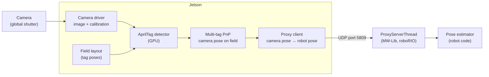

# How Our Vision System Works

Our robots find out where they are on the field by looking at the [AprilTags](./april_tags.mdx) around it.
This page follows one camera picture all the way through that process: from the camera, through the
[Nvidia Jetson](../hardware/jetsons.mdx) vision computer, over the robot network, and into the robot code
on the roboRIO.

There are two pieces of software involved:

- **[Aquila Vision](https://github.com/coalman321/Aquila-Vision)** runs on the Jetson. It reads the cameras,
  finds the AprilTags, works out where the robot is, and sends that to the roboRIO. It is written in C++ and
  CUDA on top of [ROS 2](https://docs.ros.org/), and built with Bazel.
- **[MW-Lib](../robot_dev/mwlib.mdx)** runs on the roboRIO as part of the robot code. Its `ProxyServerThread`
  receives what the Jetson sends and hands it to the robot code.

## 1. Taking the picture

Each camera on the robot gets its own **pipeline** on the Jetson. A pipeline is a small group of programs
(ROS 2 nodes) that run side by side, one group per camera, all named after that camera.

The first node is the **camera driver**. It opens the camera by its serial number and publishes every
picture along with the camera's **calibration**. The calibration describes the camera's lens: its focal
length, where the center of the picture is, and how much the lens bends straight lines (distortion).
Without it, the detector can see a tag but can't tell how far away it is. See
[Setting Up the Cameras](./camera-setup.mdx) for how a camera gets calibrated.

The driver runs the camera with:

- **Manual exposure and gain.** A short exposure keeps the tags sharp while the robot moves. Auto exposure
  is turned off so the picture doesn't change brightness in the middle of a match.
- **A global shutter.** The whole picture is taken at one instant. A rolling shutter takes the picture one
  row at a time, so a fast-moving robot would see bent, smeared tags.
- **A fixed frame rate** (30 frames per second unless the camera's settings say otherwise), and optional
  **binning**, which combines neighboring pixels into one to make a smaller picture that is faster to process.

## 2. Finding the tags

The next node is the **AprilTag detector**. It turns each picture to grayscale and runs a GPU version of the
AprilTag algorithm, originally written by FRC Team 971, on the Jetson's graphics processor. The GPU looks at
many pixels at once, which is what lets one Jetson keep up with several cameras.

For every `tag36h11` tag it finds (the family used on FRC fields), the detector reports the tag's ID and the
pixel positions of its four corners.

## 3. Working out where the camera is

Knowing *where in the picture* the tag corners are is not enough: we want to know *where on the field the
camera is*. The detector solves this with **Perspective-n-Point (PnP)**, the technique described on the
[AprilTag page](./april_tags.mdx#pose-estimation).

To do that, the detector needs to know where every tag is on the field. That is the **field layout**: a list
of every tag's position (x, y, z in meters) and rotation (roll, pitch, yaw in radians) on the field. We load
the same JSON field layout file that WPILib publishes each season (see
[Setting Up the Cameras](./camera-setup.mdx#field-layout)).

Our pipelines run in **multi-tag** mode:

1. For each tag the camera sees, look up where its four corners are on the field. Tags that aren't in the
   field layout are skipped.
2. Put the corners of *all* the visible tags into one list of 3D field points, and the matching corners in
   the picture into a list of 2D pixel points.
3. Solve PnP once for all of them together (OpenCV's `solvePnP` with the SQPnP method). The answer is where
   the camera is on the field, and which way it is pointing.

Solving with every tag at once is much steadier than solving each tag on its own. One tag's four corners are
close together, so a pixel of error in one corner swings the answer a lot. Corners from several tags spread
across the picture pin the camera down much better.

The result is published as a **tag solution**: the camera's pose on the field, the IDs of the tags used, and
the time the picture was taken.

:::tip Debug image
The detector also publishes a **debug image**: the camera picture with each tag outlined in cyan, its
corners marked with colored dots, and its ID written next to it. It is only drawn while someone is watching
it, so it costs nothing during a match. You can watch it from the camera web page (see below).
:::

## 4. Sending it to the roboRIO

The **proxy client** runs once on the Jetson and talks to the roboRIO for all the cameras. It works out the
roboRIO's address from the team number (team 4143 → `10.41.43.2`) and sends UDP packets to port **5809**.

Before it can send anything useful, the Jetson and the roboRIO have to agree on the time. The robot code
needs to know *when* each picture was taken (see step 5), but the two computers have separate clocks. The
proxy client keeps asking the roboRIO "what time is it?" with **timesync** packets, and the roboRIO answers
with its FPGA clock. From those answers the Jetson can convert its own picture times into roboRIO time.

For each tag solution, the proxy client:

1. Moves the pose from the camera to the center of the robot, using where the camera is mounted on the
   robot (the camera's pose in its pipeline settings).
2. Flattens it to a 2D field pose: x and y in meters, heading in radians.
3. Sends a **tag solution packet** with that pose, the tag IDs, the picture's time in roboRIO time, and the
   camera's serial number.

| Packet | ID | Direction | What's in it |
| --- | --- | --- | --- |
| Tag solution | 15 | Jetson → roboRIO | Robot pose (x, y in m, heading in rad), tag IDs, picture time, camera serial |
| Piece detection | 10 | Jetson → roboRIO | Game piece class and angles to it (rad), picture time, camera serial |
| Timesync request | 60 | Jetson → roboRIO | Request ID and the Jetson's send time |
| Timesync response | 61 | roboRIO → Jetson | The request ID and the roboRIO's FPGA time |

The numbers are sent as whole numbers to keep the packets simple: a tag solution's x, y and heading are sent
in millionths (of a meter, or of a radian) and divided by 1,000,000 when they arrive.

## 5. Using it in the robot code

On the roboRIO, MW-Lib's `ProxyServerThread` listens on port 5809 in its own thread. It keeps the last 20
tag solutions it received, tracks which Jetsons and cameras are talking to it, and raises an alert on the
dashboard when one goes quiet.

Each robot loop, the localization subsystem asks for the latest solutions and gives each new one to WPILib's
**pose estimator** with `addVisionMeasurement(pose, timestamp, stdDevs)`. The pose estimator blends the
cameras with the wheel odometry: the wheels are smooth but drift over time, the cameras are noisy but never
drift.

The timestamp is the reason all the clock work in step 4 matters. A picture is already a few dozen
milliseconds old when it arrives. The pose estimator remembers where the odometry thought the robot was at
each moment, so it can apply the camera's measurement at the moment the picture was *taken*, not the moment
it arrived.

See [Using Vision in Robot Code](./robot-code.mdx) for the code.

## The camera web page

Every Jetson also runs a small web server for setting the cameras up, at port **5800**:

- Varsity: [http://10.41.43.200:5800](http://10.41.43.200:5800)
- JV: [http://10.44.23.200:5800](http://10.44.23.200:5800)

The camera video is streamed separately over WebRTC on port 5801, at a low frame rate and resolution so it
doesn't crowd the robot's network. [Setting Up the Cameras](./camera-setup.mdx) walks through the web page.

## Object detection

Aquila Vision also has a game piece detector that runs a trained neural network (YOLOv8 or RF-DETR) with
TensorRT on the Jetson. See [Object Detection](./obj_det.mdx) for how the models are trained and deployed.
The detector reports each piece as angles from the camera, which the proxy client sends to the roboRIO as
piece detection packets. It is not turned on in the current camera pipelines; only the AprilTag detector is.
